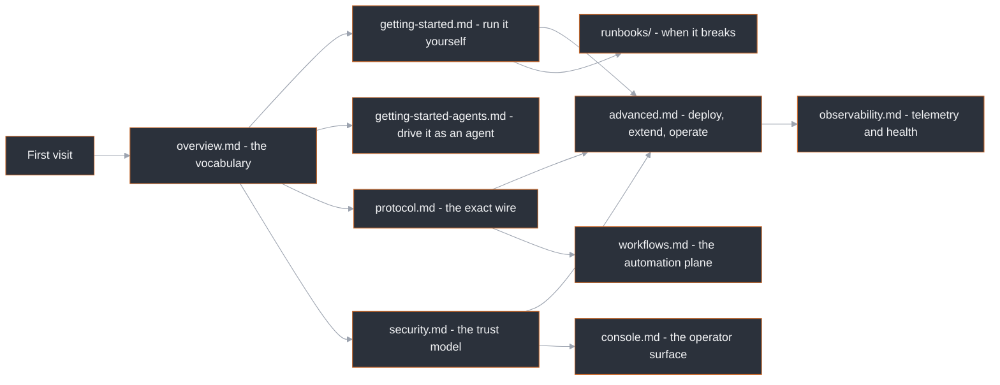

# Documentation

Open Facilitator is a durable coordination kernel for mixed human/agent
work across independently operated execution environments. This tree is the
consumer-facing documentation: it describes the system as it exists now, and
assumes you are seeing it for the first time.

You do not need to read this tree in order. Pick the row that matches why
you arrived; each path below is self-contained.

## Pick your path

| You are… | Start here |
|---|---|
| evaluating the project, seeing it for the first time | [overview.md](overview.md), then the [quick start](getting-started.md) |
| a human operator running the reference stack | [getting-started.md](getting-started.md) |
| an AI agent driving or extending the system | [getting-started-agents.md](getting-started-agents.md) |
| implementing a client, adapter, or service on the wire | [protocol.md](protocol.md) |
| authoring automations — triggers, steps, schedules | [workflows.md](workflows.md) |
| operating the console day to day | [console.md](console.md) |
| deciding who may do what, and how it's enforced | [security.md](security.md) |
| watching a live system — traces, metrics, health | [observability.md](observability.md) |
| deploying, connecting a team, adding a harness or provider | [advanced.md](advanced.md) |
| operating a live system when something goes wrong | [runbooks/index.md](runbooks/index.md) |
| publishing a release | [release-setup.md](release-setup.md) |
| contributing code | [contributing.md](contributing.md) |

The paths compose: overview builds the vocabulary every other page assumes,
getting-started proves the vocabulary against a running stack, protocol and
security give that experience exact edges, and the runbooks inherit all of
it when production asks questions.

*Each arrow means "this page assumes you have read that one". The
reference pages (protocol, security, workflows, console, observability,
advanced, runbooks) are entry points in their own right when you arrived
with a specific job.*

## The documents

| Document | Contents |
|---|---|
| [overview.md](overview.md) | The concepts and vocabulary from zero: Facilitator, Projects and Teams, Works, Gateways, Workspaces, the Link, approvals, policy, artifacts, memory, adapters — the canonical definitions every other page links back to |
| [getting-started.md](getting-started.md) | Human walkthrough: boot the reference stack, mint tokens, run a Work through approval to artifact, tour the admin SPA, run the acceptance suite, connect a workspace |
| [getting-started-agents.md](getting-started-agents.md) | Agent walkthrough: authentication, the HTTP surface you need, link-plane enrollment, machine-readable contract locations, the exact error shapes, how to be a good agent citizen of this repo |
| [protocol.md](protocol.md) | The v1 wire contract: envelopes, the full type registry, namespacing/versioning rules, payload limits, canonical approval digests, kernel ingress endpoints + error contract, Link transport (SignalR + HTTP fallback) |
| [security.md](security.md) | Identity model (human, workload, delegation evidence), role rules, operation gates, approval lifecycle, team policy engine, artifact and memory laws, provider ingress |
| [workflows.md](workflows.md) | The workflow plane: definition versions, triggers, the step palette and its enable-time law, instance lifecycle, shadow mode, operator controls, the gallery |
| [console.md](console.md) | The operator console: nav surfaces, the URL scheme, role gates and read-only mode, the config edit law, the Assistant as an API client |
| [observability.md](observability.md) | Telemetry and health: OTLP traces/metrics/logs and what gates each leg, instrumented sources, admin metrics and sweeps, gateway telemetry |
| [advanced.md](advanced.md) | Running pieces standalone: kernel without Compose, Gateway modes and configuration, the HarnessAdapter contract, communication adapters, the memory broker |
| [runbooks/index.md](runbooks/index.md) | Operational scenes: symptom → diagnosis → action, for link outages, stuck work, database/S3 loss, rate limits, identity misrouting, replica anomalies, expired approvals, undeliverable notices |
| [release-setup.md](release-setup.md) | Provisioning the registries and CI credentials the deployment pipeline consumes |
| [contributing.md](contributing.md) | Make targets, protocol-change workflow, PR gates, version-pinning policy, adding a package |

## Deeper and internal material

- [specs/](specs/) — the normative target-design specification (architecture
  + appendix). Where a spec proposes and the code ships, the code and
  [protocol.md](protocol.md) describe reality; the spec remains the design
  authority for how features are expected to grow.
- [scenarios/](scenarios/) — the behavioral conformance system: a scenario
  catalog, an approved subset, a reviewed gate manifest binding each
  scenario to a codified test, and the audit record generated by
  `make scenario-gate`. This is how the project proves its promises
  regress-free.
- [../AGENTS.md](../AGENTS.md) and the per-area `AGENTS.md` files — operational
  law for an agent working inside the tree: truth anchors, gating commands,
  and the invariants invisible in any single file.
