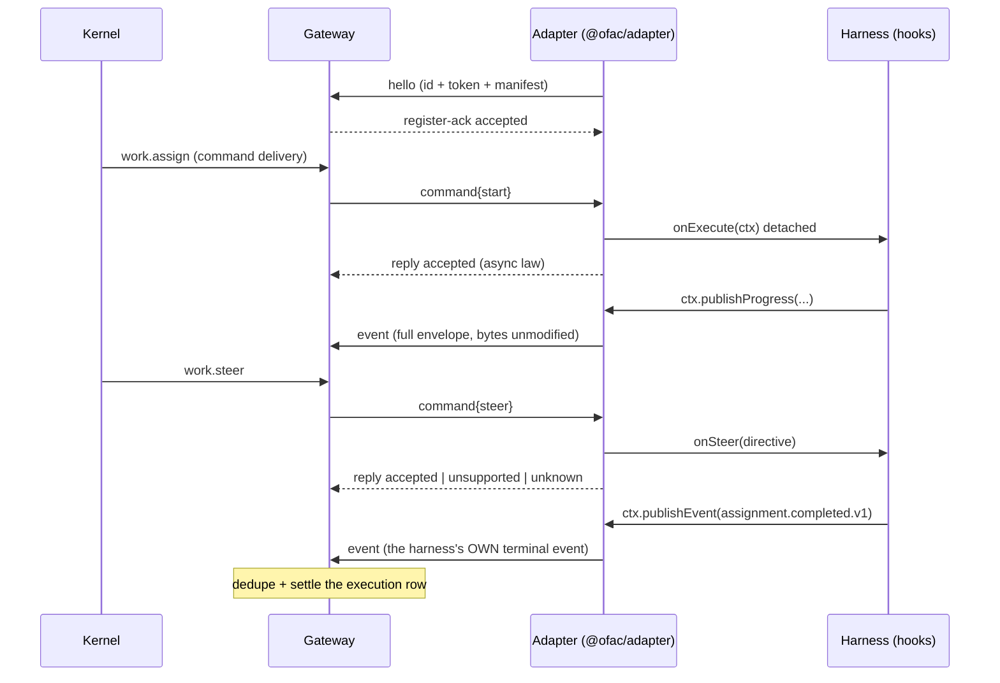

# Advanced Topics

## Kernel without Compose

The transactional kernel runs bare for focused work: boot Postgres 17
(tag pinned in `reference/versions.env`), point
`ConnectionStrings__Facilitator` at it, and
`dotnet run --project src/facilitator` — auto-migrate on boot, `/api`
served, the dev IdP story per `reference/keycloak/realm.json`. The
kernel assembly doubles as its own client riding the public HTTP API:
`dotnet run --project src/facilitator -- cli work create --objective
"kernel check"` (plus `work get|steer|timeline`). The Link client half is
`@ofac/workspace-link` + the `ofac-linkd` supervisor — enroll, capabilities
POST, connect, serve (echo-mode receipts), state file replay after a
crash:
`node src/workspace-link/dist/bin/linkd.js run --url http://localhost:8088
--secret enroll-dev --endpoint gw-dev --team team-alpha --manifest
manifest.json`. The full compose path (`./referencectl up slim`) is the
supported demo environment; this section is the seam, not the gate.

## Gateway modes

`@ofac/gateway` is the team-owned composition over the Workspace Link SDK
(`@ofac/workspace-link`): one Link endpoint per team gateway
(`gatewayId: gw.<slug>`), the execution ledger between kernel and children.

### As-built: embedded child

One process, one child: the Gateway enrolls (or mounts a stored token),
POSTs the child's capability manifest rewritten to the team's ownership,
connects, reconciles any `running` executions against the fresh child, and
serves command deliveries. The child sits behind the `ChildExecutor` seam —
serializable messages (`register`/`start`/`steer`/`status`/`stop`) with
JSON replies, in-process today. Modes `echo` and `stub` are the builtin
child manifests; `child.manifestFile` advertises any other capability set
while the builtin handlers answer.

### As-built: shared + standalone fleets

`mode: shared` and `mode: standalone` replace the single `child:` with a
`children:` list and a `childTransport:` block. Children are separate
processes attaching over a unix socket (optional localhost TCP fallback,
same protocol): NDJSON frames (`hello`/`register-ack`/`command`/`reply`/
`event`/`heartbeat`/`goaway`), per-child tokens, a heartbeat lease
(`leaseMissedBeats` missed beats kill the socket), and an admission law —
namespace, frame-size, `too-many-children` (32), manifest-schema,
first-wins `duplicate-id`, deny-ambiguity `manifest-conflict`. The kernel
sees ONE endpoint: child churn debounces a re-POST of the fleet UNION
manifest (ownerTeam = the gateway's team); nothing POSTs at boot, so a
standalone gateway is legal with zero children. Commands route to the
advertising child under its `maxInFlight` quota (over-quota answers
`child-busy`); an offline advertiser answers `child-disconnected`. A
re-registering child is probed with `status` for every durable `running`
row it owns: `unknown` means the child died mid-flight — the row goes
`lost` with ONE retryable `assignment.failed(child-lost-execution)`,
never re-executed. `standalone` is the same machinery for a
workspace-isolated deployment where the gateway owns no embedded work.

### trustMode

Every enrollment declares one of three modes (immutable for a session); the
Gateway config's `trustMode` is sent verbatim in the enroll request and
recorded server-side:

|Mode|Guarantee|Operator guidance|
|---|---|---|
|`shared-runtime`|Gateway and workspace share OS resources; no isolation|trusted single-team devcontainers|
|`separate-process-same-host`|separate processes, OS isolation may be limited|semi-trusted workloads|
|`isolated-executor`|strong isolation (VM / strict-seccomp container)|untrusted third-party or multi-tenant code|

`shared-runtime` is the honest declaration for embedded and shared fleets
(children share the host, no isolation). The validator rejects the one
dishonest combination — `embedded` cannot claim `isolated-executor`, since
an in-process child has no isolation boundary to claim.

### Configuration keys

The locked YAML surface (`loadConfigFile` rejects any other key, naming it):

|Key|Notes|
|---|---|
|`apiVersion`|`facilitator.framework/v1`|
|`kind`|`Gateway`|
|`gatewayId`|`^gw\.[a-z0-9]([a-z0-9-]*[a-z0-9])?$`, ≤128 chars — the Link endpoint id|
|`team`|must equal the kernel's enrollment team slug (else capabilities POST 403s)|
|`facilitatorUrl`|kernel base URL|
|`enrollmentSecret`|bootstrap secret; `OFAC_ENROLL_SECRET` env wins; optional once `<stateDir>/token` exists|
|`linkToken`|static mount; `OFAC_LINK_TOKEN` env wins|
|`trustMode`|see table above|
|`stateDir`|created 0700; holds `link.sqlite3`, `gateway.sqlite3`, `token`|
|`mode`|`embedded` \| `shared` \| `standalone`; default `embedded`|
|`child.name` `child.mode` `child.manifestFile`|embedded only: single in-process child: `echo` \| `stub`, or an advertised manifest file|
|`children[]`|fleet only: `name` (`^[a-z0-9]([a-z0-9-]*[a-z0-9])?$`), optional `token`, `maxInFlight` (≥1), `timeoutSeconds` (1..86400, default 120)|
|`childTransport.socket.path`|fleet only; resolved against `stateDir`; optional `allowedUid`|
|`childTransport.tcp.port`|optional localhost fallback, same wire protocol|
|`childTransport.handshakeTimeoutSeconds` `childTransport.leaseMissedBeats`|hello deadline; lease (default 5 / 2)|
|`diagnostics.port`|localhost `/status` endpoint; `0` disables|
|`heartbeatSeconds`|1..3600, default 30|
|`policy.inline` \| `policy.path`|team policy file (spec §12): exactly one; `path` resolves against the config file's dir; fail-closed loader. `policy.confirmTimeoutSeconds` (default 900) caps how long a `confirm` approval stays pending. Laws + audit line: `docs/security.md`|

## HarnessAdapter contract

A HarnessAdapter is the thin translation layer between the Gateway's child
transport and one harness execution engine (spec §8.3). Shipped as
`@ofac/adapter` (`src/adapters/harnesses/adapter-sdk/`); the worked example
is `@ofac/harness-deterministic`.

### Lifecycle

### Frames (adapter.v1.json)

One NDJSON line per frame, every frame `{ v: 1, type }`, max 262 144 bytes
— the profile of the shipped child wire, payload types imported, never
redefined:

|Frame|Direction|Payload|
|---|---|---|
|`hello`|adapter → Gateway|`childWorkspaceId`, `token`, capability manifest|
|`register-ack`|Gateway → adapter|`accepted`, optional denial `reason`|
|`command` (`start`/`steer`/`status`/`stop`)|Gateway → adapter|`requestId` + the command message|
|`reply`|adapter → Gateway|`accepted` / `rejected` / `unsupported` / `status` / `unknown`|
|`event`|adapter → Gateway|`requestId` + the FULL CloudEvent envelope (relay law: Gateway forwards bytes unmodified)|
|`heartbeat`|adapter → Gateway|`childWorkspaceId` (lease keepalive)|
|`goaway`|Gateway → adapter|drain `reason`|

### Authority law (S:422)

The adapter is thin translation; the **harness** is authoritative over
execution state; the Gateway mediates. `assignment.completed.v1` is the
harness's own publish — the SDK publishes only `assignment.failed.v1`
(retryable) when `onExecute` fails/throws. A steer without a hook answers
`unsupported` (report, don't reinterpret); an unknown execution answers
`unknown` so the Gateway's reconcile probe can declare it lost, exactly
once.

### Artifacts: verified external refs (interim)

Completion manifests reference outputs with absolute `file://` URLs plus
`sha256:` digests (`common.v1.json#/$defs/artifactRef`). The consumer
verifies by rehashing the bytes — an interim for the artifact-store era:
when the store lands, `storageUrl` gains store schemes and the digest
stays the integrity check.

### Resume

`invocation: "sdk"` only; resume is `restart-with-context`: a restarted
adapter answers the reconcile probe from its in-memory registry (running
executions survive a socket swap; amnesiac ones honestly answer `unknown`).
`SessionStore` is the seam for a harness that can re-attach to a native run
id — no in-repo implementation yet.

### Deployment lifecycle (full profile)

The full-profile example worker (`examples/full/coding-worker`) runs
long-lived inside its workspace container under the supervisor, so steer
delivery has two observable shapes: an in-run steer rides the open link as a
`command.work.steer.v1` row, and a post-completion steer re-dispatches the
original assign envelope (directive in `inputs.steers`) — the worker
re-hydrates from the branch/PR lineage instead of a live process. Scaling
the workspace itself to zero is Plan 28's provisioning story; re-dispatch
generations fence against a resumed older worker under Plan 27's fencing.

### Conformance

`@ofac/adapter/testing`'s `runAdapterLifecycleContract({...})` is the gate:
it boots an in-process Gateway listener, drives the full lifecycle against
your adapter, and schema-validates your terminal event. Wire-level fixtures
live in `protocol/conformance-fixtures/` (class `adapter`). The no-Docker
walkthrough: `examples/slim/deterministic-research-worker/`.

## Provider (communication) adapters

A communication adapter is the other adapter kind: not a Gateway child, but
a **link endpoint** (`role: child`, secret enrollment) that normalizes one
provider's events into the central domain types
(`org.facilitator.event.provider.<domain>.v1`, with `data.provider` naming
the provider — the adapter owns the provider→purpose mapping) and
executes `org.facilitator.command.communication.*` deliveries over the
provider's API. Worked examples: `@ofac/mattermost-adapter`
(`src/adapters/communication/mattermost/`, facilitator-owned chat leg) and
`@ofac/forgejo-adapter` (`src/adapters/communication/forgejo/`, team-owned
forge leg) — their READMEs carry the config law; the seams that survive
Plan 31's SDK extraction are `normalize` (pure classification), the provider
client (interface = test seam), the transport listener, and the command
handler.

**Ownership model**: the kernel facilitates, it is not a security boundary,
and it is never team-operated. Chat is a facilitator-owned integration in
the reference system; VCS/issues/CI are **team-owned** — their adapters live
in the team's domain, near the forge, under the team's Gateway (a Gateway
child, like `@ofac/forgejo-connector`, or a dedicated workspace; the seam is
deployment-neutral because everything dials OUT to the link plane: the same
binaries run as compose sidecars in the reference env or on team infra).
Nothing may assume the kernel host owns forge credentials. Chat adapters
being facilitator-owned is today's reference placement, not law — a
team-owned communication adapter is one deployment away.

Authoring law, as both adapters prove it:

- **Inbound trust is the adapter's own credential, before normalize.**
  Mattermost 11.11 webhooks carry no signing secret on the event-carrying
  hook form, so inbound is the bot WebSocket (bot token) — no inbound port,
  DMs work, thread context (`root_id`) survives. The Forgejo adapter's
  inbound is a webhook endpoint, so trust is the shared hook secret:
  constant-time HMAC-SHA256 over the raw bytes (`X-Forgejo-Signature`
  bare-hex, `X-Hub-Signature-256: sha256=<hex>` also accepted), 401 before
  any parsing. Whatever the transport, authentication completes before a
  normalized event exists.
- **Normalized events keep provider identity**: original ids, actor account
  id, and the raw payload ride in `data`; the kernel's
  `provider_events UNIQUE (provider, provider_delivery_id)` makes replay a
  no-op. Identities the provider object doesn't carry (a Mattermost Reaction
  has no `id` on 11.11) get a **synthesized stable composite** — never a
  transport nonce.
- **Outbound is idempotent per §13.3**: record the provider object id keyed
  by the command's `idempotencyKey` in a durable ledger BEFORE answering the
  receipt; replays answer `accepted` without touching the provider.
- **Echo suppression is the kernel's judgment, the adapter's honesty**: the
  bot publishes its own post back as a `message.v1` echo; the kernel records
  the provider post id into `communication_bindings` and runs no arms. One
  exemption: a bot-authored `change_request.v1` `opened`/`reopened` is a state
  change the head-branch resolver must see (a connector-minted PR would else
  strand unbound) and nothing answers it, so it runs the arm instead.

### Operation semantics (spec §13.5, as-built — Mattermost)

The Forgejo adapter advertises only `communication.reply.v1` (issue/PR
comment as the bot, ledger-keyed the same way).

|Command|Adapter behavior|Receipt|
|---|---|---|
|`communication.reply.v1`|`POST /posts` with `root_id` when the target names a thread|`accepted` + post id, ledgered|
|`communication.react.v1`|`POST /reactions` as the bot; identity = `(user, post, emoji)` composite (11.11 objects carry no id)|`accepted` + composite, ledgered|
|`communication.update.v1`|`PUT /posts/{id}` ONLY for a post the ledger proves this adapter created|`accepted` / `rejected` (foreign post)|
|`communication.acknowledge.v1`|no-op (transport auto-ack covers delivery)|`accepted`, not ledgered|
|`read` / `discover`|not advertised — an adapter declares only what it implements|`unsupported` by manifest absence|

### Opt-in story

Provider-less is the default: the kernel arms switch on the central domain
types, and a provider token joins the registry only when its options section
(`providers:mattermost`, `providers:forgejo` — mounted `facilitator.json` or
`Providers__<Provider>__*` env, section key lowercased = the token) is
present with `enabled: true`; absent, that provider's events get typed
`unsupported` refusals and zero routes or rows exist. Each provider is a
registry entry on one plane — adapter-side mapping + the shared arms + an
options section — not a new plane, and the addressing is per-provider too
(each section carries its own `assignEndpointId` for the review-steer path).
A new forge ships as normalizer + connector policy + one config section:
zero core-protocol change. The adapter is opt-in by existence — nothing
enrolls it unless somebody runs the process.

## Memory broker

The kernel is a **broker, not a memory product**: it stores, indexes, and
ACLs what teams retain, and enforces the read law — it does not decide what
is worth remembering. Extraction, consolidation, and reflection live
team-side (harness or provider); the kernel's `reflect` answer is a typed
`unsupported`.

### Provider profiles (as fact)

|`Memory:Provider`|State|
|---|---|
|`postgres-fts`|The shipped reference profile: PostgreSQL tsvector index over the entry rows, ranked recall, no sidecar process|
|`hindsight`, `custom`|Documented seams only — the `IMemoryProvider` port is the seam; naming an unshipped profile fails composition (fail-closed, read once at boot)|

Disabling the surface is configuration (drop the `Memory` section ⇒ the
`postgres-fts` default composes; a deployment that wants no memory simply
gates every `memory.*` operation off, since the broker never runs a
background process that needs it).

### Scopes and the `work:` mapping law

Entry scopes are `work:`, `project:`, `team:`, `private:` — provisioned
lazily by the first retain into them (owner team + canonical selector). The
frozen candidate-event `scope` enum has no `work:` member, so the mapping
law is: **a `work:` selector addresses a project-scope entry carrying
`workId` in its provenance**, and a candidate event with `scope: "workspace"`
lands team-scoped-by-ownership. A `team:` write selector names exactly the
caller's team; `scopeSelectors` on a recall are hints the broker intersects
with the readable predicate.

### Team-side profile

Teams opt in through a `.facilitator/memory.yaml` profile (owner-verified
configuration, not a privilege grant — spec §14.10/§14.11): `provider`,
`retrieval.{enabled,maxItems,maxTokens,purposes}`, `retention.*`,
`sharing.*`, `reflect.enabled`. The kernel reads none of it; it is the
Gateway/harness-side statement of how the team uses the broker.

### Retention homes

Per-Project policy rides the `projects.config` jsonb key `memory`
(Plan 14's carrier): `{"workCandidateDays": int, "candidateDays": int}` —
work scopes read `workCandidateDays`, project scopes `candidateDays`,
matching the `memory.yaml` `retention.*` names. The kernel-level fallback is
`Memory:Retention:CandidateDays` (90). The retention pass
(`MemoryRetentionService`, advisory lock 420003, interval
`Memory:Gc:IntervalSeconds`) tombstones lapsed candidates under the same
deletion law as a manual delete (content drop, share revocation, usage
retention) and audits `memory.gc`.
