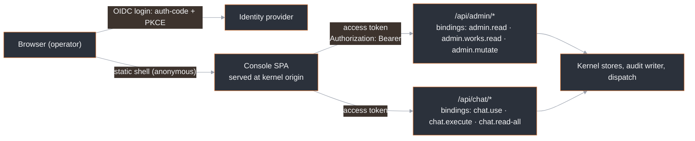

# The operator console

The console is the embedded operator SPA: a Svelte single-page app served as
static assets **from the kernel's own origin**, so the UI and the API it
calls are the same host. The static surface itself is anonymous (non-`/api`
paths ride past the role gate, with SPA fallback to `index.html`), but every
screen fills itself by calling `/api/admin/*` and `/api/chat/*` with an OIDC
bearer token — an unauthenticated browser lands on an empty shell and is
sent through the authorization-code + PKCE login flow (`oidc-client-ts`,
silent renew via a prompt-none iframe, access token kept in
memory/sessionStorage).

**Roles come from the access token payload** (`realm_access.roles` ∪
`groups`) — exactly what the kernel's `IngressRoleGateMiddleware` evaluates.
Authorization on both surfaces the console uses is 100% config-driven
bindings under `identity:authorization:operations`; there is no
`.RequireAuthorization` anywhere in the endpoint maps:

| Binding | Admits | What it unlocks in the console |
|---------|--------|--------------------------------|
| `admin.read` | GETs on the admin read surface (summary, search, project/work detail + timeline, links, deliveries, provisioning, metrics, replicas, config + history, audit + export, workflow definitions/registry/instances) | Every Monitor screen, Config read view, Team read view |
| `admin.works.read` | `GET /api/admin/works` | The Activities queue; team members are admitted here, and the caller's team scope is applied automatically |
| `admin.mutate` | POST/PATCH/PUT on the admin surface (config PATCH, dead-letter replay, manifest re-mark, artifact sign-over, sweep triggers, workflow definition edits) | All edit affordances |
| `chat.use` (+ `chat.execute`, `chat.read-all`) | `/api/chat/*` | The Assistant drawer |

Because of this, identities **without** mutate rights get a read-only
presentation: the client's `session.canMutate` is derived from the token
roles rather than a client-side guess, and edit affordances (config save,
dead-letter replay, re-mark) simply do not render. The server remains the
enforcement point; the hidden controls are presentation, not security.

## The URL grammar

Routing is plain hash routing (no router dependency): the whole navigation
surface is one string, so a deep link is copy-pasteable and a reload
restores the view. The grammar, organized by the console categories so the
address bar and the category rail say the same thing:

```
Works        #/works?state=<csv>&team=<slug>   the queue, filtered
             #/work/<id>                       one work, inspector open
Flows        #/flows                           definitions, editorial
             #/flows/<id|new>                  one definition under edit
Monitor      #/monitor/runs[?def=<id>]         instances, optionally one def
             #/monitor/runs/<instanceId>       one run, read-only
             #/monitor/deliveries              every message sent, and its fate
             #/monitor/audit?decision=&actor=&action=&correlation=&since=
             #/monitor/runtime                 replicas, provisioning, sweeps
             #/monitor/definitions/<id>        one definition's history + runs
Team         #/team                            links, gateways, enrollment
Config       #/config                          the live routing policy
(assistant)  #/chat[/<id>]                     not a screen: opens the
                                               AiDeck drawer over whatever is
                                               underneath, session preserved
             #/hit/<kind>/<id>                 one non-work search hit
```

Old hashes still work: `flowdef/X`, `flow/X`, `audit`, `deliveries`,
`runtime`, `links` redirect (at parse level) to the new form, and the URL
writer emits the new form — so a stale bookmark lands on the right screen
and the address bar heals itself to the canonical route. Anything else is
`#/`: the shell with no view open.



## Activities — `#/works`

The work queue: active and completed activity items, ordered by creation
date, filtered by `state` (a comma-separated list) and `team` slug. Backed
by `GET /api/admin/works`, which has its own `admin.works.read` binding so
team members see the queue — scoped to their own teams automatically.
Selecting an item opens the work inspector (`#/work/<id>`): detail,
timeline (the same event shape as `GET /api/works/{id}/timeline`), and
result manifests. Dead-lettered notices surface here with a replay affordance
for `admin.mutate` holders.

## Flows — `#/flows`

Workflow definitions, editorial: author the flow, cut versions, enable
trigger rules. `#/flows/<id|new>` edits one definition (the canvas renders
steps and transitions); validation, import, and per-version toggling are
`admin.mutate` writes. The definition's history and its runs live under
`#/monitor/definitions/<id>`.

## Monitor — `#/monitor/runs`

Workflow instances, optionally narrowed to one definition with `?def=<id>`;
`#/monitor/runs/<instanceId>` shows a single run read-only, step by step.
This is where "where is this thing stuck?" gets answered before anyone
reads logs.

## Deliveries — `#/monitor/deliveries`

Every message the kernel sent, and its fate: outbox deliveries with
destinations and receipt statuses, merged across providers. The sibling
question to the run view — the run says what should have been sent, this
says what actually left and how it was received.

## Audit — `#/monitor/audit`

The audit trail of authorization decisions — allows and denies — filterable
by `decision`, `actor`, `action`, `correlation`, and `since`; rows carry
`correlationId`, and an export affordance produces CSV (no raw credential
ever enters an audit row). Every operator write on the admin surface leaves
a row here, which is why the Audit screen is the receipts drawer for Config
and Monitor actions alike. See [observability.md](observability.md).

## Runtime — `#/monitor/runtime`

Kernel replicas, provisioning records, dead-letter queue depth, metrics,
and the sweeper tasks. From here `admin.mutate` holders can force a sweeper
pass — `POST /api/admin/sweeps/{name}` (`nudge|approvals|schedules|session-loss|workflows|audit-retention`)
— which is a human act on live state, so it **requires** a non-empty
`X-Change-Reason` header (≤512 chars) and audits as `admin.sweep` correlated
to the sweep name.

## Team — `#/team`

Teams and workspaces connected over outbound links, and the enrollment
tokens used to onboard new workspaces: the mint/revoke card
(`EnrollmentTokensCard`) renders only for principals holding
`enrollment-tokens.manage`; a minted token literal is shown exactly once,
straight off the `201` response, so copy it before it is gone. Revoking an
endpoint link retires its keys and bumps the epoch so live sessions die
inside one token lifetime. See [security.md](security.md).

## Config — `#/config`

The live routing-policy resources and their change history, under a strict
edit law:

- A write is `PATCH /api/admin/config/{resource}` carrying **both**
  `If-Match: "<rowVersion>"` (optimistic revision — a stale write gets `412
  config-version-conflict`, and the UI reloads the current row and explains
  the collision) and a **mandatory** `X-Change-Reason` header (non-empty,
  ≤512 chars).
- `GET /api/admin/config/{resource}/history` returns a **bounded** audit of
  prior versions (newest first, capped at 20).
- **Rollback** is a re-save of a historical payload through the same PATCH
  path — so it carries its own change reason and its own audit row, never a
  silent rewind.

Every resource row in the list carries its existence flag and current
`rowVersion`, which is the ETag the form submits against.

## Assistant — `#/chat` (drawer)

The rail's Assistant entry (`needsChatRole`: it renders only for principals
the `chat.use` binding admits) is a drawer toggle, not a screen:
`#/chat[/<id>]` opens the AiDeck drawer over whatever view is underneath,
with the session preserved. The drawer is a thin client of `/api/chat/*` —
session CRUD, `POST …/messages` for one turn, the read-phase `reads` trail,
and proposed actions awaiting `confirm`/`cancel`. The wire contract lives in
[protocol.md](protocol.md) ("Kernel ingress" and the `/api/chat/*` row of
the API surface table), not here.

## Where to go next

- [security.md](security.md) — the OIDC plane, role bindings, and what each
  binding actually admits.
- [observability.md](observability.md) — audit, metrics, and traces the
  Monitor screens are windows into.
- [protocol.md](protocol.md) — the full API surface, including
  `admin-v1.yaml` for every endpoint the console calls.
