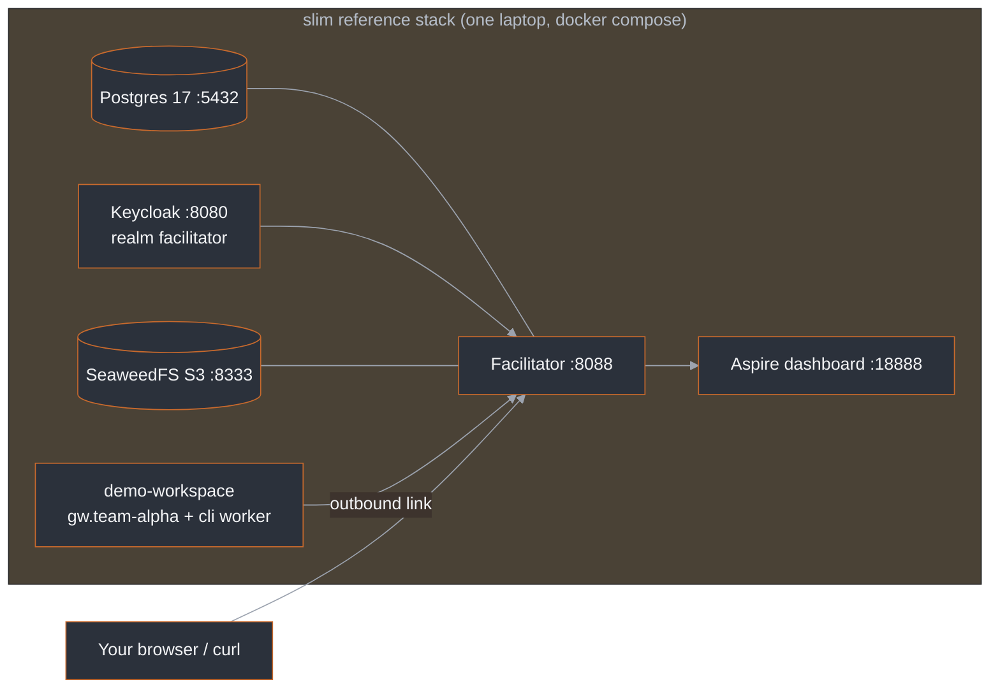

# Getting started

This walkthrough takes you from an empty laptop to a proved system: a full
slim reference stack booted, a Work routed to a team workspace, executed,
approved, and filed as digest-verified evidence — every hop observed through
public APIs and the admin SPA, then proved unattended by
`./referencectl verify`. The commands and transcripts below are a real
session against a fresh stack.

When you finish you will have: the stack running, tokens minted, one Work
traced end to end, the acceptance suite green, and a recipe for attaching
your own workspace.

## 1. Environment

**Recommended: devcontainer.** Open the repository in the included
`.devcontainer` configuration — Docker-in-Docker, .NET SDK 10, Node 24, and
pnpm 12 are preinstalled.

**Manual path:**

- Docker + Compose v2 (the reference environment needs ~4 GiB free RAM)
- `curl`, `jq`, `git`
- .NET SDK `10.0.40x` (per `global.json`, `rollForward: latestFeature`) and
  Node.js ≥ 22 only for the build/test loop below; the walkthrough itself
  needs just Docker

## 2. Build & test loop

The stack boots from published-style images that this repository builds, so
the loop below is what compiles them. You can defer it to section 3 —
`referencectl up` builds what it needs.

```bash
make restore   # dotnet restore + pnpm install
make build     # dotnet build -c Release + pnpm -r build
make test      # dotnet test -c Release --no-build + pnpm -r test
make lint      # dotnet format --verify-no-changes + eslint + prettier --check
make format    # auto-fix .NET + TS/JSON/YAML formatting
```

`dotnet test` requires a running Docker daemon: the integration suite boots
PostgreSQL 17 via Testcontainers (tag pinned in `reference/versions.env`).

Running individual tests:

| Tier | Command |
|---|---|
| .NET, one fixture | `dotnet test OpenFacilitator.slnx -c Release --filter FullyQualifiedName~HealthEndpointTests` |
| TypeScript, one package | `pnpm --filter @ofac/gateway test` |
| TypeScript, one file | `pnpm --filter @ofac/workspace-link exec vitest run test/package.test.ts` |

Measuring coverage: `make coverage` runs the unit-tier ladder (.NET
`Facilitator.Tests` + every TS package) with the collectors attached, merges
the results into `.omp/coverage/baseline.json` + `README.md`, and fails if any
area's line coverage regressed — move the ratchet upward with
`COVERAGE_UPDATE=1 make coverage`. `FULL=1` adds the heavier legs (scenario
walks, Playwright browser tier, reference-env flows); that combination is
nightly-sized, not the default. Collection never rides on `make test`.

## 3. Bring up the reference environment

You will have: every service healthy and one demo Work already dispatched
end to end.

```bash
./referencectl up slim
```

This builds the kernel + node-runtime images, boots Postgres, Keycloak
(realm `facilitator`), SeaweedFS (S3), the Aspire dashboard, the Facilitator
container, and `demo-workspace` (standalone Gateway `gw.team-alpha` +
cli worker), waits for every healthcheck, then seeds one
`work.assign` that dispatches end-to-end. What you are booting:



*The demo workspace dials out to the kernel; nothing on the team side
publishes a port to the kernel. Service table and ports:
[`reference/README.md`](../reference/README.md).*

Companion commands: `./referencectl status` probes the stack (service table +
kernel `/health` + Gateway `/status` via `compose` exec — diagnostics bind
the workspace container's loopback); `./referencectl down -v` tears it all
down. First run generates `reference/.env` from `.env.example` — rotate the
placeholder secrets for anything beyond a smoke run.

The presigned artifact redirects name the in-network host `artifacts`
(SigV4 forbids rewriting them), so for host-side downloads add
`127.0.0.1 artifacts` to `/etc/hosts` (or use `curl --resolve
artifacts:8333:127.0.0.1`, shown below).

## 4. Log in: OIDC end to end

You will have: a bearer token that the kernel accepts, for both a service
and a human identity.

The realm fixture (auto-imported) carries users `alice`/`alice` (and `bob`,
`carol` for multi-team legs). The Keycloak admin console is
`http://localhost:8080/admin` with user `demo-admin` and the password from
`DEMO_KEYCLOAK_ADMIN_PASSWORD` in `reference/.env`. Every kernel API needs a
bearer; two grants matter:

```bash
# operator/service token (client_credentials)
./referencectl token
# eyJhbGciOiJSUzI1NiIsInR5cCIgOi...   (JWT)

# human token, password grant — the kernel maps the subject to a
# kernel-side identity for audit + policy claims
./referencectl token --user alice --password alice
# eyJhbGciOiJSUzI1NiIsInR5cCIgOi...
```

Bearers live ~5 minutes (realm default) — re-mint liberally.

## 5. Run a Work

You will have: one Work executed by the demo team, with its timeline,
manifest, report artifact, and a memory candidate visible through the
public read models.

```bash
./referencectl work --objective "survey the reference environment"
# workId=6f0c1a67-... 
# [ { "kind": "created", ... } ]
```

The seed's assign rides kernel → gateway → worker: progress events, a
Markdown report uploaded through the artifact flow, and an
`assignment.completed` receipt come back through the link plane. Watch the
read models (pair from a real run — `W` = the work, tokens as above):

```bash
W=e5c6c58d-1240-45e3-87a6-f46e70b399a9
ATOK=$(./referencectl token --user alice --password alice | tail -1)

curl -s http://localhost:8088/api/works/$W/timeline -H "Authorization: Bearer $ATOK" \
  | jq '[.[].kind]'
# ["created","artifact.stored","artifact.stored","manifest.recorded","memory.candidate"]

curl -s http://localhost:8088/api/works/$W/manifests -H "Authorization: Bearer $ATOK" \
  | jq '.[0] | {revision, revisionOf}'
# {"revision":1,"revisionOf":null}

# the manifest doc names its report artifact; content redirects to a
# presigned S3 URL (see the /etc/hosts note above)
MID=$(curl -s http://localhost:8088/api/works/$W/manifests -H "Authorization: Bearer $ATOK" | jq -r '.[0].artifactId')
AID=$(curl -sL --resolve artifacts:8333:127.0.0.1 \
  "http://localhost:8088/api/artifacts/$MID/content" -H "Authorization: Bearer $ATOK" \
  | jq -r '.outputs[0].artifactId')
curl -sL --resolve artifacts:8333:127.0.0.1 \
  "http://localhost:8088/api/artifacts/$AID/content" -H "Authorization: Bearer $ATOK" | head -2
# # Research report e5c6c58d-1240-45e3-87a6-f46e70b399a9
# Objective: slim verify: analyze the reference environment
```

Traces: open the Aspire dashboard at `http://localhost:18888`, resource
`facilitator`. Every kernel span carries the work's trace id — the W3C
`traceparent` the dispatcher stamped onto the assign envelope. The team
plane joins that trace and re-parents under it (same 32-hex trace id, its
own parent id), so the outbox stamp, the worker's progress/completion
envelope carriers, and the dashboard spans all share ONE trace id.

## 6. Admin tour: the embedded inspector

You will have: the same picture as section 5, read entirely through the
operator SPA — and the operational surfaces (links, deliveries, config).

The kernel embeds the operator SPA itself — no separate portal.
With the slim stack up (section 3), open `http://localhost:8088`: the SPA
redirects to Keycloak, sign in `alice`/`alice`, and you are in the
inspector. Trace the acceptance-run Work without psql:

1. Paste the work id (or a word from its objective) into the search bar →
   the hit list filters by kind; open the Work hit.
2. The inspector shows assignments (attempts table), manifests/artifacts
   (content links ride the same presigned redirect as section 5 — add the
   `127.0.0.1 artifacts` host entry), and the full timeline
   (`/api/admin/work/{id}/timeline`).
3. A `CorrelationId` chip copies the trace handle; the dashboards' trace
   link opens the Aspire resource with that id (the kernel stores no
   telemetry time-series).
4. **Links** view: gateways online/offline (a stale session collapses to
   offline — the DB lease is the sole authority) + trust tier.
   **Deliveries**: filter poisoned rows and replay a dead-letter once —
   the second replay reports the ledger's `already replayed`.
   **Config**: the stored-intent resources (e.g. `nudge-policy`,
   `media-policy`) edit via versioned PATCH (`If-Match`); a concurrent
   writer's 409 reloads and names the other author + reason. Writes are
   audited intent — a feature reads a value through only when it opts in.
   `media-policy` is the media plane's federation law: per-item/count
   defaults, per-kind retention days, and per-team allow/forbid lists plus
   the history-forwarding switches (an absent row = the defaults above).

The browser tier runs in CI as the `admin-e2e` job
(`make admin-e2e` locally; chromium downloads on first run).

## 7. Acceptance run: `referencectl verify`

You will have: machine proof that every hop in this walkthrough works,
re-runnable at any time.

The 12-step acceptance script (`reference/checks/verify.sh`) proves every
acceptance hop through public read models, the Postgres planes, S3, and the
dashboard — no product hooks, no dev-only routes. Run it against a
booted-but-unseeded stack (`up slim --no-seed`): it seeds its own works.
Exit 0 iff every step passes; `--json` is the machine report, `--only <ids>`
reruns a leg and its prerequisites. The `signal-emission` leg reads the
telemetry overlay (`compose.telemetry.yaml`, booted by `up slim`) through
the Aspire query API and the verification collector's dump. Transcript
(clean stack, exit 0):

```
PASS idp-login (313ms) — both grants minted and accepted by the kernel
PASS work-create (559ms) — work created + assigned
PASS dispatch-link (306ms) — assign delivered over the link plane + gateway ready with a connected child
PASS progress (128ms) — worker progress reached the kernel inbox
PASS artifact-stored (3920ms) — manifest doc + report stored/verified + blob in S3 + Markdown bytes served
PASS memory-candidate (235ms) — candidate ingressed + timeline row + 1 recall hit(s)
PASS kernel-restart-resume (3444ms) — approval parked across a facilitator restart
PASS approval-roundtrip (23187ms) — parked durably, resumed exactly: approved after restart, decided, completed
PASS worker-restart-resume (6346ms) — worker killed mid-run: honest retryable failed, retry completed with exactly 1 manifest
PASS trace-correlation (288ms) — facilitator stamp echoed by worker envelopes + dashboard spans
PASS signal-emission (41216ms) — trace spans facilitator,ofac-gateway (+link.deliver); correlated gateway log record(s); collector dump carries delivery.attempts+link.delivered under both resources; no PII
PASS dead-letters-empty (26ms) — no dead letters
```

| Step | Proves |
|---|---|
| `idp-login` | Both grants mint and the kernel accepts them (roles + claim mapping wired) |
| `work-create` | Work creation + assign outbox row via the seed primitives |
| `dispatch-link` | Dispatcher → LinkSink → gateway session (row `delivered`, child connected) |
| `progress` | Worker event rode the link back into the kernel inbox |
| `artifact-stored` | Manifest doc + report stored/verified, blob in the bucket, bytes served |
| `memory-candidate` | Candidate event ingressed, timeline row, recall hits |
| `kernel-restart-resume` | A parked approval survives a `restart facilitator` (durable await) |
| `approval-roundtrip` | Confirm → approval.required → respond → consumed → completion, exactly once |
| `worker-restart-resume` | Mid-execution kill = ONE honest retryable `assignment.failed`; re-dispatch completes with exactly 1 manifest |
| `trace-correlation` | Dispatcher-stamped `traceparent` == worker-echoed envelope traceparent == dashboard span trace |
| `signal-emission` | One trace id spans kernel + gateway spans and a gateway log record; the collector dump carries the required instrument/resource identities under both services; zero PII in telemetry |
| `dead-letters-empty` | No hop failed hard anywhere in the run |

This run is part of every task's acceptance criteria — see
[`docs/contributing.md`](contributing.md).

## 8. CI and releases

- CI (`ci.yml`) is the merge gate: .NET build+test, the scenario gate +
  composed walks, TS lint+build+test, the protocol drift gate, workflow/meta
  validation, image builds, and the live-kernel e2e tiers (`link-e2e`,
  `gateway-e2e`, `admin-e2e`, `features`). Job-by-job scope:
  [`.github/workflows/README.md`](../.github/workflows/README.md).
- The slim reference environment is part of every task's acceptance
  criteria — and locally IS the gate: the hosted
  `ref-env-bringup`/`ref-env-verify` jobs are commented out in `ci.yml`
  (free-tier GitHub compute). Before calling anything done:
  `./referencectl down -v && ./referencectl up slim --no-seed && ./referencectl verify`
  exits 0.
- Releases trigger on `v*` tags: the Facilitator image is pushed to GHCR for
  `linux/amd64` + `linux/arm64`, and the Dev Container Features are
  published as OCI artifacts under `…/features/<name>`.

## 9. Artifact registries

| Artifact | Registry | Coordinate |
|---|---|---|
| OCI images (facilitator) | GHCR | `ghcr.io/denisekart/open-facilitator/<name>` |
| npm packages `@ofac/*` | npmjs.org | `https://registry.npmjs.org` — `@ofac` org, published with OIDC provenance once `ENABLE_NPM_PUBLISH=true`; the 16 publishable packages ship from the next `v*` tag |
| Dev Container Features (OCI-published: `gateway`, `workspace-link`, `harness-adapter`, `omp-adapter`, `codex-adapter`, `forgejo-provider`) | GHCR | `ghcr.io/denisekart/open-facilitator/features/<name>:1` |
| NuGet | — (public deps from nuget.org; first internal package → `https://nuget.pkg.github.com/denisekart/index.json`) | — |

## 10. Connect an existing workspace: add one Feature

You will have: any team container turned into a linked, headless workspace.

An existing team container becomes a linked, headless workspace by adding
ONE Feature to its `devcontainer.json` (the one-Feature onboarding law) — no
base image change, no build-time secrets:

```jsonc
// .devcontainer/devcontainer.json of any Node >= 22 workspace container
{
  "image": "mcr.microsoft.com/devcontainers/base:ubuntu",
  "features": {
    "ghcr.io/devcontainers/features/node:1": { "version": "22" },
    "ghcr.io/denisekart/open-facilitator/features/gateway:1": {
      "configPath": ".facilitator/gateway.yaml"
    }
  },
  // Secrets arrive at runtime via env — never as Feature options:
  "containerEnv": { "OFAC_ENROLL_SECRET": "${localEnv:OFAC_ENROLL_SECRET}" }
}
```

The Feature's supervisor entrypoint starts the Gateway headless (IDE and
`devcontainer up` alike); the container log then carries the ready line:

```
gateway ready endpointId=gw.demo epoch=1 children=0
```

Per-Feature options, the 1:1 env surface, state law, and troubleshooting:
[`features/src/gateway/README.md`](../features/src/gateway/README.md).
The published Feature family:
`gateway`, `workspace-link`, `harness-adapter` (plus the
harness-specific `omp-adapter` / `codex-adapter` and the `forgejo-provider`
feature) — see the sibling READMEs under
[`features/src/`](../features/src/). A fully composed
three-Feature example with an end-to-end walkthrough:
[`examples/slim/cli-research-worker`](../examples/slim/cli-research-worker/README.md).

### The full-profile walkthrough

The `up full` providers (the chat/VCS legs) are live:
Mattermost + the ingest pair, and Forgejo + the VCS pair (`forgejo-init`
seeds org/repo/labels/webhook + the bot PAT; the adapter normalizes
HMAC-verified hook deliveries; the connector child executes policy-held PR
writes). The coding lane closes the demo end to end: labeling an issue
`ofac:coding` creates a Work on team-coding and a rule-matched assign to the
coding gateway (`gw.coding`); the coding worker clones the repo, appends a
changelog entry + a deterministic test on branch `ofac/<assignment>`, pushes,
and its completion manifest asks the kernel for a PR — the kernel posts the
request as a connector op, the team-side connector (bot PAT, kernel holds no
token) opens exactly one PR carrying `Closes #<issue>`. A PR review then
steers the Work: while an execution is live the steer rides the open link;
after the run completed, the kernel re-dispatches the original assign with
the directive in its inputs, the restarted worker re-hydrates from the branch
and posts a "steer incorporated" comment. Live proof: `make provider-e2e`
runs the 20 provider steps against the FULL overlay. Kafka and Ollama boot as
example ingest / optional routing only.

## 11. Tear down

```bash
./referencectl down -v   # FULL=1 includes the overlay
```

## Next

- The same walkthrough written for an agent at the keyboard:
  [getting-started-agents.md](getting-started-agents.md)
- The wire each command rode: [protocol.md](protocol.md)
- Operational scenes when a stack misbehaves:
  [runbooks/index.md](runbooks/index.md)
