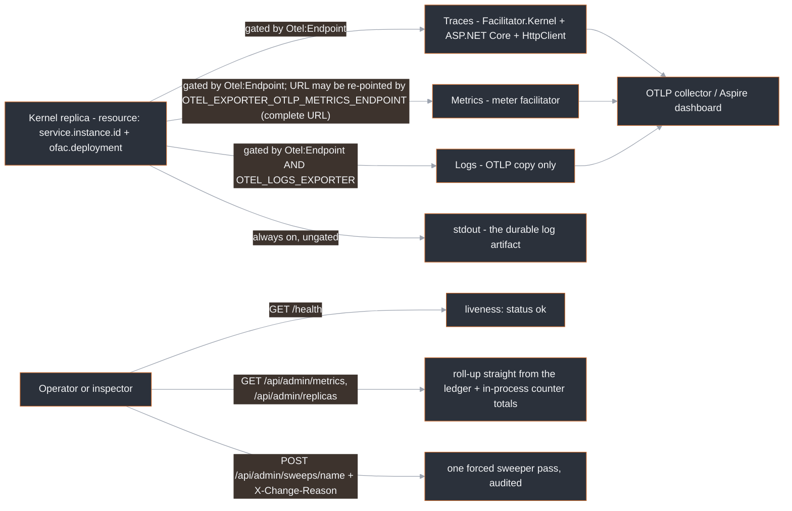

# Telemetry and health

The kernel emits three signals and answers two questions about itself. The
push side is OpenTelemetry: traces and metrics ride OTLP when an endpoint is
configured, logs join them only per explicit opt-in, so stdout stays the one
log pipeline a process must have. The pull side is HTTP: a liveness route with
no dependencies, and an admin surface that reads queue depth, replica
placement and windowed facts straight from the ledger — no scrape backend
required. This page states what each leg is gated by, which instruments exist,
and what an operator can ask the running system.

| Signal | Gate | Transport |
|---|---|---|
| Traces | `Otel:Endpoint` non-empty | OTLP; per-exporter settings from the standard `OTEL_*` env |
| Metrics | `Otel:Endpoint` non-empty | OTLP; `OTEL_EXPORTER_OTLP_METRICS_ENDPOINT` may re-point this leg alone |
| Logs | `Otel:Endpoint` non-empty **and** `OTEL_LOGS_EXPORTER` names an exporter | OTLP, in addition to stdout |
| Health / admin roll-up | none (liveness), `admin.read` / `admin.mutate` bindings (admin) | HTTP |

## Configuration switches

All wiring lives in `AddOpenTelemetry` in
`src/facilitator/Kernel/KernelServiceCollection.cs`: three-signal setup on the
component packages (no `OpenTelemetry.AspNetCore` meta-package), so each leg is
visible as its own `WithTracing` / `WithMetrics` / `WithLogging` call.

- **`Otel:Endpoint`** is the kernel's own on/off switch. When it is set, the
  tracing and metric providers each gain an OTLP exporter; when it is empty or
  absent, the process emits nothing over the wire and pays no exporter cost.
  The exporter takes no argument, so its transport details come from the
  standard OTLP environment (`OTEL_EXPORTER_OTLP_PROTOCOL` in particular —
  the .NET exporter defaults to gRPC, and the reference stack pins
  `http/protobuf` so both legs land on the collector's HTTP listener).
- **`OTEL_EXPORTER_OTLP_METRICS_ENDPOINT`** overrides only the metric leg, and
  it is read **code-side** (`KernelServiceCollection.cs:449`). The .NET 1.21
  exporter reads only the generic `OTEL_EXPORTER_OTLP_ENDPOINT` from the
  environment, while an endpoint set in code is used verbatim — no signal path
  appended. This variable therefore carries a **complete URL** including
  `/v1/metrics`, the same convention the JS SDK follows. Both planes are
  expected to be pointed at the collector's full per-signal URL.
- **Logs** opt in per process, on two conditions
  (`LogsExportEnabled`, `KernelServiceCollection.cs:464`): `Otel:Endpoint` set,
  **and** `OTEL_LOGS_EXPORTER` naming at least one exporter other than `none`
  (the variable is read as a comma-separated list). .NET reads
  `OTEL_LOGS_EXPORTER` itself only for the built-in `none` selector, so the
  opt-in has to be code-side — the same asymmetry `Otel:Endpoint` covers for
  the other two signals. The log pipeline itself is registered
  unconditionally: a pipeline with no exporter costs nothing, so what the gate
  controls is the exporter, not the provider. **stdout remains the durable
  artifact either way**; the OTLP leg is a copy for the viewer.

In the reference stack these live in `reference/config/facilitator.env` — the
single env source the primary and the replica twin (`reference/compose.replicas.yaml`,
via `extends`) both read, so a replica can never drift from its primary — and
`reference/compose.telemetry.yaml` re-points the metric leg at a verification
sink for `referencectl verify`.

## Resource identity

Every span, metric and log record carries two resource attributes
(`KernelServiceCollection.cs:416-419`):

| Attribute | Source | Why it matters |
|---|---|---|
| `service.instance.id` | `KernelOptions.ReplicaId`: config `Kernel:ReplicaId`, else `<machine-name>/<guid>` | The resource carries the replica id, so a two-replica fleet reads as **two resources** in any viewer — per-replica rate, depth and latency are directly comparable, and a single replica's numbers never blend with its twin's |
| `ofac.deployment` | config `Otel:Deployment`, default `"reference"` | Labels which deployment a record came from; the same key name is used by team-plane processes via `OTEL_RESOURCE_ATTRIBUTES`, so kernel and gateway records group under one label |

## Instrumented sources

- **`Facilitator.Kernel`** — the kernel's own `ActivitySource`
  (`src/facilitator/Kernel/Shared/Dispatch/KernelActivity.cs`, name locked by
  contract). Hand-opened spans: `ai.decode`, `ai.chat.turn`, `link.handshake`
  and friends, each started with an explicit parent `ActivityContext` when the
  caller crosses a durable hop, so a trace survives an outbox row. Callers pass
  the extracted carrier; ambient propagation is the default.
- **ASP.NET Core** — server spans, with a filter that drops the chatty paths:
  requests whose path starts with `/api/health` or `/api/dev` produce no span.
- **HttpClient** — client spans, filtered to `http`/`https` request URIs only.

No PII filter is needed: URL query strings stay redacted
(`DisableUrlQueryRedaction` is deliberately unset) and neither instrumentation
captures headers, so `Authorization` and `Set-Cookie` never reach a collector.

## The `facilitator` meter

`KernelMetrics` (`src/facilitator/Kernel/Shared/Dispatch/KernelMetrics.cs`)
owns the meter named `facilitator`. Descriptions below are the ones in code.
Counter tags are the low-cardinality label sets the emission law allows: finite
state words only — ids, tokens and prose ride spans and log attributes, never
metric labels.

### Counters

| Instrument | Description (from code) | Tags |
|---|---|---|
| `facilitator.delivery.attempts` | Outbox delivery attempts | — |
| `facilitator.inbox.processed` | Inbox rows processed | — |
| `facilitator.link.received` | Envelopes admitted over the link surface | — |
| `facilitator.identity.decisions` | Authorization-gate decisions | `decision` |
| `facilitator.link.evidence` | `actorEvidenceRef` evaluations on link admission | `scheme`, `outcome` |
| `facilitator.link.session_loss` | Executions failed by the session-loss law | `reason` |
| `facilitator.artifact.allocated` | Upload slots allocated | — |
| `facilitator.artifact.stored` | Artifacts stored with verified digests | — |
| `facilitator.artifact.registered` | Externally-declared artifacts registered (unverified) | — |
| `facilitator.artifact.rejected` | Upload ingest rejections | `reason` |
| `facilitator.artifact.confirmed` | Direct-to-store uploads confirmed by kernel re-hash | `origin` |
| `facilitator.artifact.presigned` | Presigned URLs minted | `op` |
| `facilitator.artifact.gc.collected` | Retention-GC collections | `reason` |
| `facilitator.artifact.store.errors` | Backend store errors by operation | `op` |
| `facilitator.manifest.recorded` | Result manifests recorded into the ledger | `origin` |
| `facilitator.manifest.superseded` | Result-manifest chain heads superseded by a correction | — |
| `facilitator.manifest.digest_mismatch` | Manifest recompute-vs-declared digest rejections | — |
| `facilitator.memory.retained` | Entries retained | `status`, `origin` |
| `facilitator.memory.recalled` | Recall queries served | `truncated` |
| `facilitator.memory.used` | Usage rows written (auto-recall + attestations) | — |
| `facilitator.memory.promoted` | Candidates promoted to active | — |
| `facilitator.memory.denied` | Broker denials | `reason` |
| `facilitator.provisioning.ops` | Provisioning ops appended by the scale-law sweep | `operation`, `reason` |
| `facilitator.ai.decode.total` | Decode pipeline outcomes | `basis` |
| `facilitator.ai.gateway.errors` | AI gateway failures | `endpoint` |
| `facilitator.ai.chat.messages` | Admin chat assistant messages | `basis` |
| `facilitator.ai.chat.actions` | Admin chat proposed actions reaching a terminal status | `status` |

### Histograms (all `ms`)

| Instrument | Description (from code) |
|---|---|
| `facilitator.delivery.latency` | Sink call latency |
| `facilitator.ingress.processing.latency` | Inline ingress processing latency |
| `facilitator.artifact.store.latency` | Content put latency |
| `facilitator.memory.recall.latency` | Recall query latency |

### Observable gauges

| Instrument | Description (from code) | Unit |
|---|---|---|
| `facilitator.outbox.queue_depth` | Pending outbox rows | — |
| `facilitator.inbox.queue_depth` | Pending inbox rows | — |
| `facilitator.delivery.dead_letter_count` | Dead-lettered rows | — |
| `facilitator.link.sessions` | Live link sessions | — |
| `facilitator.queue.oldest_wait_seconds` | Age of the oldest pending routing intent (starvation, I5/N28) | — |
| `facilitator.artifact.gc.last_pass_age` | Seconds since the last retention-GC pass | `s` |
| `facilitator.ai.chat.actions.pending` | Pending chat action proposals | — |

The queue-depth and pending-action gauges serve from a 5-second cache refreshed
by a background poller — an observable callback never hits the database
synchronously, so a collector scrape cannot stall the kernel.

## The pull side: what the kernel answers

The admin roll-up exists because a viewer is not the only way to read a
kernel. `KernelMetrics` runs an in-process `MeterListener` that accumulates
every `long` counter of the meter, so `GET /api/admin/metrics` can serve
process counters with **no scrape backend and no time-series query**: the
snapshot is SQL gauges, windowed table facts and those in-process totals.

| Route | Shape |
|---|---|
| `GET /health` | `{ "status": "ok" }` — anonymous, no database touch (`src/facilitator/Program.cs:32`). This is the only liveness route the kernel maps, and it is what the container healthcheck probes. |
| `GET /api/admin/metrics?window=` | `outboxPending`, `inboxPending`, `deadLetters`, `linkSessions`, `queueOldestWaitSeconds`, hourly buckets for dead letters, audit denies, artifacts stored and artifacts rejected, plus the accumulated `counters` map. `window=24h` widens the buckets to 24 hours; any other value (including absent) means 1 hour. |
| `GET /api/admin/replicas` | `answeringReplicaId`, one row per replica id with `liveSessions` (unexpired link leases from the DB — the cross-replica authority) and `socketsHere` (sockets this replica actually holds), plus `outboxPending`. The pair per row is the placement question answered: who leases, who actually answers. |
| `POST /api/admin/sweeps/{name}` | Force one sweeper pass without waiting for its loop. `name` is `nudge`, `approvals`, `schedules`, `session-loss`, `workflows` or `audit-retention`; anything else is a 400. `X-Change-Reason` is **mandatory** (non-empty, ≤ 512 chars) — a manual sweep is a human act on live state, so it leaves an `admin.sweep` audit row like every other operator write. Answers `{ "sweep": name, "effects": n }`. |

Both admin reads sit behind the config-driven `admin.read` binding, the sweep
behind `admin.mutate`; there is no `.RequireAuthorization` in the route table,
so the binding — not the code — is what gates them.

Note on `/api/health`: the trace filter drops that prefix, but the kernel maps
only `/health`. The filter is defensive — a proxy or check that asks for
`/api/health` gets a 404-shaped response and still costs no span, and the same
prefix rule keeps the Development-only `/api/dev/*` test affordances
(development environment only) out of the trace stream.

## Gateway side: `@ofac/otel`

`src/otel` (`@ofac/otel`) is the team-plane counterpart: an env-only
three-signal bootstrap for every gateway, worker, adapter and launcher child,
with one entry point, `startTelemetryFromEnv`. The process's `OTEL_*`
environment **is** the config — no config file, no YAML key. Traces and metrics
register whenever an endpoint is set; the OTLP log bridge additionally requires
`OTEL_LOGS_EXPORTER`, so each process keeps exactly one log pipeline by default
and stdout stays the durable artifact, exactly as on the kernel side.

The important property is that being dark is free: with no
`OTEL_EXPORTER_OTLP_ENDPOINT` (or `OTEL_SDK_DISABLED=true`) the call returns the
shared `DARK_TELEMETRY` handle **synchronously without importing a single SDK
module** — no timers, no context hooks, no exporter sockets. Call sites stay
syntactically identical on both paths (`handle.instrument(name, carrier, run)`,
`handle.log(fields)`), and the emit path never throws: an unreachable endpoint
warns once and goes silent rather than failing a business operation. Trace
continuity across the plane comes from the envelope: `instrument` parents on
`carrier.traceparent` when it parses, so a team-plane span joins the kernel's
trace by W3C re-parenting (same trace id, new parent id) rather than inventing
ids, and `OTEL_EXPORTER_OTLP_METRICS_ENDPOINT` carries a complete URL here too.

## Where to go next

- Running the pieces apart, including the collector targets a hand-rolled
  deployment should point at: [advanced.md](advanced.md)
- What to do when a signal says something is wrong:
  [runbooks/index.md](runbooks/index.md)
- The wire-level contract those spans and counters describe:
  [protocol.md](protocol.md)
