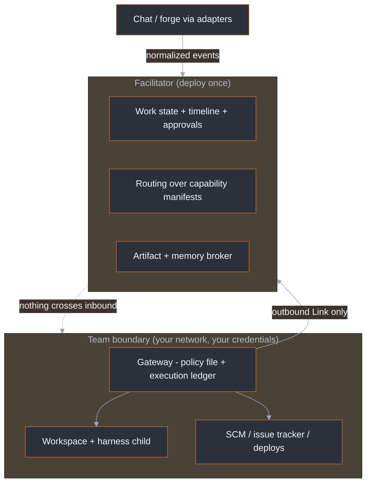
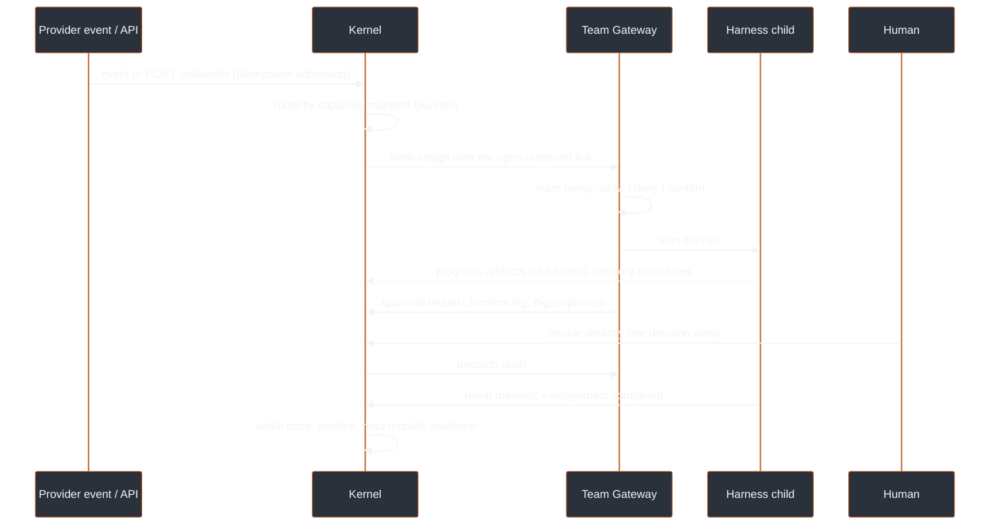

# Overview

This page builds the mental model of Open Facilitator from zero: the problem
it solves, the objects it works with, and the rules it plays by. It assumes
no prior knowledge of the project, and it is the canonical home of the
vocabulary — every other page links back to these definitions rather than
restating them. For commands and screens, go to
[getting-started.md](getting-started.md); for exact wire shapes,
[protocol.md](protocol.md).

After reading this page you can: name every object the system moves, predict
what happens to a piece of work end to end, and know which rules the design
never breaks.

## The problem

Teams that run a mix of autonomous agents, assisted humans, and plain
deterministic jobs across different machines, clouds, and vendors have no
neutral place to coordinate the **work** itself. Every tool owns a slice —
the chat platform owns the conversation, the forge owns the code, one
vendor's agent runtime owns the execution — and the durable state of "what
are we trying to do, who has it, what happened, who approved what, where is
the evidence" lives nowhere.

Open Facilitator is that missing place: one persistent service that owns
**coordination state** and nothing else. It deliberately does not run
workloads, hold deployment credentials, or become a privileged
super-agent. Teams keep execution authority; the Facilitator keeps the
durable record and the routing brain, and talks to the outside world through
adapters.

## The cast of objects

**Facilitator** — the service you deploy once. It ingests events (chat
mentions, issue labels, webhooks, API calls), holds Work state in
PostgreSQL, makes deterministic routing decisions, brokers artifacts and
memory, and serves an operator API and an embedded admin SPA.

**Project** — a unit of coordination: an objective space that Works belong
to, with its own configuration (e.g. memory retention). Projects belong to
Teams.

**Team** — the ownership boundary for everything a group controls:
link endpoints, workspaces, artifacts, memory entries, policy. The kernel
never lets one team's data leak into another's reads (non-disclosure 404s
everywhere).

**Work** — a durable objective with a lifecycle (`open → planning → active →
review → completed`, with `blocked`, `cancelled`, `failed` reachable from
the middle), a versioned optimistic-concurrency record, an append-only
timeline, and optionally approvals and result manifests. A Work is *not*
code-shaped: its outputs can be a report, a dataset, a document, a PR, or
test evidence.

**Assignment** — one attempt to execute a Work by one target workspace,
with an execution generation (fencing) so a restarted worker can never
double-run a settled assignment.

**Gateway** — a team-owned process (`@ofac/gateway`) that multiplexes one or
more Workspaces over a single Link endpoint, evaluates the team's policy
file, and holds the execution ledger that survives restarts.

**Workspace** — an environment where work actually executes: a devcontainer,
a VM, a worker process. It runs one or more harness children (an agent CLI,
a deterministic program) behind a harness adapter.

**Link** — the connection between a Gateway/workspace and the Facilitator.
Crucially it is *outbound*: teams dial out (SignalR, with a plain HTTP
fallback), so no team has to expose an inbound port, and the team's network
boundary stays intact.

**Artifact** — content-addressed (`sha256:`) output registered with the
kernel's metadata ledger, stored in an object store (or referenced
externally). The kernel verifies digests on ingest; large bytes travel by
reference, never inline.

**Memory entry** — a governed note the kernel *brokers* (stores, indexes,
ACLs) but never authors: extraction and reflection live team-side.
Workload-written entries land as `candidate` proposals; only curated,
promoted entries are recalled. Recall is FTS-ranked and ACL-filtered inside
the query itself.

**Approval** — a durable, digest-pinned, single-use decision record
(`pending → approved|denied|expired|revoked → consumed`). Approvals expire
lazily (no timers), exactly one concurrent decider can win, and every
decision audits. This is how a human gates a privileged action without
anyone polling chat.

**Capability manifest** — what an endpoint advertises ("I can run
`research.report.v1` with these limits"). Routing matches work needs to
advertised capabilities; the kernel routes only to what is declared.

The ownership lines are the point of the whole model:

*What the picture states: the only edge from the kernel into a team is an
assignment pushed down a link the team itself opened, and the only way team
work reaches the outside world is team-owned credentials. The kernel never
holds them.*

## How a piece of work flows

1. **Ingress.** A provider event (a chat mention, a labeled issue) or a
   direct `POST /api/works` creates a Work. Admission is
   at-least-once with idempotent dedupe: replays are no-ops, everything is
   journaled in a transactional inbox.
2. **Decision.** Routing is deterministic policy over capability
   manifests — a model may propose, but only code authorizes.
3. **Dispatch.** The Work coordinator writes an outbox row; the dispatcher
   materializes it into a durable delivery ledger and pushes a
   `work.assign` command down the team's open Link.
4. **Execution.** The Gateway checks its own policy file
   (`allow | deny | confirm`). `confirm` parks a durable approval and asks
   a human. Otherwise the command goes to the advertising child, whose
   harness adapter starts the run.
5. **Progress + results.** Progress events, artifact uploads (verified by
   kernel re-hash), memory candidates, and a canonical result manifest ride
   the Link back; trace context (`traceparent`) is stamped at dispatch and
   echoed end to end so one trace covers kernel→gateway→worker.
6. **Settle.** A terminal event (`assignment.completed/failed`) closes the
   assignment exactly once; the timeline and read models reflect it; a
   chat reply, PR, or other external side effect happens team-side, under
   team credentials, through the adapter that owns the provider.

When a handoff crosses team boundaries, a `sign-over` step (a workflow
step kind, or the `POST /api/admin/artifacts/sign-over` admin twin)
transfers the record: artifact **ownership is a column on the artifact
row**, the router team mints the sign-over transfer, and the receiving
team's access runs through **delivery-scoped artifact grants** — minted
at reply time, consumed on receipt, so a fetch is proof of the delivery
it belongs to (`Migrations/20261116234551_AddRouterTeamSignOver.cs`,
`WorkflowRunner.ExecuteSignOverAsync`). No team ever shares a bucket
credential; the kernel re-mints access per delivery.

The same six legs as one hop diagram, with the human gate drawn where it
actually appears:

*What the picture states: every arrow into the kernel is either an
idempotent event or a decision; the kernel's one outbound act is pushing a
command down a link the team opened. Dashed arrows are at-least-once.*

## The rules the design holds itself to

- **Coordination ≠ execution.** The kernel holds no SCM/issue/deploy
  credential and never performs privileged external writes itself.
- **Deterministic authority.** Identity evidence and policy authorize;
  model output only informs. Every gate evaluation — allow *and* deny —
  writes an audit row.
- **Recoverable by construction.** Transactional inbox/outbox, leases,
  fencing generations, idempotent admission. Crash a replica mid-approval
  and the run resumes exactly once.
- **Protocol-first.** Everything on the wire is a schema-validated,
  versioned message (`org.facilitator.<class>.<type>.v<N>`) with a frozen
  error contract; two independent language implementations run the same
  conformance fixtures, so third parties can implement any component from
  [protocol.md](protocol.md) alone.
- **Non-disclosure by default.** Cross-team reads answer like "not found"
  rather than "forbidden" — the shape of the system leaks nothing about
  other teams.
- **Small honest core.** PostgreSQL, OIDC, and an object store are the only
  required infrastructure. Message buses, workflow engines, vector DBs, and
  LLMs are optional adapters — never load-bearing.

## Where the code lives

| Concern | Home |
|---|---|
| Kernel (ingress, work lifecycle, Link hub, brokers, admin SPA, CLI) | `src/facilitator/` (.NET 10) |
| Gateway runtime | `src/gateway/` (TypeScript, `@ofac/gateway`) |
| Link client SDK + supervisor | `src/workspace-link/` (`@ofac/workspace-link`) |
| Harness-adapter SDK + reference harnesses | `src/adapters/harnesses/` (`@ofac/adapter`, cli/omp/codex workers) |
| Chat/forge adapters | `src/adapters/communication/` (Mattermost, Telegram, Forgejo/GitHub/GitLab pairs, Kafka) |
| The wire contract | `protocol/` (JSON Schemas, CloudEvents schemas, OpenAPI, conformance fixtures) |
| Dev Container Features (one-step workspace onboarding) | `features/` |
| Compose deployments + acceptance scripts | `reference/` (`./referencectl`) |

## Where to go next

- Run it: [getting-started.md](getting-started.md)
- Drive it from an agent: [getting-started-agents.md](getting-started-agents.md)
- Speak the wire: [protocol.md](protocol.md)
- Trust model: [security.md](security.md)
