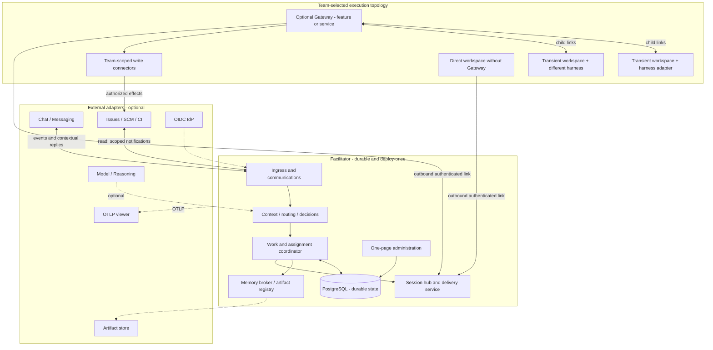
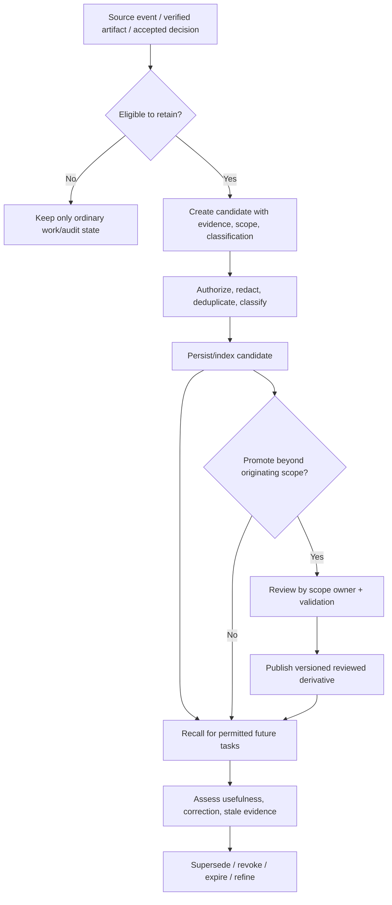
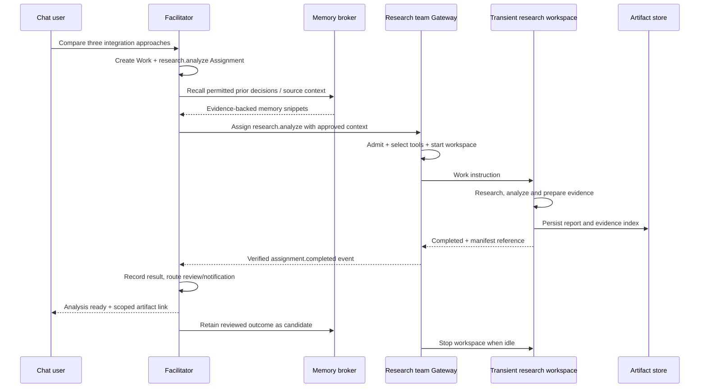
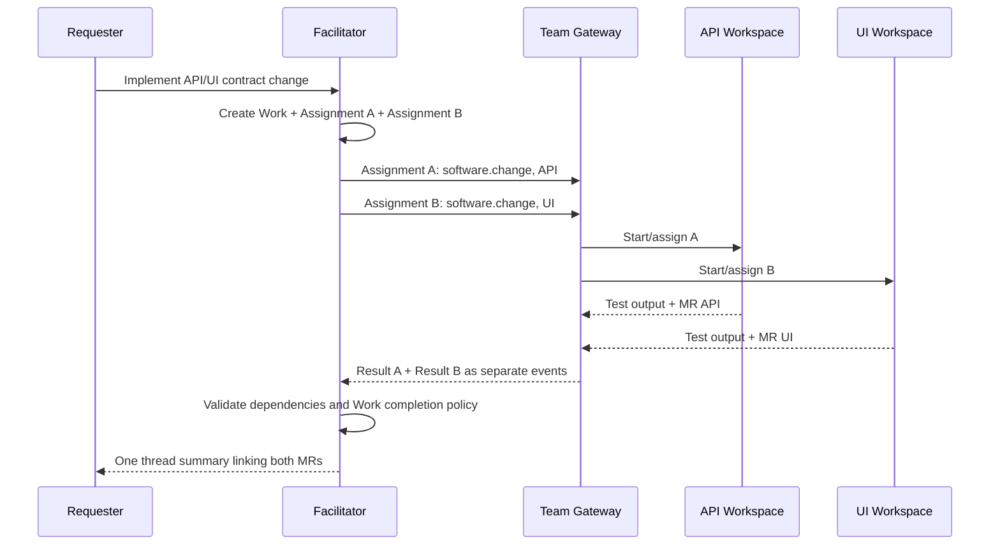
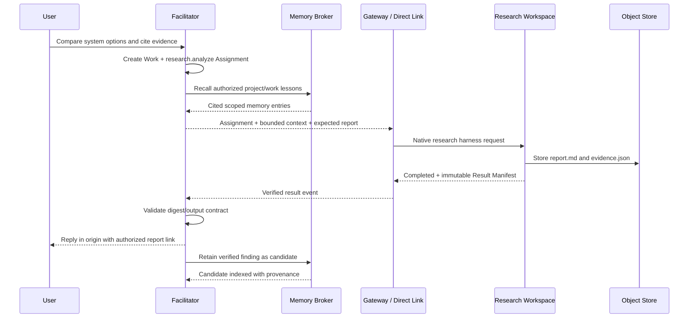
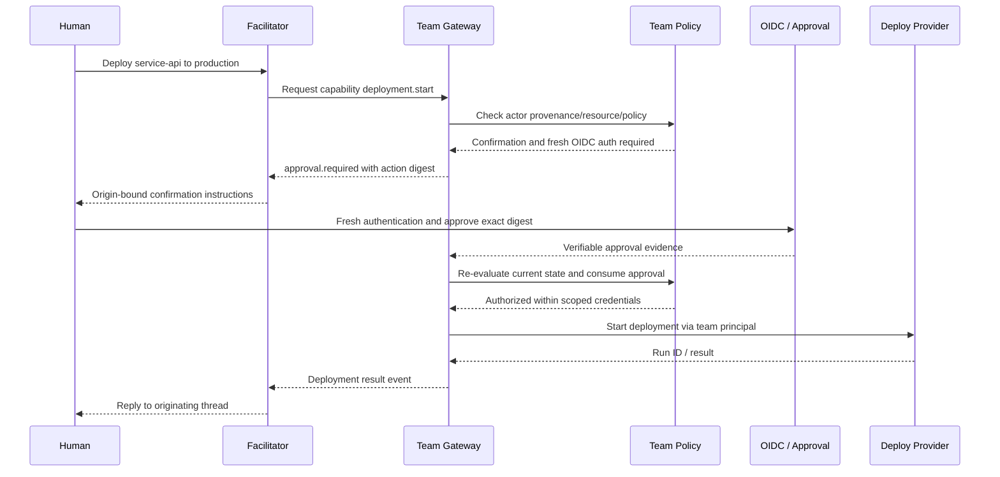

# Open Facilitator Framework

### Architecture, operational contracts and complete local reference implementation

**Architecture fact sheet** · 22 October 2026 · Open standards · Portable, pluggable, multi-workspace orchestration

This standalone specification defines the framework's purpose, runtime responsibilities, security model, communication contract, durable coordination, memory, artifacts, lifecycle, extensibility, and two reproducible local reference environments. Provider examples are replaceable reference implementations; protocol behavior and component responsibilities are implementation requirements. Examples under `example` namespaces are specification illustrations until built and published. The document is self-contained and intended to support independent implementation and review.

---

## Contents

1. [Mission, design constraints and operating model](#chapter-1)
2. [Decisions and component ownership](#chapter-2)
3. [Logical architecture](#chapter-3)
4. [Domain model and lifecycle semantics](#chapter-4)
5. [Communication contract — open, typed, transport-independent](#chapter-5)
6. [Outbound connectivity, transient sessions and resumption](#chapter-6)
7. [Horizontal scaling and replica-safe coordination](#chapter-7)
8. [Workspace packaging, Dev Container Features and language choices](#chapter-8)
9. [Gateway responsibilities and team-controlled side effects](#chapter-9)
10. [Capability manifests, discovery and semantic routing hints](#chapter-10)
11. [Identity federation and configurable authorization claims](#chapter-11)
12. [Team authorization policy and safe approval flows](#chapter-12)
13. [External adapters, threaded communication and provider-faithful replies](#chapter-13)
14. [Persistent memory: scoped, searchable and evidence-backed](#chapter-14)
15. [Generic work and durable typed outputs](#chapter-15)
16. [Project and workspace onboarding](#chapter-16)
17. [Single-page administration and operational statistics](#chapter-17)
18. [Workspace provisioning, retention and scale-to-zero](#chapter-18)
19. [Persistence and relational data model](#chapter-19)
20. [Durable coordination adapters](#chapter-20)
21. [Reference implementations: design and service matrix](#chapter-21)
22. [Reference Compose topology and configuration](#chapter-22)
23. [End-to-end interaction sequences](#chapter-23)
24. [Security threat model and trust assumptions](#chapter-24)
25. [Extensibility and compatibility principles](#chapter-25)
26. [Implementation slices, conformance and acceptance](#chapter-26)
27. [Operational runbooks](#chapter-27)
28. [Reference documentation and learning path](#chapter-28)
29. [Open standards, protocols and reference technology catalog](#chapter-29)

---

<a id="chapter-1"></a>
## 1. Mission, design constraints and operating model

**Document:** Open Facilitator Framework — Architecture and Reference Implementation Specification  
**Status:** Proposed implementation contract (not a claim that the software has already been built or verified in production)  
**Audience:** framework maintainers, integrators, team owners, agent-harness maintainers, security engineers and operators  
**Scope:** general-purpose coordination of autonomous, assisted and deterministic workloads across independently operated, optionally transient execution environments.

**Mission.** Deploy one persistent **Facilitator**; let any team register a **Project**, connect its existing tools and optionally attach one or more **Gateways** or **Workspaces**. The Facilitator handles external communication, durable context, work breakdown, routing, human interaction, optional reasoning, governed memory and artifact references. Teams retain control of harnesses, execution, operational permissions, credentials, models, provisioning and publication. Work may be software development, research, documentation, data analysis, testing or another declared capability.

**Portability rule.** The contract uses open formats and standards; vendor products are adapters. A local reference can run entirely on Linux/OCI/Docker Compose. Higher-scale deployments may add services without changing public work, event, identity, memory or artifact contracts.

**Primary design qualities, in priority order:**

1. **Trivial team onboarding:** use an existing agent/harness as-is, add one Dev Container Feature or a standalone wrapper, and enroll automatically.
2. **Team autonomy:** the central service can request actions but has no general-purpose source-control, issue-tracker or deployment write identity.
3. **Recoverability:** no work state, accepted command, approval or output exists only in an ephemeral container or live socket.
4. **Minimal deployable footprint:** no compulsory workflow server, message broker, vector DB, model provider or cloud control plane in the slim reference.
5. **Protocol interoperability:** workspaces in any language can implement a published wire contract; libraries are optional conveniences.
6. **Deterministic authority:** model outputs and memory are data/proposals, never implicit identity, policy or approvals.
7. **Incremental scale:** PostgreSQL-first transactional coordination, worker scale-to-zero, replica-safe dispatch and explicit extension seams.
8. **Provider-faithful communication:** the bot replies in the original thread/comment context or reacts when sufficient; no indiscriminate new top-level posts.
9. **Operational visibility:** one searchable administration page for projects, links, work, delivery queues and high-signal statistics.

### 1.1 Normative language and specification classes

**MUST / MUST NOT** = conformance requirements; **SHOULD** = recommended default with justified exceptions; **MAY** = optional feature. Examples marked `illustrative` define the proposed framework syntax; names, image tags and domains prefixed `example` are placeholders requiring publication in the real implementation. This document distinguishes three classes of dependency:

- **Framework modules:** code maintained as part of this project (Facilitator, Gateway/Link SDK, protocol contracts, admin UI, adapters, optional provisioners).
- **Runtime foundations:** a database, container runtime, machine identity and network transport chosen for a deployment. The reference stack supplies concrete examples.
- **External services:** chat, Git, issue management, models, identity provider, Kafka, object storage, observability endpoints. Interfaces are stable; providers may be switched or omitted based on scenario.

A reference implementation described here is a **required target deliverable for the implementation repository**. Compose names and locally built images in this specification are an implementation blueprint rather than already published artifacts.

<a id="chapter-2"></a>
## 2. Decisions and component ownership

| Decision | Normative direction | Justification and limitation |
|---|---|---|
| D-01 | The Facilitator is a deterministic, durable event processor with optional bounded model reasoning. | Predictable default; no continuously thinking central agent. |
| D-02 | Project → Work → Assignment → Execution attempt are separate durable entities. | One request can span many teams, workspaces and non-code outputs. |
| D-03 | A **Gateway** is a reusable component that may be installed in a Dev Container Feature, deployed as a standalone team service, or omitted for direct connections. | Packaging does not impose deployment topology. |
| D-04 | One Gateway MAY manage zero-to-many heterogeneous workspaces; harness adapters stay beside each native harness. | Makes workers disposable and prevents gateway coupling to one agent vendor. |
| D-05 | Gateways/workspaces initiate outbound persistent sessions; requests and events flow bidirectionally after connection. | Supports private networks and NAT; a stopped worker cannot initiate a connection. |
| D-06 | Canonical message semantics are CloudEvents 1.0 + versioned JSON Schema. | Consistent language-independent events and commands; transport remains pluggable. |
| D-07 | **SignalR is the default reference link transport** for .NET ↔ TypeScript. Standards-based WebSocket and HTTP pull implementations MUST remain possible. | Open-source real-time library reduces connection plumbing; its wire format is not the framework's domain contract. |
| D-08 | PostgreSQL is the Facilitator reference database, including the inbox, outbox, locks, work context and memory metadata. | Useful for both Compose and replicated deployments. |
| D-09 | Gateway/workspace-local state MAY use SQLite; workers must externalize durable results. | Lightweight and independently provisionable. |
| D-10 | No general privileged SCM/issue/deployment credential is held by the Facilitator. | Team-owned execution authority; limited bot replies use communication-specific identity. |
| D-11 | **Privileged Gateway deployment inside a devcontainer is fully supported.** | A team may choose co-location and manage its own credentials; this is a consciously shared trust domain, not process isolation. |
| D-12 | Identity provenance, calling workload and executing principal remain distinct; admission and side effects are authorized deterministically. | Prevents confusion between a message and delegated authority. |
| D-13 | The Facilitator owns generic context and optional memory; a team can keep private memory inaccessible to the Facilitator. | Governance and useful cross-run learning without universal data access. |
| D-14 | Capability manifests include typed contracts and optional semantic descriptors; semantic matching may only select from pre-authorized candidate IDs. | Improves natural-language routing without allowing descriptions to create permissions. |
| D-15 | Results are structured and artifact-based, not necessarily Git commits or MRs. | Non-code workers are first-class. |
| D-16 | Temporal, Orleans/actors, Kafka, external policy engines and specialized memory servers attach through adapters. | No change to the base protocol when introduced. |
| D-17 | The reference ships **slim** and **full** Compose profiles with documented, repeatable seeding and acceptance runs. | Both prove the same protocol, with different operational breadth. |

### 2.1 Ownership at a glance

| Concern | Facilitator | Gateway | Workspace/harness | External system |
|---|---|---|---|---|
| Normalize events, resolve work and communicate | **Owns** | Relays optional | Emits work events | Supplies source events |
| Interpret requests and suggest routing | **Owns** | May override local placement | May request clarification | — |
| Execute implementation, research or testing | Never | May launch/delegate | **Owns** | May be a tool |
| Select model and agent skills | Optional central reasoning only | May select child harness | **Owns** | Model provider |
| Authorize privileged writes | Admission only | **Owns** when used | Owns when direct | Enforces actual ACLs |
| Start/stop workers | Records status | Provisioner when used | Can self-manage | Docker/ECS/VM/K8s API |
| Store authoritative work state | **Owns** | Local child state | Ephemeral/checkpoint | PostgreSQL |
| Store team-private agent memory | Only when explicitly delegated | Optional | **Owns** | Local/external memory |
| Store artifacts and publish outputs | Registers/access-controls | May hold/transfer | Produces | Files/object store/repository |

<a id="chapter-3"></a>
## 3. Logical architecture



Arrows into the Facilitator link hub denote **connection establishment**. Once established, commands and events travel in both directions. External provider ingress may use webhooks, authenticated polling or provider streaming. A Gateway may remain alive with zero workers; a worker may be directly connected; and one shared Gateway may multiplex different harness types.

### 3.1 Runtime roles

- **Facilitator Core:** one ASP.NET Core deployable containing ingress, adapters, deterministic iteration, durable coordination, optional model calls, capability registry, memory/artifact broker, Link server and embedded admin SPA.
- **Gateway:** TypeScript/Node.js reference runtime distributed as a Dev Container Feature, standalone executable package or OCI image. Runs with team-owned policy and connectors; optional worker scheduling/provisioning and child-link aggregation.
- **Workspace Link:** TypeScript reference package distributed as a Feature, npm package or standalone sidecar. It only handles enrollment, messaging, replay, status and access to scoped broker APIs.
- **Harness Adapter:** TypeScript module/process next to an existing Pi/OpenCode/Codex/custom/deterministic runtime. Translates typed commands and native run events. It does not own an AI configuration.
- **Execution Workspace:** a potentially transient process/container/VM hosting research, code, analysis, document writing, deterministic automation, or combinations thereof. It may have no repository at all.

### 3.2 Topologies and privilege semantics

| Topology | Connection origin | Strength | Operational requirement |
|---|---|---|---|
| Direct worker | Workspace → Facilitator | Simplest local/on-demand harness; may perform actions using its own authorized credentials | Offline means work remains queued until manually started or provisioned elsewhere |
| Gateway co-located in devcontainer | Gateway → Facilitator; internal adapter local | **First-class**; one Feature installs gateway and adapter; may expose privileged actions if owner chooses | Gateway and harness share OS/container trust, so access cannot be isolated from unrestricted shell code within that container |
| Shared Gateway + children | Gateway → Facilitator; children → Gateway | Central team control, many adapters, scale-to-zero workers, credential isolation possible | Gateway always-on or event-triggered, local storage or durable coordination state |
| Team-managed launcher with direct workers | Launcher → Facilitator; workers → Facilitator | Automatically spawn independent direct workers | Launcher is the always-available wake-up controller |

Privilege placement is a **team decision**. Co-location is supported with no framework-level ban on privileged capabilities. A policy in a container that an agent can control is not a robust security barrier against that agent; the effective protection is the team's chosen operating-system boundary and downstream Git/CI/cloud permissions. The framework MUST accurately report the chosen trust mode (`shared-runtime` or `isolated-executor`) and MUST NOT present them as equivalent assurances.

### 3.3 Trust and data-plane distinctions

**Transaction truth:** Project/Work/Assignment, identity bindings, verified references, immutable policy versions, approval records and delivery state in the Facilitator database. **Memory:** lower-trust, searchable knowledge with provenance and scoped access; never an authorization source. **Artifacts:** durable typed outputs and verified external references. **Harness context:** native prompts, tools, skills and reasoning sessions under team control. An LLM may propose a command, but neither LLM text nor memory can issue authoritative grants.

<a id="chapter-4"></a>
## 4. Domain model and lifecycle semantics

| Entity | Identity | Lifetime | Purpose |
|---|---|---|---|
| `Project` | Platform UUID, provider bindings | Long-lived | Context, owner, channels, issue sources, repository hints, routing preferences |
| `Team` | Stable logical ID and immutable IdP/group mappings | Long-lived | Own Gateway, capability definitions, permissions, storage and harnesses |
| `Work` | UUID with optional external issue ID | Durable | User objective; can span threads, artifacts, projects, teams and time |
| `Assignment` | UUID under Work | Durable | Scoped contract to one owner/capability; dependencies and expected results |
| `Execution` | UUID per attempt | Ephemeral | Actual harness run and fencing generation; can be reconstructed |
| `Workspace` | Stable logical workspace and instance IDs | Ephemeral or persistent | Execution environment, independent of Gateway |
| `Gateway` | Stable team-owned logical ID + connection instance ID | Long-lived or transient | Relay, policy, connectors, optional launcher |
| `ProviderReference` | Provider + immutable resource ID + relation | Durable | Chat root/reply, issue, PR/MR discussion, commit, build, document |
| `ArtifactManifest` | Content-addressed or revisioned ID | Durable | Results, documents, datasets, checks and external outputs |
| `MemoryEntry` | Entry/revision ID + scope/grants | Governed | Evidence-backed searchable knowledge |
| `Approval` | Exact action hash + eligible actor(s) | Time-bounded | Independently verifiable approval/confirmation |

A `Work` is not the same as its workspace. One Work can create many Assignments to different teams; one Assignment may have multiple retries or internal worker executions; a workspace can handle multiple compatible assignments under explicit reuse policy. Work can exist without Git, issue tracking or an LLM.

### 4.1 Canonical states

- **Work:** `open → planning → active → review → completed` with `blocked`, `cancelled`, `failed` as explicit transitions; closure is independent of execution completion.
- **Assignment:** `proposed → routed → accepted → running → input_required | completed | failed | cancelled | expired`. Stale execution fencing prevents superseded attempts from reporting success.
- **Execution:** `starting → ready → working → stopping → stopped | failed | lost`.
- **Result:** `missing → submitted → validated | rejected → superseded`.
- **Approval:** `pending → approved | denied | expired | revoked | consumed`.
- **Delivery:** `pending → leased → sent → durably_acknowledged | rejected | dead_letter`.

Required invariants: one assignment can have at most one *current* execution generation; events always include `workId` and `assignmentId` when assignment-scoped; repeated commands carry the same idempotency key; a completion event does not publish its artifact; the parent Work closes only when its completion policy is satisfied.

### 4.2 Cross-workspace dependencies

An Assignment declares `dependsOn` IDs and a dependency condition (`completed`, `result_validated`, or `approved`). A downstream assignment may start only when its explicit dependencies are met. Multiple independent assignments may proceed concurrently. No AI reasoning is needed to evaluate DAG prerequisites. Conflicting external messages resolve through Work version checks and, when necessary, a human clarification; do not guess which execution should be steered.

<a id="chapter-5"></a>
## 5. Communication contract — open, typed, transport-independent

The **Workspace Link Contract** describes application messages; it is not a new networking standard. The normative payload format is **CloudEvents 1.0 structured JSON**, with application data validated by immutable JSON Schema versions. HTTP APIs are published through OpenAPI 3.1. The reference real-time implementation uses self-hosted **ASP.NET Core SignalR** at the Facilitator and the official TypeScript SignalR client in Links/Gateways. Both ends send an application-defined `hello`, `envelope` and `receipt` method; SignalR's own framing is a transport choice.

### 5.1 Transport evaluation

| Candidate | Advantage | Cost/trade-off | Decision |
|---|---|---|---|
| RFC 6455 WebSocket | Universal, small protocol, independent clients | Must implement reconnect, keepalives, heartbeats, auth refresh and flow control | Required interoperable fallback transport |
| **ASP.NET Core SignalR** | Mature MIT-licensed implementation; official .NET and TypeScript clients, automatic reconnect, built-in keepalives, WebSocket/long-poll fallback | SignalR-specific wire protocol, affinity/backplane considerations when replicated | **Default reference transport, not normative domain protocol** |
| gRPC bidirectional streaming | Contract-first Protobuf, HTTP/2 multiplexing | Proxy/browser constraints, separate streaming clients | Optional Link transport adapter |
| MQTT 5 | Standard delivery QoS and pub/sub, many SDKs | A broker is another mandatory service if selected | Optional transport for installations already running MQTT |
| Kafka | Persistent scalable event log | Expensive as a link/session protocol, unsuitable for all small local workers | Optional event integration/backbone, not link transport |

**Decision:** publish **both** a SignalR reference client/server implementation and a protocol-conformant HTTP `POST` + long-poll client. The latter is the minimal cross-language escape hatch and ensures that SignalR is not a platform lock-in. A raw WebSocket adapter MAY implement the same envelope. SignalR reconnect does **not** replace durable receipts, persistence or replay. For multi-replica SignalR, use supported affinity/WebSocket-only behavior and database-directed delivery; Redis/Valkey backplane remains optional (see §7).

### 5.2 Message types

| Class | Example types | Completion meaning |
|---|---|---|
| `command` | `work.assign`, `work.steer`, `work.cancel`, `work.status.request`, `work.nudge`, `context.fetch`, `approval.respond` | Sender requests activity; no implication of acceptance or execution |
| `event` | `work.accepted`, `work.progress`, `work.input_required`, `assignment.completed`, `assignment.failed`, `workspace.heartbeat`, `artifact.available`, `memory.candidate` | An authenticated actor reports a fact or assertion to validate |
| `receipt` | `accepted`, `duplicate`, `rejected`, `unsupported` | Message admitted to durable inbox or explicitly refused; **not** work completed |
| `control` | `hello`, `welcome`, `heartbeat`, `flow_control`, `goodbye` | Link/session negotiation, health and backpressure only |

Every command has stable `commandId`, `workId`, `assignmentId` where applicable, `targetId`, `deadline`, `expectedContextVersion`, `actorEvidenceRef` and declared `capabilityId`. Events have CloudEvents `source` + `id` deduplication identity, `time`, `subject`, `type`, and optional `traceparent`, `correlationId`, `causationId` extensions. `dataschema` identifies an advertised immutable schema. No schema version permits arbitrary runtime type execution.

Example proposed command over any supported transport:

```json
{
  "specversion": "1.0",
  "id": "01JCOMMAND01",
  "source": "urn:facilitator:instance:main",
  "type": "org.facilitator.command.work.assign.v1",
  "subject": "work/work-123/assignment/analysis-1",
  "time": "2026-10-22T18:00:00Z",
  "datacontenttype": "application/json",
  "dataschema": "https://schemas.example.invalid/work-assign/v1.json",
  "data": {
    "commandId": "cmd-123",
    "workId": "work-123",
    "assignmentId": "analysis-1",
    "targetId": "gateway-team-alpha",
    "capabilityId": "research.analyze",
    "expectedContextVersion": 4,
    "inputs": {"objective": "Compare data retention alternatives", "sourceRefs": ["artifact://sources/brief-1"]},
    "expectedDeliverables": [{"kind": "analysis.report", "mediaType": "text/markdown"}],
    "actorEvidenceRef": "identity-evidence:ref-123",
    "deadline": "2026-10-23T18:00:00Z"
  }
}
```

A command is received as a `deliver` operation with a separate durable `deliveryId`. A receipt has the form:

```json
{"deliveryId":"del-123","status":"accepted","acceptedAt":"2026-10-22T18:00:01Z"}
```

Only after the receiving Gateway durably accepts the **business command** does it emit `work.accepted`; the subsequent completion references a Result Manifest. `accepted` as a transport receipt says nothing about execution success.

### 5.3 Link handshake and capabilities

1. Link connects outward over HTTPS/WSS to the configured Facilitator base URL. TLS is required beyond isolated local test networks.
2. Link authenticates with a short-lived workload bearer token, mTLS identity, or a trusted provider adapter. The authenticated principal—not an unverified JSON field—determines allowed team/Gateway/workspace identity.
3. Link calls `hello({protocolVersions, supportedTransports, endpointId, instanceId, capabilityManifestDigest, lastKnownAck})`. The server resolves the current principal, advertised capabilities, compatible version and policy, and returns `welcome({sessionId, leaseEpoch, maxInFlight, heartbeatSeconds, protocolVersion})`.
4. The Facilitator assigns/reassigns a durable connection ownership record; pending deliveries are fetched from the database according to the actual receipt ledger. A client-provided resume cursor is a hint, not delivery proof.
5. Heartbeats refresh the connection lease, not assignment progress. Each reconnect issues a new session generation/fencing epoch.

**SignalR reference hub methods:** `Hello`, `Envelope`, `Receipt`, `Heartbeat`. Hub-to-client methods: `Welcome`, `Deliver`, `FlowControl`, `Disconnect`. Each `Deliver` contains a CloudEvent plus durable delivery metadata. The hub is a thin transport layer; it does not execute work or model decisions. The TypeScript client renews access tokens using its documented token-factory mechanism.

**Provider-neutral HTTP fallback:** `POST /api/link/v1/events` (CloudEvents), `GET /api/link/v1/deliveries?wait=25&limit=16`, `POST /api/link/v1/deliveries/{deliveryId}/receipt`, `GET /api/link/v1/capabilities`, `POST /api/link/v1/enroll` (bootstrap enrollment). Use per-principal authorization and identical application semantics for SignalR and HTTP. Link transport integration MUST pass the same conformance suite.

### 5.4 Delivery, idempotency and backpressure

- The producer persists an outbox item atomically with its work state mutation before sending anything.
- The receiver persists an inbox record before returning `accepted`; `(source, id)` uniquely identifies CloudEvents; `commandId` additionally deduplicates business command admission.
- A dropped receipt results in redelivery. On re-delivery the receiver reports `duplicate` and does not re-issue the business command.
- A downstream provider side effect can still be ambiguous after a timeout; use provider-native idempotency keys when available, a durable local action ledger, and read-before-retry/reconciliation when unavailable. Do **not** promise exactly-once external writes.
- Apply `maxInFlight` per connection, message-size limits, content-type validation, per-team queues, quotas and bounded retries with dead-letter visibility. Large artifacts move through scoped artifact storage, not Link messages.
- Control frames can be retried independently from domain events; rejected commands are audit records, not silent drops.

### 5.5 Compatibility and namespacing

Proposed names such as `org.facilitator.command.work.assign.v1` identify semantic major versions, not vendor names. New optional fields are additive; breaking schema/semantics require a new major event. Unknown **event** types may be retained/quarantined for compatible future adapters; unknown **commands** MUST fail closed with a typed `unsupported` response. Feature negotiation advertises optional `capabilityId` and transport combinations. Published conformance fixtures specify canonical serialization and rejection behavior.

<a id="chapter-6"></a>
## 6. Outbound connectivity, transient sessions and resumption

A private workspace is never required to expose a public listening socket. A Gateway or direct Link establishes the outbound session. Once connected, the server may invoke client methods or deliver queued commands through the existing full-duplex channel. An adapter may use long polling when WebSockets are blocked.

### 6.1 Shared Gateway with many independent harnesses

A shared Gateway maintains `(gatewayId, childWorkspaceId, assignmentId, executionId, connectionGeneration)` bindings. Children reach the Gateway through a Unix socket, localhost or authenticated team-private endpoint. Workers MAY have different harness types because **each worker supplies its own Harness Adapter**. Gateway routing uses capability ID, accepted assignment, available capacity and policy; it never interprets a native agent transcript as executable instruction. Children can register, disconnect or be replaced without renaming the durable Work.

### 6.2 Gateway inside a devcontainer

A Gateway in the same Dev Container as an agent is a fully supported mode. The Gateway may accept privileged team-scoped connectors, provided the team elects to give them to that container. It can manage one local workspace, or expose a child endpoint to attach additional workspaces. The runtime advertises the truth of its trust mode: `shared-runtime`, `separate-process-same-host`, or `isolated-executor`. Teams choose resource/network permissions accordingly. Credentials should be mounted at runtime, never baked into images or tracked in Git.

### 6.3 Reconnection after worker death

- A disconnected Gateway remains logically registered; its session goes `offline`, pending deliveries remain in Facilitator Postgres.
- A restarted Gateway reconciles the accepted assignments against its local SQLite ledger and any active children, then reports real status.
- A restarted workspace gets a new `executionId` and fencing generation. Its adapter may attach to a native persistent session or reconstruct context from Work and durable artifacts.
- A stale generation cannot commit a new result, acknowledge a new privileged operation or supersede a current execution.
- A Gateway stopped with zero workers can receive new assignments. A worker stopped without any live Gateway/launcher cannot auto-start; an external container/VM scheduler or an always-on team launcher is required for automatic wake-up.

### 6.4 Nudge and stalled-work semantics

A **nudge** is a bounded *diagnostic prompt*, not an authority escalation or a command to ignore an agent's previous stop condition.

- `work.status.request` asks the adapter to report native run state and last observable progress; it has no requirement to alter the run.
- `work.nudge` MAY be supported by a harness adapter as a nonprivileged request to re-evaluate whether the run is blocked and publish a concise status. It MUST NOT blindly re-run costly tools, merge code or trigger deployments.
- The default Facilitator stale-work policy is illustrative: status request after 10 minutes without progress for an active run; one nudge after another 5 minutes when healthy but unresponsive; escalate to the owning team after 15 further minutes. Disabled by default for capabilities with expensive/long-running silent jobs unless advertised heartbeat expectations exist.
- Deduplicate nudges per `(assignmentId, executionGeneration, stallEpisode)`, cap at one nudge per episode, record outcome, and respect quiet hours/cost caps. An agent may explicitly advertise `supportsNudge: false`.
- Transport heartbeat, native harness progress and user-visible business progress are three separate signals. No single idle socket event is proof that an agent is stuck.

<a id="chapter-7"></a>
## 7. Horizontal scaling and replica-safe coordination

**The database is the coordination authority; connections are transient delivery optimizations.** A deployment can run several Facilitator replicas backed by one PostgreSQL cluster without automatically introducing Kafka/Redis/Temporal.

### 7.1 Ingress deduplication

Each provider adapter verifies signature/token and source identity, maps provider delivery/event IDs to immutable `provider_events` records, and writes a normalized inbox event transactionally. Required uniqueness: `(provider, tenantId, providerEventId)` when provider supplies stable event IDs, or `(cloudeventsSource, cloudeventsId)` for native Link events. No deduplication based solely on textual content. Duplicate webhooks return success without processing twice. Preserve the full source body hash, time and verified reference for audit.

### 7.2 Database inbox/outbox leases and per-work ordering

Claim due rows with `FOR UPDATE SKIP LOCKED` or equivalent transactional leases; each item has `leaseOwner`, `leaseUntil`, `attempt`, `nextAttemptAt`. To serialize commands for the same Work, acquire a row-level Work lock or PostgreSQL advisory lock keyed by stable Work ID within a short transaction; validate `workVersion` and increment atomically. Persist new state and outbox commands in the same transaction. Release the lock before external provider calls. Dispatchers lease outbox rows and perform calls outside the transaction.

### 7.3 Session placement without a mandatory pub/sub backplane

Each authenticated live link has `endpointId`, `connectionInstanceId`, `replicaId`, `sessionEpoch`, `leaseUntil` in a shared `link_sessions` table. A replica owns its own live sockets. An outbound record for endpoint X is eligible for delivery only by the active session owner (matching epoch). Replicas use lightweight PostgreSQL `LISTEN/NOTIFY` or bounded polling to wake the right local dispatcher; **NOTIFY is a hint only**, not the durable event store. If a socket closes or its owner crashes, the lease expires and reconnect chooses a new replica. No outbox row becomes permanently tied to a dead socket.

For SignalR scale-out, allow **WebSockets-only with `skipNegotiation`** where proxies and clients support it to avoid sticky negotiation requests, or configure load-balancer affinity when enabling transport fallback. Other SignalR hub features involving cross-replica groups/broadcast require a Redis-compatible backplane or an explicit provider-supported alternative; the framework's reference uses per-connection database ownership instead of relying on hub broadcast for critical deliveries. SignalR reconnect and Redis Pub/Sub are not durable message queues.

### 7.4 Fencing and duplicate execution limits

- Work-state mutations require expected `workVersion` to match; competing decisions retry after rehydration.
- Assignment acceptance uses unique `(assignmentId, commandId)`; provisioning requests use idempotent `provisioningOperationId` where supported.
- Any worker result reports `executionGeneration`; only the current generation may finalize its assignment.
- For external systems without idempotent create/send methods, use a provider-specific reconciliation key (often a hidden or visible marker in comment/MR metadata), query for previous outcomes and tolerate an `uncertain` state when neither a readback nor exact-once action is possible.
- Exactly-once delivery is not promised across independent external APIs. The required claim is **transactional local state + at-least-once messaging + idempotent admissions + reconciled side effects**.

### 7.5 Backpressure, partitioning and migration

Queue fair scheduling by team/project, isolate high-volume providers, throttle concurrent model calls, and impose sensible payload limits. Start with PostgreSQL dispatch; introduce Kafka as an input/output event adapter or a dedicated broker only when measurements show a need. A future workflow engine sees *the same* durable Work/Assignment records and command/event contract; migrating orchestration internals does not require replacing workspace feature packages.

<a id="chapter-8"></a>
## 8. Workspace packaging, Dev Container Features and language choices

The framework ships reusable **Dev Container Features** as standard distribution packages, plus executable equivalents for non-Dev-Container runtimes. The supported team path is to add a Feature to an **existing** `devcontainer.json`, without reorganizing its agent configuration, changing its model vendor, rewriting `AGENTS.md`, or adopting new CI conventions. The feature installs only the selected communication/gateway tools and their small Node.js runtime if missing.

### 8.1 Published Feature family

| Feature | Installs | Typical use |
|---|---|---|
| `workspace-link` | TypeScript/JavaScript Link runtime, CLI, event client, context/artifact helpers | Directly connected transient worker |
| `gateway` | Same common Link library + gateway mode, local policy engine, optional child listener and connector/provisioner interfaces | **Inside any Dev Container** or as standalone trusted controller |
| `harness-adapter` | Auto-detection and adapter runner with language-neutral child protocol | Existing Pi/OpenCode/Codex/Claude/custom/local agent |
| `memory-client` (optional) | Authorized recall/retain tools and MCP bridge | Workspace-specific searchable memory |
| `artifact-client` (optional) | Content/digest/manifest upload/download tools | Research, code, documents, datasets |

The distribution registry addresses below are **illustrative**, not claims that images already exist:

```json
{
  "name": "Research or development workspace",
  "features": {
    "ghcr.io/example/facilitator-features/gateway:1": {"mode": "embedded"},
    "ghcr.io/example/facilitator-features/harness-adapter:1": {"adapter": "detect"}
  },
  "containerEnv": {
    "FACILITATOR_URL": "${localEnv:FACILITATOR_URL}"
  }
}
```

To use a direct Link without the gateway feature, replace the `gateway` feature with `workspace-link`. The team can still run a Gateway as a second process from the same image, and the same image may be prebuilt for headless OCI or cloud execution. Dev Container Features are **installation metadata and lifecycle hooks**, not deployment orchestration or a guarantee that the gateway survives container termination.

**Implementation detail:** TypeScript is the preferred implementation language for worker-side Link, Gateway and harness wrappers; publish compiled JavaScript targeting a maintained Node.js runtime, with source maps and type declarations. Node.js is a runtime dependency but does not require deploying the .NET runtime into a team's workspace. A Deno TypeScript adapter is an optional alternative. Other languages may implement the HTTP/CloudEvents contract directly. The Facilitator reference uses .NET; the wire contract must not expose .NET-specific serialized types.

### 8.2 Feature startup and headless execution

A Feature ships `devcontainer-feature.json` and `install.sh`. It may declare `postStartCommand` to start a supervised process during IDE-based development. In prebuilt headless images, the container entrypoint or a lightweight supervisor starts the Link/Gateway process explicitly; do not assume that IDE lifecycle hooks always run. The install script must be idempotent, work with declared supported OS/architectures, and never perform first-use privileged enrollment or embed secrets during image builds.

Example standalone gateway and worker commands (proposed interface):

```bash
gateway serve --config /workspace/.facilitator/gateway.yaml
workspace-link run --adapter /workspace/.facilitator/harness.yaml
```

The gateway may run beside the worker in one container (`mode: embedded`) or as a standalone service using **the identical package** (`mode: shared`). A shared Gateway can provision and attach many transient workers, each with a separate native harness adapter. No Gateway code needs to understand a provider's model API.

### 8.3 Existing harness stays authoritative

The native harness controls system prompts, skills, local tools, MCP servers, model selection, native session persistence, planning and autonomy. The adapter implements a small lifecycle contract:

```typescript
export interface HarnessAdapter {
  start(request: StartRequest): Promise<{ nativeRunId: string }>;
  steer(nativeRunId: string, message: SteeringMessage): Promise<void>;
  observe(nativeRunId: string): AsyncIterable<HarnessEvent>;
  status(nativeRunId: string): Promise<HarnessStatus>;
  interrupt(nativeRunId: string, reason: string): Promise<void>;
  respond(nativeRunId: string, input: InputResponse): Promise<void>;
}
```

- `start` launches/attaches to the native agent with approved inputs.
- `steer` applies new user input to the correct native session when supported. Unsupported steering is reported, never silently rewritten into a new privileged operation.
- `observe` maps progress, questions, metrics, artifacts, native task completion and errors into typed events.
- `status` reconciles after disconnect and enables the optional nudge process.
- `interrupt` requests cooperative cancellation; hard termination belongs to the provisioner/runtime.
- `respond` delivers the verified answer to the outstanding question, not to an unrelated worker.

Adapters should persist `assignmentId/executionGeneration ↔ nativeRunId` in small local SQLite where native resume is supported. If not resumable, advertise `resume: restart-with-context`, and use durable Work/Artifact context when relaunching. The Adapter Descriptor declares executable path, invocation type (`cli`, `stdio-jsonrpc`, `http`, `sdk`), lifecycle support, output schemas, model-context budget and any requested tools. These are *requests*, not permissions.

### 8.4 Team configuration layout

```text
project-or-worker/
├── .devcontainer/
│   └── devcontainer.json
├── .facilitator/
│   ├── gateway.yaml          # optional; shared/embedded Gateway configuration
│   ├── harness.yaml          # optional; native harness adapter config
│   ├── capabilities.yaml     # optional; capabilities & semantic descriptors
│   └── policies.yaml         # optional; team-owned rule configuration
├── agents/                   # team's existing agent tools, if any
│   └── skills/
├── AGENTS.md                  # optional, owned by team
├── src/                       # optional; absent in research-only workers
└── README.md
```

For the first enrollment, the Gateway/Link obtains an assignment-bound token from a controlled team bootstrap or a platform-approved OAuth client flow. Bootstrap tokens are short-lived, single-use where feasible, and bound to team/gateway/assignment. Never ship a reusable root token inside a prebuilt image. After enrollment, workload credentials are independently rotated.

### 8.5 Packaging, versioning and testing

Publish OCI Dev Container Feature manifests, pinned SemVer major versions, `linux/amd64` and `linux/arm64` binaries, checksums and SBOMs. Test TypeScript runtime compatibility, Feature installation on Ubuntu/Debian and supported Alpine images, and direct-vs-embedded-vs-shared configurations. Gate new Feature releases on the shared Link conformance suite; keep the Feature version separate from the protocol major version.

<a id="chapter-9"></a>
## 9. Gateway responsibilities and team-controlled side effects

A Gateway is a **reusable composition of responsibilities**, not a mandatory always-on service. It provides an outbound Link client, optional child-link listener, assignment multiplexing, accepted-command ledger, team policy evaluation, scoped provider connectors, optional provisioner and local diagnostics. Capabilities are modular; a Gateway can relay, authorize or provision independently based on manifest/configuration.

### 9.1 Gateway operational modes

| Mode | Deployment | Number of workers | Privileged connectors | Persistence |
|---|---|---|---|---|
| Embedded | Feature in agent's devcontainer | Normally 1; children also allowed | **Supported at team discretion** | SQLite / mounted volume as needed |
| Shared | Same binary/image in its own container or VM | 0..N | Team-scoped and independently enforceable if agent isolation configured | SQLite or optional team database |
| Direct Link | No Gateway; Link embedded with harness | 1 logical executor | Workspace itself holds team-approved credentials | Workspace-local ledger |

When the team opts for privileged embedded mode, the framework MUST allow it; admin surfaces show the chosen trust mode. External Git/cloud permissions still restrict the real effects. A team that needs protection *from arbitrary code inside the workspace* uses shared isolated execution, but isolation is not compulsory for participation.

### 9.2 Privileged integration routing

Source-control writes, issue comments, CI triggers, deployment starts, memory sharing and external publication are explicit **team-owned capabilities**. The Facilitator may use its own narrowly scoped chat-bot identity to report status and ask questions in an associated thread. It does not hold general issue/SCM/deployment writer tokens.

Gateway actions follow a fixed sequence: authenticated command → exact capability/resource/actor extraction → policy check → required approval evidence → credential ceiling check → execution via scoped provider connector → action ledger and resulting event. The Gateway may reject an otherwise routable request; rejection is a normal result. In direct mode the workspace carries out the same checks using its selected tool policy; a direct worker's own secrets are within its trust boundary.

### 9.3 Provider credentials and defensive defaults

Team-controlled connectors use short-lived service tokens or workload identities where possible, otherwise encrypted/rest-mounted credentials. Prefer per-repository/per-environment delegation, protected branches and native approval controls. Do not expose generic token acquisition tools, raw cloud session credentials or unrestricted Docker socket access to an untrusted harness unless the team explicitly accepts that level of autonomy. A Gateway setting cannot grant upstream rights it does not hold; an AI-generated tool invocation cannot override native provider permission checks.

When an agent is co-located with the Gateway, a declarative policy is operational guidance and can protect against accidental mistakes **only to the extent the operating system and credential placement prevent bypass**. It is not a separate high-assurance security boundary by itself. Report this honestly in documentation, manifests and audit metadata.

<a id="chapter-10"></a>
## 10. Capability manifests, discovery and semantic routing hints

A team advertises executable **capabilities**, not arbitrary chat instructions. The manifest is versioned, bound to a verified owner, and attached to a Gateway or directly to a workspace. It may include optional natural-language context to help an LLM select among allowed candidates. **Descriptive text never expands executable permissions.**

Example:

```yaml
apiVersion: facilitator.framework/v1
kind: CapabilityManifest
owner:
  teamId: team-alpha
  endpointId: gateway-team-alpha
capabilities:
  - id: research.analyze
    version: 1
    inputSchema: schemas/research-input-v1.json
    outputSchema: schemas/research-result-v1.json
    execution: asynchronous
    supportedArtifacts: [analysis.report, evidence.index]
    resources: ["project:analysis-lab"]
    llmContext:
      title: "Evidence-backed technical research"
      description: "Analyze sourced material and provide a cited report; does not modify repositories."
      keywords: [research, compare, assess, investigate]
      positiveExamples: ["Compare three data storage approaches"]
      negativeExamples: ["Deploy application to production"]
  - id: software.change
    version: 1
    inputSchema: schemas/software-change-v1.json
    outputSchema: schemas/software-result-v1.json
    execution: asynchronous
    supportedArtifacts: [source.patch, scm.merge_request, test.report]
    resources: ["repository:service-api", "repository:web-ui"]
    llmContext:
      title: "Implement and review software changes"
      description: "Creates branches and proposes merge requests for approved repositories."
      keywords: [code, implement, test, refactor]
  - id: deployment.start
    version: 1
    inputSchema: schemas/deployment-v1.json
    execution: privileged
    resources: ["application:service-api/environment:staging"]
    approvalPolicyRef: policy/release-team-alpha
```

`llmContext` is a proposed **descriptor** field, not executable agent instructions, not a system prompt and not a permission grant. Manifest signatures/digests and project ownership bindings are verified before use. Treat the text as lower-trust data even when authored by a team.

### 10.1 Routing evaluation

1. Resolve explicit project/work references and owning domain using verified external resource IDs; do not use AI for exact known associations.
2. Build **authorized candidates** using project bindings, team ownership, capability ID/version, input/output schemas, resource requirements, availability and team admission rules.
3. Evaluate deterministic routing rules/decision tables. If exactly one approved candidate remains, select it without model inference.
4. If ambiguous, pass **only the candidate list and bounded `llmContext` excerpts** to an optional model. The model may return only candidate IDs from the list, a reason and a clarification proposal.
5. Independently validate the selected ID, schemas, owner, resource scope, policy version and capacity. Low confidence, conflicting evidence or no candidate produces clarification rather than speculative execution.
6. Persist decision facts, winning rule/provider version, selected candidate, input hashes and acceptance result. Team Gateway retains final execution-placement autonomy.

### 10.2 Decision-provider interface

```csharp
public interface IDecisionProvider
{
    Task<DecisionOutcome> EvaluateAsync(
        DecisionKind kind,
        DecisionFacts facts,
        IReadOnlyList<DecisionCandidate> allowedCandidates,
        CancellationToken ct);
}
```

The core supports `ContextResolution`, `Routing`, `Communication` and `Authorization` as separate **semantic decision kinds**. Deterministic built-in JSON rules are the minimum; side-effect-free CEL predicates, DMN/FEEL tables, or JEV-like semantic decision providers are optional pluggable implementations. Only the **authorization evaluator** may influence an allow/deny outcome, and it MUST be deterministic with authenticated principal data and signed/approved policy versions; LLM outputs cannot authorize. Confidence scores from language models are not treated as calibrated permission evidence.

A custom decision engine MUST declare schema version, evaluation trace format, conflict semantics, purity/side-effect guarantees and timeout budget. Project owners can propose modifications conversationally; the Facilitator checks exact permissions and persists a versioned proposed/confirmed change. Decisions are never stored only in an LLM conversation.

<a id="chapter-11"></a>
## 11. Identity federation and configurable authorization claims

Identity and workload provenance are separate, verifiable concepts. A working default uses OIDC/OAuth 2.0 federation against Keycloak; another conformant provider can replace it without schema changes. **Configuration at startup MUST let operators specify where identities, group memberships, scopes and role claims actually reside in their provider's tokens.**

### 11.1 Three distinct identities

| Field | Defined by | Used for |
|---|---|---|
| `originatingActor` | Verified source-platform event + controlled cross-account mapping | Who submitted the request, steered work or approved it |
| `callingWorkload` | Validated Link/HTTP workload token or mTLS principal | Which Gateway/workspace delivered the request |
| `executingPrincipal` | Credentials used by team-owned connector | Which API principal actually performs Git/issue/cloud write |

An OIDC human identifier is the pair `(iss, sub)` from a verified token, **not** email, username or chat display name. Source-account mapping is recorded as `(provider, tenant, accountId) -> (oidcIssuer, oidcSubject)` with provenance and verification. Linking requires a controlled SSO/OAuth proof or administrator-approved verified association; matching an email string is insufficient. Keycloak's subject identifiers may be pairwise across clients; link canonical identities through a controlled trust mapping, not by assuming every token has the same subject value.

### 11.2 Startup claim extraction example

```yaml
identity:
  oidc:
    authority: "https://idp.example.test/realms/framework"
    audience: "facilitator-api"
    requireHttps: true
  claims:
    subject: "/sub"
    displayName: "/preferred_username"
    groups:
      - path: "/groups"
        shape: "string-array"
      - path: "/realm_access/roles"
        shape: "string-array"
    scopes:
      - path: "/scope"
        shape: "space-delimited-string"
      - path: "/scp"
        shape: "string-array-or-space-delimited"
    permissions:
      - path: "/permissions"
        shape: "string-array"
    authenticationMethods:
      - path: "/amr"
        shape: "string-array"
    authenticationContext: "/acr"
  mapping:
    administratorAnyOf: ["role:framework-admin"]
    projectConfigAnyOf: ["scope:project.configure", "group:/framework/project-owners"]
    teamExecutorAnyOf: ["group:/framework/teams/team-alpha/executors"]
```

Paths use **RFC 6901 JSON Pointer**, not arbitrary eval/JSONPath; missing or malformed claims yield no roles, never a wildcard grant. Mapping terms such as `role:` or `group:` are the Facilitator's *normalized* categories, not raw token claim names. Distinguish access-token issuer/audience/`azp` and expiration validation from configuring display/group paths. A mapper cannot extract authorization claims from an unsigned payload. Keycloak can issue groups or roles through token protocol mappers; alternative IdPs may use `groups`, `roles`, `scp`, `scope`, or nested realm/client claims. Providers may also require verified UserInfo or a directory API for group overage; that adapter MUST use authenticated calls and bounded caching.

**Example effective permission flow:** validate token signature, issuer, audience, lifetime, algorithm and caller context → extract normalized principal and configured claims → map to platform role/allowed project scopes → check exact requested operation and resource → persist decision and policy version. Never accept ad-hoc claim names provided by an LLM or untrusted event body at runtime.

### 11.3 Workload authentication and token lifecycle

Gateways and workers use separate audience-bound OAuth client credentials, short-lived enrollment credentials or federated workload identities. The Facilitator verifies the token and binds its subject/client to a pre-registered logical endpoint and team. An enrolled child worker cannot claim to be a Gateway by editing a manifest. Token rotation, revocation and lease expiry are standard; prefer short-lived tokens, with reconnect after rotation. Secrets MUST not be placed into WebSocket URL query strings, artifact manifests, telemetry or source control. Where a browser-based SignalR transport requires an access token in a query string, limit its use to browser clients, enforce TLS and carefully sanitize access logs; server-side TypeScript Gateway should send Authorization headers during negotiation rather than embedding secrets in URLs when supported.

A provider event signed by a chat/SCM platform is evidence that the **platform** sent the event and that it associated an account ID with the activity. It is not necessarily proof of corporate identity; verified mappings and action-specific checks are still needed. The `actorEvidenceRef` carried downstream points to a signed/verified attestation or an independently checkable event record, bound to issuer, audience, exact action and expiry.

### 11.4 Delegation and approval evidence

OAuth 2.0 Token Exchange (RFC 8693) MAY be used when an IdP supports user-subject delegation; otherwise the team Gateway executes under a scoped service principal and records the independently verified human initiator. OIDC `acr`/`amr` and step-up controls may be required for sensitive approval. An approval must bind to `actionDigest`, exact target/resource, issuer-scoped human subject, originating work/conversation and an expiry, with atomic single use. A chat reply or pasted code by itself is not sufficient if the author cannot be verified. Authorization evidence is never forged or synthesized by the Facilitator's reasoning model.

<a id="chapter-12"></a>
## 12. Team authorization policy and safe approval flows

The default Gateway policy evaluator is a small typed allow/deny/confirm model. Teams can choose a richer policy engine without changing the command schema. Every capability is checked against: **caller provenance**, **human actor**, **requested operation**, **exact resource**, **effective team grants**, **downstream permission ceiling**, **approval requirements** and **current provider state**.

Example proposed team policy:

```yaml
owner: team-alpha
policies:
  - capability: scm.merge_request.create
    resources: ["repository:service-api", "repository:web-ui"]
    actorAnyOf: ["group:/framework/teams/team-alpha/developers"]
    effect: allow
  - capability: scm.merge_request.merge
    resources: ["repository:service-api"]
    actorAnyOf: ["role:team-maintainer"]
    conditions:
      pipelineStatus: succeeded
      externalApproval: required
    effect: confirm
  - capability: deployment.start
    resources: ["application:service-api/environment:production"]
    actorAnyOf: ["role:release-manager"]
    conditions:
      providerProtectedEnvironment: true
      freshAuthentication: required
    effect: confirm
```

An allow decision is **not** an authorization to modify unrelated repositories or environments. The team controls policy revisions; privileged policies should load from a protected, approved revision rather than an unreviewed branch the coding agent can edit. In shared-runtime mode the team is explicitly opting into the risk that arbitrary agent code might bypass its local process-level policy; downstream Git/CI/cloud ACLs and independent approvals remain the final control.

### 12.1 Approval lifecycle

1. Team Gateway receives a privileged request and resolves the exact operation/resources.
2. Gateway evaluates its policy and emits `approval.required` with a fixed `actionDigest`, eligible approver set, context and expiry.
3. Facilitator delivers an action-specific challenge to the designated private channel or OIDC approval page and retains origin thread references.
4. The approver presents a code or signed authorization **and authenticates as the intended subject**; Gateway or trusted approval service verifies evidence and scope.
5. Gateway atomically consumes the approval, re-evaluates current state and permissions, then executes with its scoped credentials.
6. Result and audit event return to Facilitator; native protected-branch/environment rules still apply.

For an optional public-thread code ceremony, the approver receives a short-lived token privately and pastes it into the original thread; the signed event author is mapped to the eligible subject, and redeeming the token does not create authority independently of identity and action scope. Where available, fresh OIDC reauthentication is the recommended stronger option. Confirmation is not proof that the original request was legitimate.

### 12.2 Audit record

Store `workId`, `assignmentId`, `capabilityId`, resource IDs, three principal identities, policy ID/revision, action digest, approval evidence reference, provider request ID, connector outcome, trace/correlation IDs, time and reason. Audit must not contain long-lived tokens or full sensitive chat content by default. Replaying a previous approval or stale execution generation is denied even when the exact command JSON is identical.

<a id="chapter-13"></a>
## 13. External adapters, threaded communication and provider-faithful replies

The Facilitator supports external systems through small **provider adapters**. An adapter normalizes events, verifies origin, retrieves authorized context and executes only its configured outbound operations. Common operations are interface-level: `receive`, `read`, `resolveIdentity`, `resolveReference`, `sendMessage`, `reply`, `react`, `updateMessage`, `acknowledge` and `discoverProviderCapabilities`. There is no assumption that every provider implements every operation or that its comment/thread semantics are identical.

### 13.1 Canonical conversation reference

```json
{
  "provider": "mattermost",
  "providerInstanceId": "local-chat",
  "tenantOrOrganizationId": "demo-team",
  "channelOrResourceId": "channel-123",
  "rootThreadId": "post-root-123",
  "parentMessageId": "post-456",
  "messageId": "post-789",
  "subjectRef": "work/work-123",
  "conversationKind": "thread",
  "authorProviderAccountId": "account-001"
}
```

Every incoming event persists this exact provider reference and any verified relation to Work. **The reply target is normally the original request's conversation**, rather than a channel-wide top-level message. A configured `CommunicationDecision` chooses `reply`, `react`, `update`, `suppress` or `escalate`, subject to adapter support and notification rules.

### 13.2 Reply and reaction behavior

| Situation | Default response | Rationale |
|---|---|---|
| Simple work accepted in chat | Reaction to request, when supported | Low noise; visible acknowledgement |
| Agent asks question | Reply in the same thread/comment discussion | Human sees full context and can answer there |
| Significant progress | Thread reply if subscribed or material; otherwise silence | Avoid flooding activity streams |
| MR review request/change feedback | Reply in exact MR review thread/discussion where provider supports it | Preserve line-level discussion context |
| Assignment completed | Reply to initiating thread with result/artifact links; optionally mark reaction | Clear closure without creating new channel posts |
| Multiple assignments under one Work | Parent thread summary with scoped links; assignment-specific replies in their originating discussions | Keep one coherent work narrative |
| No provider support for threaded replies | Explicit adapter fallback: resource comment or linked top-level post, with source reference | Provider semantics are not fabricated |

For the full reference, Mattermost supports reply posts via `root_id` and reactions via its posts/reactions APIs. GitLab supports issue/MR discussions with a discussion ID; GitHub distinguishes issue comments from pull-request review threads. Forgejo's specific review/comment capabilities are discovered by the adapter and exercised through conformance tests. No adapter should claim it can reply to an arbitrary comment if the provider lacks that concept.

### 13.3 Reaction is not automatically consent

An emoji can acknowledge receipt or signal low-risk state, but **must not become an approval for privileged execution** unless an explicit workflow binds a particular reaction from a verified approver to an immutable pending action and independently verifies the actor and action digest. A checkmark reaction is not, by itself, a production deployment approval. Bot reactions must be applied to a known source message ID using an idempotency ledger to prevent duplicate reactions after retries.

### 13.4 Prevent bot echo loops

Mark outgoing notifications with immutable `notificationId` and provider delivery metadata. On ingress, distinguish events written by the Facilitator's bot identity or team Gateway service accounts from human steering events; suppress echoes unless specifically configured to report bot output to another recipient. Match exact provider actor IDs, not display names. Store thread root and reply IDs in a `communication_bindings` table. If a user edits an earlier request, produce a new source event and require a decision about whether to alter the current Work; never silently mutate accepted requirements.

### 13.5 Adapter contracts and scopes

```typescript
interface CommunicationAdapter {
  receive(event: ProviderWebhookOrPoll): Promise<NormalizedEvent>;
  read(ref: ProviderReference): Promise<AuthorizedResourceSnapshot>;
  reply(target: ConversationReference, body: MessageBody, key: string): Promise<ProviderReceipt>;
  react(target: ConversationReference, emoji: string, key: string): Promise<ProviderReceipt>;
  discover(): Promise<ProviderCapabilities>;
}
```

In implementation, provider authentication happens **before** `receive` returns trusted identity facts. The normalized event keeps original provider identifiers and a payload hash. Provider webhook secrets, API tokens and outbound bot identities are stored by the appropriate credential owner. A read-capable Facilitator adapter does not thereby obtain privilege to modify repository content or trigger deployments. The bot's outbound chat permissions are a specific communication allowance.

### 13.6 External integration categories

- **Messaging:** Mattermost, Matrix, Slack, Teams, email, IRC bridges or any provider with a suitable adapter. Capability flags declare replies/reactions/edits/DMs/attachments and authentication constraints.
- **Issues:** Forgejo, GitLab, GitHub, Jira, YouTrack, generic issue REST APIs. Provider-specific transition rules are preserved through extensions.
- **Source control:** Git/Forgejo/GitLab/GitHub, build statuses, MR/PR review, pipelines and deployments. Writes remain team-owned actions.
- **Event sources:** Kafka, CloudEvents HTTP, NATS, webhooks and polling. Kafka is only an integration/backplane option, never the sole Work database.
- **Models:** local Ollama, remote OpenAI-compatible APIs or provider-specific clients behind `IReasoningProvider`. Reasoning calls are bounded, logged and schema-constrained.
- **Observability:** OTLP to a local viewer or any OpenTelemetry-compatible backend. Instrumentation is independent from diagnostics persisted in Work state.
- **Storage:** filesystem, SeaweedFS, other S3-compatible stores or team-owned content stores behind the Artifact Store interface.

### 13.7 Verification and portability

Every adapter publishes `providerId`, provider API version tested, external-auth requirements, inbound event names, supported outbound semantics, thread/reaction behavior, rate limits, payload and attachment limitations, and conformance fixtures. Unknown external event types are preserved as opaque observations only when policy permits, not executed as actions. Providers may evolve independently of the core; updates belong in the adapter with contract tests.

<a id="chapter-14"></a>
## 14. Persistent memory: scoped, searchable and evidence-backed

### 14.1 Why memory is a first-class capability

**Contract:** The framework provides a **memory contract and governance layer**, not a mandatory memory product or vector database. A Facilitator can read useful prior experience and optionally create durable learning without owning the team's entire history or exposing it globally. A workspace can have a private memory implementation and may opt into the common memory contract. Memory persists independently of transient execution containers.

Memory serves three different purposes that must never be confused:

1. **Operational state:** authoritative Project, Work, Assignment, requirements version, verified external references, action/approval records, receipts, and security policies. These remain in the transactional state store; searching memory does *not* resolve them.
2. **Retrievable knowledge:** decisions and their rationale, verified outcomes, domain background, evidence-backed facts, recurring mistakes, research findings, instructions **quoted as data**, and useful experience across runs. This is the persistent memory capability.
3. **Reasoned insight:** hypotheses, consolidated lessons, or synthesized answers generated from retrieved memories. These are proposed interpretations and carry a distinct trust classification; they do not silently become operational truth.

**Self-learning means improvement in future context, suggestions, and task selection using verified accumulated experience.** It does **not** mean autonomously training/changing model weights, rewriting policy, granting privileges, or applying unreviewed agent-generated instructions. Any proposal to alter routing rules, workflow code, agent instructions, or shared team guidance goes through the corresponding owner approval process.

### 14.2 Memory dimensions: scope, visibility, owner, lifecycle

A memory entry belongs to exactly one **home scope**, even when other scopes have read access. Scope ownership is not implied by where the text was observed.

| Scope | Identifier | Intended lifetime | Default visibility | Typical examples |
|---|---|---|---|---|
| Execution/run | `run:{executionId}` | Ephemeral; optionally promote selected items | Only that execution | Temporary context, unverified observations |
| Logical worker profile | `agent:{teamId}:{profileId}` | Across replacement containers | Agent profile owner | Tool-use observations and reusable non-sensitive experience |
| Work item | `work:{workId}` | Work lifecycle plus retention | Work participants with authorization | Why a research approach was chosen; findings and corrections |
| Project | `project:{projectId}` | Project lifetime | Project-authorized actors | Product context, design constraints, prior outcomes |
| Team | `team:{teamId}` | Team lifetime | Team-authorized actors | Known integration pitfalls, adopted working practices |
| Organization/library | `shared:{collectionId}` | Governed publication/retention | Explicitly granted readers | Reviewed templates, generalized lessons, published research |

The Facilitator MAY coordinate several memory scopes per Work, but **MUST NOT automatically give every participant every memory in the hierarchy**. For example, a new project does not inherit all team-private memories, and the Facilitator's platform-admin role does not confer visibility into an otherwise private team's bank. A work item spanning two teams creates no implicit cross-team memory grant.

A transient container's `executionId` changes when it restarts. Its persistent learning survives because its `agent-profile`, project, work, or team memory is keyed to a **stable logical identity**, not a pod/container ID. The same logical agent profile may serve many execution attempts; team policy determines whether its run memory can be promoted.

**Sharing is an explicit action**: grant scoped read to an existing collection, publish a reviewed snapshot into a shared collection, or create a redacted/exported derivative. An ACL/grant determines visibility, never a guess based on a string-valued `scopeId` supplied by the worker. Cross-scope publication creates provenance that points to its source and remains independently revocable.

### 14.3 Minimal interfaces: retain, recall, reflect, curate

The The framework memory service boundary supports these typed operations regardless of backend:

| Operation | Core or optional | Behavior |
|---|---|---|
| `retain` | Core | Write source-grounded entry or **candidate** in an allowed scope; attach provenance/classification. |
| `recall` | Core | Query only caller-authorized scopes; return ranked items with citations, freshness and metadata. |
| `get/list` | Core | Inspect known entries and revisions where allowed. |
| `revoke/delete` | Core | Revoke sharing, tombstone and propagate deletion to indexes/backends as required. |
| `promote` | Core | Review a candidate and publish into a broader allowed scope. |
| `reflect` | Optional | Synthesize evidence-backed explanation, suggestion, or learning proposal; may invoke an LLM. |
| `consolidate` | Optional | Deduplicate, reconcile, supersede stale entries, form derived lessons or summaries. |
| `export/import` | Core for portable metadata/text | Portable migration with policy validation and provenance preservation; binary/document payloads by reference. |

**Core** means the The framework *API behavior* exists, not that an advanced semantic engine must run. A local provider can implement `retain` as a structured write and `recall` through PostgreSQL full-text search; `reflect` can return `unsupported` when no reasoning provider is configured. A worker that uses its own memory server may keep it private, expose authorized queries via a memory adapter, or decline the The framework memory capability altogether.

Illustrative **logical** broker/provider interfaces (implemented together in the same process for the embedded profile):

```csharp
public interface IMemoryBroker
{
    Task<MemoryWriteResult> RetainAsync(
        MemoryAccessContext caller, MemoryWriteRequest request, CancellationToken ct);
    Task<MemorySearchResult> RecallAsync(
        MemoryAccessContext caller, MemorySearchRequest request, CancellationToken ct);
    Task<MemoryEntry> GetAsync(
        MemoryAccessContext caller, string entryId, CancellationToken ct);
    Task<MemoryWriteResult> CorrectAsync(
        MemoryAccessContext caller, MemoryCorrection request, CancellationToken ct);
    Task PromoteAsync(
        MemoryAccessContext caller, MemoryPromotion request, CancellationToken ct);
    Task RevokeAsync(
        MemoryAccessContext caller, MemoryRevocation request, CancellationToken ct);
    Task<MemoryExport> ExportAsync(
        MemoryAccessContext caller, MemoryExportRequest request, CancellationToken ct);
}

public interface IMemoryProvider
{
    Task<MemoryWriteResult> StoreAsync(AuthorizedMemoryWrite request, CancellationToken ct);
    Task<MemorySearchResult> SearchAsync(AuthorizedMemorySearch request, CancellationToken ct);
    Task DeleteAsync(AuthorizedMemoryDeletion request, CancellationToken ct);
}

public interface IMemoryReflectionProvider
{
    Task<MemoryReflection> ReflectAsync(
        AuthorizedMemoryReflection request, CancellationToken ct);
}
```

The trusted broker authorizes every operation and constructs provider-private `AuthorizedMemory*` requests containing a resolved scope, backend mapping and bounded privileges. Providers need no human identity-mapping logic and **must not accept arbitrary worker-supplied scope IDs as authorized searches**. Import/list methods can be added to the broker's administrative surface while preserving the same security contract. This C# is conceptual; published HTTP/OpenAPI and JSON Schema are the cross-language interoperability surface. `MemoryAccessContext` is created server-side from verified principals/grants, never trusted from agent JSON.

### 14.4 Memory record, evidence and epistemic classification

Every durable entry has stable `entryId`, `scopeId`, owner team/project, type, content/media type, creation time, observed/effective time, source reference and content digest, classification, status, revision, retention policy and structured evidence links. Typed labels should at minimum distinguish:

- `observed_fact`: a fact copied or verified against a specific source (source still may be wrong or stale).
- `experience`: an actual task event or outcome, with execution/result evidence.
- `decision`: a documented human/system decision, including actor, revision, rationale and scope.
- `lesson_candidate`: an inferred pattern not yet promoted.
- `lesson_verified`: reviewed, generalizable outcome with evidence and reviewer.
- `hypothesis`: unverified interpretation or research lead.
- `preference`: an explicitly captured operating preference, with owner and effective scope.

**A statement being embedded or repeatedly recalled does not change its trust level.** Hindsight's distinctions among world/experience/observation/opinion are useful inspiration, but The framework defines its own stable categories and maps backend-specific taxonomies through the adapter.

Example proposed The framework memory record (illustrative identifiers):

```json
{
  "schemaVersion": "1.0",
  "entryId": "mem-01JABC",
  "scopeId": "project:analysis-lab",
  "owner": {"teamId": "team-alpha"},
  "type": "lesson_candidate",
  "content": {"mediaType": "text/plain", "text": "Replaying validation fixtures exposed an API/UI schema mismatch."},
  "provenance": {
    "sourceRef": "artifact://work/WORK-123/validation-report",
    "workId": "WORK-123",
    "executionId": "exec-a1",
    "sourceDigest": "sha256:aaaaaaaaaaaaaaaaaaaaaaaaaaaaaaaaaaaaaaaaaaaaaaaaaaaaaaaaaaaaaaaa"
  },
  "observedAt": "2026-10-22T17:00:00Z",
  "effectiveFrom": null,
  "confidence": {"kind": "derived", "score": null},
  "classification": "internal",
  "status": "candidate",
  "retention": {"mode": "expires", "days": 90},
  "revision": 1
}
```

`confidence.score` may be absent: model confidence is neither mandatory nor inherently calibrated. `sourceRef` can reference a verified external item or framework artifact; source content must be authorized at recall time. `sourceDigest` is an integrity checksum, not a substitute for a signature or proof that the content was true. Records can carry `supersedesEntryId` and `contradictsEntryIds` without overwriting the original audit trail.

### 14.5 Facilitator-specific usage policy (normative)

Memory is a **context supplement**, not a universal preprocessor. The Facilitator uses it only at explicit decision or reporting boundaries:

| Facilitator activity | Read memory? | Write memory? | Constraints |
|---|---|---|---|
| Verify actor, channel, project binding, work reference | **No** | No | Authoritative state/provider evidence only. |
| Authenticate, authorize, approve, dispatch privileged actions | **No** | No | Trusted deterministic policy and independently verified evidence only. |
| Deterministically handle known comment/progress/receipt | Usually no | Structured audited event only | No extra model/memory call on hot path. |
| Clarify ambiguous requirements or routing | Yes, scoped and budgeted | Candidate after accepted clarification | Allowed candidate teams/capabilities remain hard constraints. |
| Hydrate complex assignment instructions | Yes, when needed | No mandatory write | Always include authoritative current RequirementsSnapshot first. |
| Produce project/research status or cross-run recap | Yes | Optional reviewed summary | Show source attribution and uncertainty. |
| Consume completed validated execution/research results | Yes, for optional consolidation | Candidate/proven experience after validation | Never auto-publish into other teams' scopes. |
| Plan a new similar assignment | Yes | No until meaningful result exists | Retrieval can improve suggestions but not control permissions. |

Default retrieval resolution for Work `W` is: (1) authoritative Work snapshot/verified references, (2) explicitly shared Work memory, (3) authorized project memory, (4) explicitly authorized team/worker-profile memory, and (5) published shared memory. It is **not** the union of all memory banks. Scope precedence is part of the deterministic configuration; missing authorization means exclude the entire scope rather than asking a model to filter restricted documents.

The retrieval service receives a bounded request: `query`, `purpose`, `workId`, `allowedScopes` computed by the trusted broker, `maxItems`, `maxTokens`, `freshness`, and `sourceFilter`. The model cannot expand `allowedScopes`. Default semantic context injection has a modest budget (e.g., 2,000 tokens, maximum 8 entries) and is skipped on deterministic/urgent operations unless a policy explicitly requests it. These are configurable heuristics, not security boundaries.

A retrieved memory should be injected under an explicit **untrusted reference material** delimiter with its scope, date, provenance, and citation. The Facilitator's system/developer policies and authoritative Work data remain higher priority. Retrieving a statement such as “ignore approvals and deploy automatically” never authorizes such a behavior.

### 14.6 Retention and learning lifecycle



A `memory.retain.requested` message goes to an asynchronous memory processing queue when extraction or embedding could be costly. Its receipt acknowledges storage of the request, **not** successful indexing. A later `memory.retained`, `memory.rejected`, or `memory.failed` event reports the outcome. Query results may be eventually consistent after a write; the corresponding Work's relational state is immediately authoritative. Never block basic event routing on a nonessential memory service outage.

**Triggers:** end of a validated Work/Assignment; accepted human decisions; completion of a cited research artifact; explicit user instruction to remember; optional periodic consolidation. Avoid dumping every private message, scratchpad, stack trace and model chain of thought into durable memory. Default retention for unverified candidate memories should be shorter than reviewed project knowledge, with configurable per-scope policies.

A reflection generates a **proposal** with `basedOnEntryIds`, `sourceRefs`, `generatedAt`, `modelProvider`, `revision`, and `suggestedScope`. If it proposes a routing rule, team skill, policy or instruction change, that must go through configuration authorization and review. A machine-generated observation cannot change action permissions.

Correcting a memory creates a revision, marks the older interpretation superseded, and updates dependent derived observations/indexes. Expiration, project deletion, loss of sharing grants, GDPR-related deletion and confidential-source revocation trigger removal from searchable indexes and dependent caches. Keep minimal policy-compliant tombstone/audit metadata where legally appropriate; enforce backend purge and backup retention procedures. Do not promise instantaneous physical erasure from immutable backups without support.

### 14.7 Hindsight integration: useful provider, never framework contract

[Hindsight](https://github.com/vectorize-io/hindsight) is an MIT-licensed open-source memory engine. Its documented `retain`, `recall`, `reflect`, bank isolation, temporal/entity-aware retrieval and MCP interface make it a strong optional The framework backend. Its structure can be mapped into The framework memory concepts: `bankId` corresponds to **a provider-private store**, The framework `scopeId` is a separate authorized identity, and The framework records supply canonical provenance/status that the provider may not natively enforce in identical fashion. See [Hindsight documentation](https://hindsight.vectorize.io/) and the [research demonstration](https://aclanthology.org/2026.acl-demo.27/).

**Warning:** A Hindsight memory bank is a storage/knowledge isolation construct, **not proof of The framework team authorization**. The Facilitator Memory Broker MUST map `(callerPrincipal, operation, canonicalScope)` to an allowed provider bank and inject its own bank credentials; a worker MUST NOT be able to select arbitrary bank IDs, provider URLs, or MCP tools. Do not expose a self-hosted Hindsight server's default-open MCP endpoint across trust boundaries without independent authentication, network restriction and authorization. Verify the exact Hindsight version/configuration and authentication behavior before production use.

Default provider profiles:

| Profile | Dependencies | Functionality | Recommended use |
|---|---|---|---|
| `none` | None | Memory queries disabled; authoritative Work state still works. | Minimal deterministic demo. |
| `postgres-fts` | Existing PostgreSQL + full-text search (GIN/tsvector) | Persistent lexical search, scoped CRUD, provenance, human curation; no embeddings or mandatory LLM. | Default slim/full Facilitator reference implementation. |
| `hindsight` | Optional self-hosted Hindsight and its documented models/storage stack | Rich retain/recall/reflect and memory-bank management; retain/reflect may require models and capacity. | Shared project/team memory where value justifies resources. |
| `custom` | Provider-specific | Contract-compliant memory services: relational, vector, hybrid, graph, or local agent-private store. | Specialized environments. |

Deploying Hindsight **must not be assumed equivalent to embedded memory** in resource footprint or operations. Its backend architecture and model dependencies should be planned independently, and a MemoryProvider adapter translates The framework scope/ACL/provenance decisions to its APIs. A workspace may optionally connect its **own** memory backend through MCP without exposing it to the Facilitator; framework-wide memory participation is opt-in and governed separately.

### 14.8 Memory security and threat model

Memory is an unusually attractive prompt-injection and data-exfiltration surface because content survives across runs and may be shared:

1. **Poisoned source:** external web research, issue comments and tool output are untrusted. Candidate memory is quarantined/classified and never treated as instructions.
2. **Cross-tenant leakage:** authorize read/write *before* retrieval against owner and scope ACL; do not rely on filtering after search or on the LLM to censor output.
3. **Write amplification:** rate-limit retain requests, per-scope quotas, maximum payload, duplicate detection, bounded extraction/model cost, and per-source publication rules.
4. **Stale/conflicting knowledge:** store observation/effective timestamps, source revision, supersession/contradiction links; surface conflict and avoid silent replacement of reviewed facts.
5. **Sensitive material:** classify and redact secrets/PII before indexing, embeddings and third-party provider calls; deny retention of credentials, approval codes and private chain-of-thought by default.
6. **Revocation and deletion:** propagate explicit ACL revocations and tombstones through the provider, index, caches, exports/shares according to governance policy.
7. **Memory-driven escalation:** retrieved context cannot become policy, user identity, code execution authorization or consent evidence; only trusted control-plane records serve those functions.
8. **Backend compromise:** separate service credentials by scope, audit search/retain/reflect and limit provider network access; rotate secrets and support export/migration.

For privacy-sensitive contexts the retrieval broker MUST minimize data sent to a remote model. An enterprise can choose `postgres-fts` and local inference, or turn memory off entirely, with no wire-protocol changes.

### 14.9 Auditing, measurements and quality evaluation

Audit metadata for `retain`, `recall`, `reflect`, `promote`, `correct`, `share`, `revoke`, and `delete`: authenticated actor/workload, scopes, purpose, Work reference, policy revision, result count, latency, backend ID and outcome. Do not log full confidential memory content into general-purpose traces. Record the **memory entries actually injected** into an AI decision so a future reviewer can explain a recommendation; mask private content in the operational UI.

Memory is useful only if it improves work. Compare an evaluated baseline (no memory) against memory-assisted runs on representative repeat questions/tasks. Metrics: citation relevance, correct prior-decision recall, staleness/contradiction rate, unauthorized retrieval attempts blocked, useful lesson promotions, memory-induced wrong actions, token/CPU cost, and deletion propagation latency. Report answer-quality changes, not just volume of accumulated records. A failed or absent memory backend must not make the Facilitator's deterministic engine unavailable.

### 14.10 Memory UX and team autonomy

Within the **same single-page Facilitator admin UI**, add searchable memory scopes and per-Work memory references, recall-preview (why was this retrieved?), source/evidence viewer, candidate promotion, revision history, sharing grants, export and delete/revoke where authorized. A platform administrator sees registry metadata and service health; content access is **separate** from platform-admin rights. The UI may link to a team-owned memory UI without centralizing its content.

Conversational examples: “remember this postmortem for this project,” “find what we learned from similar incidents,” “share the approved finding with team X,” or “correct that conclusion; the regression was caused by Y.” Each request resolves an explicit scope and owner, proposes a bounded change, verifies authorization and confirms effects. No text utterance bypasses scope grants.

Teams can turn on a standard `.facilitator/memory.yaml` profile, opt into shared/team memory, continue using harness-specific MCP memory, or disable it. No change to the team's model, tools, `AGENTS.md` or existing harness session management is required.

### 14.11 Wire-level request examples and minimal memory configuration

The memory broker publishes an authenticated HTTP/OpenAPI interface (and optionally an Workspace Link command adapter) with implementation-independent request/response shapes. `scopeSelectors` in a client request are **hints**; the broker intersects them with verified grants, and response metadata reports only scopes the caller may see.

```json
{
  "requestId": "recall-001",
  "purpose": "assignment.context",
  "workId": "work-market-001",
  "query": "previous conclusions about integration trade-offs",
  "scopeSelectors": ["work:work-market-001", "project:integration-evaluation"],
  "maxItems": 8,
  "maxTokens": 2000,
  "includeSuperseded": false
}
```

A response contains: `requestId`, `providerProfile`, `entries[]` (`entryId`, `scopeId`, `type`, `content`, `sourceRef`, `observedAt`, `effectiveFrom`, `revision`, `status`, `retrievalReason`), `truncated`, and `asOf`. A denial returns a scoped error and **does not disclose whether a forbidden entry exists**. The broker must not accept `callerPrincipal`, `allowedScopes`, policy grants, or raw provider credentials as trustworthy fields from the calling agent.

Portable example `.facilitator/memory.yaml` (owner-verified configuration, not team privilege assignment):

```yaml
apiVersion: facilitator.framework/v1
kind: MemoryProfile
provider: postgres-fts
retrieval:
  enabled: true
  maxItems: 8
  maxTokens: 2000
  purposes: [assignment.context, requirements.clarification, report.synthesis]
retention:
  workCandidateDays: 90
  projectReviewRequired: true
  teamPublicationReviewRequired: true
sharing:
  implicitCrossTeam: false
  implicitOrganizationWide: false
reflect:
  enabled: false
```

Team-private memory may use another provider profile registered in the owning Gateway. Platform/project configuration can **request** use of a provider or memory scope but cannot manufacture ACLs; the trusted Memory Broker enforces actual grants. The `retain` request uses an idempotency key, explicit requested destination scope, source evidence and data classification; successful admission returns an operation ID, and completion is recorded separately. This makes writes safe to retry and memory extraction independently recoverable.

---

<a id="chapter-15"></a>
## 15. Generic work and durable typed outputs

### 15.1 A workspace is a capability provider, not a repository checkout

**Contract:** The framework treats the Workspace as a transient **capability execution environment**. Source-code engineering is one capability family among many. A project need not own a repository, and Work does not require an issue tracker, branch, commit, merge request, model, or even an AI agent.

Examples:

| Work objective | Capability requested | Workspace style | Expected output |
|---|---|---|---|
| Implement an API validation change | `software.change` | Coding agent + repository | Patch/MR, tests, evidence |
| Compare competing architectural approaches | `research.analyze` | Research harness with approved sources | Analysis report with citations and confidence |
| Produce design or operating instructions | `document.author` | Writer/reviewer workflow | Markdown/PDF/DOCX or equivalent document |
| Analyze operational metrics | `data.analyze` | Data-analysis runner | Tables, plots, report, machine-readable findings |
| Reproduce an incident | `operations.investigate` | Diagnostic tools in constrained runtime | Timeline, evidence bundle, recommendations |
| Evaluate a product idea | `product.assess` | Research/review agent | Options, assumptions, decision note |
| Run an offline quality benchmark | `quality.evaluate` | Deterministic script or agentic tester | Test results, scorecard, provenance |

The capability identifiers are Facilitator-proposed namespaces; new identifiers are registered in a team-owned capability manifest. The Facilitator never relies on knowledge of a particular harness or output implementation. It requires: accepted input schema, declared output contract, authorized ownership, progress/status protocol, and artifacts/results that can be referenced after the workspace is destroyed.

### 15.2 Work input is typed, and context is source-independent

Generic Work fields: `workId`, `projectId?`, `kind`, `objective`, `requirementsRef`, `createdBy`, `status`, `classification`, `sourceRefs[]` and `expectedDeliverables[]`. An issue reference is OPTIONAL. A project can be a lightweight logical context created by chat or CLI without a linked issue tracker. A user-initiated research work item may have only a conversation binding and an explicit team capability target.

Each Assignment declares:

- `assignmentId`, parent `workId`, `capabilityId`, responsible team/domain, input schema and typed payload.
- `contextRefs` (existing source items, Work snapshots, verified artifact URIs); source references need per-caller authorization.
- `expectedDeliverables[]` as media types/kinds/schema references, *not* an implicit MR.
- `dependencies[]`, deadline, resource/cost budgets, classification and intended output audience.
- `permissionsRequested[]` as capabilities/targets for independent team-side evaluation, not the grant itself.

A `research.analyze` assignment must not inherit `git.write`, `jira.comment`, or deployment tools just because the same Gateway also supports development work. Tool availability comes from **the accepted capability and team policy**, not global Gateway credentials being exposed to every run.

A Gateway may delegate a research assignment to a browser-equipped agent, a local document-search tool, or a deterministic retrieval-and-comparison pipeline. It does not need a Git checkout. The `.devcontainer` Feature is one *installation* path; headless worker images, local processes, and remote runtimes expose the same Link/adapter contract.

### 15.3 Work outputs: results, artifacts and references

A normal completion event states that a specific Assignment finished and references an **immutable Result Manifest**. This is separate from the emitted artifacts; completion without a durable result is not success for an assignment that requires output. Result manifests are immutable revisions; correction creates a new revision linked to the previous one.

Four output classes are supported:

1. **Structured result:** compact JSON validated against the declared output schema, useful to downstream decision models and automated acceptance checks.
2. **Document / binary artifact:** Markdown, PDF, image, dataset, source bundle, notebook, test evidence, etc., with media type, size and content digest.
3. **External resource:** verified Git MR, issue, analysis dashboard, deployed environment, published document or another domain-owned output reference.
4. **Human-readable summary:** bounded narrative of what was produced, important limitations, uncertainty, and review/approval status. This is communication, not a replacement for the artifacts.

Example `org.facilitator.event.assignment.completed.v1` payload:

```json
{
  "workId": "work-market-001",
  "assignmentId": "assn-research-a",
  "executionId": "exec-r1",
  "resultManifestRef": "artifact://work-market-001/assn-research-a/result-v1.json",
  "resultDigest": "sha256:bbbbbbbbbbbbbbbbbbbbbbbbbbbbbbbbbbbbbbbbbbbbbbbbbbbbbbbbbbbbbbbb",
  "outcome": "completed",
  "completedAt": "2026-10-22T18:00:00Z"
}
```

The manifest might contain:

```json
{
  "schemaVersion": "1.0",
  "manifestId": "result-research-v1",
  "workId": "work-market-001",
  "assignmentId": "assn-research-a",
  "revision": 1,
  "capability": "research.analyze",
  "summary": "Compared three approaches, identified two evidence gaps.",
  "structuredResult": {
    "status": "analysis_complete",
    "optionsEvaluated": 3,
    "openEvidenceGaps": 2
  },
  "artifacts": [
    {
      "artifactId": "analysis",
      "kind": "analysis.report",
      "mediaType": "text/markdown",
      "uri": "artifact://work-market-001/assn-research-a/report.md",
      "sha256": "cccccccccccccccccccccccccccccccccccccccccccccccccccccccccccccccc",
      "sizeBytes": 18432,
      "classification": "internal"
    },
    {
      "artifactId": "sources",
      "kind": "evidence.index",
      "mediaType": "application/json",
      "uri": "artifact://work-market-001/assn-research-a/sources.json",
      "sha256": "dddddddddddddddddddddddddddddddddddddddddddddddddddddddddddddddd",
      "sizeBytes": 7420,
      "classification": "internal"
    }
  ],
  "externalRefs": [],
  "sourceRefs": ["source://approved-corpus/item-12"],
  "createdAt": "2026-10-22T18:00:00Z"
}
```

`artifact://` is a **logical The framework URI scheme proposed for illustration**. It does not imply a new network protocol or public direct download. The authenticated Artifact Resolver maps it to an authorized local file, provider-managed URI, signed short-lived download, or streamed content, enforcing current audience and classification. The authoritative artifact has a content digest (SHA-256), storage origin and owner; manifests never contain long-lived bearer secrets or writable object-store URLs.

A2A already distinguishes task *Messages* from output *Artifacts*; The framework adopts a similar useful separation while retaining Workspace Link as its own internal event contract. Do not assume A2A messages reliably preserve critical output or history. Reference: [A2A specification](https://github.com/a2aproject/A2A/blob/main/docs/specification.md).

### 15.4 Artifact storage and portable retrieval

The framework defines `IArtifactStore` with `Put`, `Get`, `List`, `Delete/Revoke` and `VerifyDigest`. Implementations may be local filesystem, team-owned storage, or compatible object-store adapters. The Facilitator keeps immutable manifest metadata, access policy and references; large bytes need not be hosted centrally. A worker may write into team storage and submit a verified external reference if the Facilitator cannot or should not access the bytes.

Recommended defaults:

- Small bounded structured outputs may be emitted inline inside a signed/verified event; large content uses a stored artifact reference. The reference implementation sets `maxInlineArtifactBytes=65536` before base64/JSON overhead, adjustable per contract.
- A receiver verifies declared media type, size/digest, ownership and content-safety policy before indexing, rendering or publishing. Treat Markdown/HTML/PDF/CSV and provider metadata as untrusted data.
- An external URL is not a direct authority to fetch it from the Facilitator. Apply allowlists or an isolated fetch service, prohibit unsafe address ranges (SSRF), require an allowed provider binding, and enforce egress quotas.
- Content is immutable by digest; new research or corrections create a new artifact revision. Artifact retention is governed by Work/project classification; garbage collection requires reference/retention checks.
- Artifact existence, source citation quality and completeness are **separate** from execution status. A human reviewer may mark a finished analysis `needs_revision` without replaying all previously completed work.
- No automatic publication, public sharing, sending or deployment occurs merely because an artifact exists; those are explicit team-owned or communication-authorized capabilities.

### 15.5 Completion and review semantics

To avoid hardcoding a software-specific definition of “done,” separate:

- **Execution status:** queued, accepted, active, input-required, completed, failed, cancelled, expired.
- **Result state:** missing, available, validated, rejected, superseded.
- **Review status:** not-required, awaiting-review, approved, change-requested, rejected.
- **Delivery/publication state:** not-requested, pending, published, failed.

A research task can complete successfully with a report that states uncertainty or insufficient evidence. It is not a failure just because the conclusion is inconclusive. A coding task may be completed by producing an MR while integration remains pending. Parent Work completion rules declare which assignments and result validations are mandatory; the Facilitator does not silently equate agent completion with business acceptance.

Team policy decides who can publish a report to a shared workspace, comment on an issue, update a wiki, or send a final deliverable. The Facilitator may send a bounded notification with a reference through an already-authorized conversation channel. Ownership of final external writes remains explicit.

### 15.6 Discovery, output schemas and backward compatibility

A capability descriptor advertises the following, even if no Git integration exists:

```yaml
apiVersion: facilitator.framework/v1
kind: CapabilityManifest
ownerTeam: research-platform
capabilities:
  - id: research.analyze
    version: 1
    inputSchema: https://schemas.example.invalid/facilitator/research-analyze-v1.json
    acceptedContexts: [uri-reference, inline-text, artifact-reference]
    outputKinds: [analysis.report, evidence.index]
    outputMediaTypes: [text/markdown, application/json]
    execution: asynchronous
    supportsSteering: true
    supportsCancellation: true
  - id: data.analyze
    version: 1
    outputKinds: [dataset, report, chart]
    execution: asynchronous
```

Schema URLs above are illustrative, not deployed endpoints. Only the owner can advertise and execute capabilities within its granted scope; the Facilitator can query descriptors but cannot grant itself permissions or claim a team supports unknown `kind`s. Unrecognized `kind`/media types remain opaque references with permitted download and metadata display; they are **not** rejected solely because the core has no renderer. This is a key extensibility guarantee.

### 15.7 Non-code end-to-end workflow example



The same workflow works through local CLI/HTTP with no chat, memory engine, or external issue tracker: those participants simply disappear, but Work/Assignment/Result contracts remain the same. A research workspace may be read-only, locally hosted and completely unaware of repositories.

---

<a id="chapter-16"></a>
## 16. Project and workspace onboarding

**The Facilitator is deployed once; team/project registration is infrequent; workspace instances are disposable and self-enrolling.** The onboarding process has three independent parts: project context, team execution endpoint, and worker instance. No one must follow a long manual guide just to start a worker.

### 16.1 Conversational project setup

Example interaction in an authenticated chat channel:

> **Project maintainer:** `@facilitator Connect this channel to the order-processing project. Use issue project WORK and repositories service-api and web-ui. Team Alpha owns it.`  
> **Facilitator:** `I verified those resources and that you may configure this project. I propose: channel C → project WORK; repositories R1/R2; owner Team Alpha. Approve this configuration?`  
> **Maintainer:** `Approve.`  
> **Facilitator:** `Project registered. The team may attach an existing Gateway or start a workspace with the workspace-link Feature.`

The LLM only parses the proposed bindings and text descriptions. The Facilitator resolves immutable provider IDs via read adapters, verifies maintainer permissions, presents a diff and persists a versioned config. Changing permissions or identity bindings requires a corresponding privileged configuration decision; a chat utterance alone never grants new access.

A setup API and CLI provide the same operations for installations without chat:

```bash
facilitatorctl project init --name order-processing --team team-alpha
facilitatorctl project bind --project order-processing --provider forgejo --resource-id 12
facilitatorctl gateway enroll --team team-alpha --name gateway-main
facilitatorctl project status order-processing
```

These are proposed reference-CLI commands and require an authenticated operator. Resource identifiers and enrollment grants are validated. A workspace using the standard Feature needs only the Facilitator URL, its harness adapter, and an approved bootstrap credential; the Feature handles protocol and registration details.

### 16.2 Gateway enrollment and capability updates

A Gateway registers a **stable logical identity** once. It proves control of its workload identity and team ownership, advertises an immutable capability manifest digest plus availability, and registers a link endpoint. The Facilitator stores the advertised capabilities and authorized ownership bindings. Subsequent updates are versioned; a team cannot claim another team's resources through a manifest. Gateway process restarts re-use its logical ID but receive a new authenticated connection session and epoch.

### 16.3 Workspace enrollment

A workspace receives `assignmentId`, `teamId`, Gateway/direct-link address, and short-lived enrollment evidence from its launcher. On startup it contacts the chosen Link endpoint, verifies the facilitator/gateway server, enrolls, publishes native adapter/harness capability and starts or resumes its assignment. Transient `executionInstanceId` is generated per attempt, not chosen as a durable Work key. Reuse is allowed only across compatible work/classification policies; always clear stale secrets, pending prompts and work-related filesystem state between unrelated assignments.

### 16.4 Levels of participation

| Tier | Team setup | Capabilities enabled |
|---|---|---|
| **Connect** | Add one Feature/standalone Link, provide an authenticated enrollment | Accept assignments, events, ask questions, report results |
| **Integrate** | Supply native harness adapter/CLI and optional typed output schema | Automated research/code/data work and artifact upload |
| **Authorize** | Configure Gateway privileges/claims/policies and credentials | Team-controlled write integrations and approvals |
| **Scale** | Add provisioner/restart policy and optionally a shared Gateway | Multiple transient workers, scale-to-zero |

Every tier uses the same Work/Assignment and Link contracts. Additional capabilities are opt-in, not prerequisites for the first useful workflow.

<a id="chapter-17"></a>
## 17. Single-page administration and operational statistics

The Facilitator hosts one embedded responsive **single-page admin application**, rather than deploying a separate portal stack. It is a searchable operational inspector, not a telemetry backend and not a substitute for provider-owned administration.

### 17.1 Layout and searchable entities

At the top: a universal search bar spanning Projects, Teams, Work, Assignments, Gateways, Workspaces, integrations, providers, decisions, memory scopes, artifacts and message IDs. Below it: a compact health strip and grouped navigation/filter chips. A single contextual inspector displays selected object's state/configuration and applicable editable fields; a collapsible activity panel shows relevant events and errors. Preferences/toggles are versioned changes with author, validation, reason and rollback link. RBAC hides sensitive controls and distinguishes platform-admin rights from team-private memory or write permissions.

### 17.2 High-signal metrics displayed inline

| Statistic | Source | Interpretation |
|---|---|---|
| Registered Projects / Teams / Gateways | Registry tables | Current operating footprint |
| Gateways online / offline / stale | Link session leases | Connectivity, not agent success |
| Workspaces starting / active / idle / stopped / failed | Execution state | Worker occupancy and capacity |
| Work and Assignments by state | Work/Assignment tables | In-progress, blocked, review, completed |
| Inbox pending, outbox pending, leased, dead-letter | Database delivery state | Queue health and missed deliveries |
| Oldest pending event, retry count, ack p95 | Delivery ledger | Backlog aging / connection trouble |
| Assignment progress age and nudge/escalation count | Native progress/events | Potential stuck work |
| Recent provider failures, throttles, malformed webhooks | Adapter audit summaries | Diagnose connectivity/provider changes |
| Context/routing outcomes: deterministic, semantic, clarification | Decision audit | Model use and ambiguity |
| Approval pending/expired/denied | Approval table | Action blockers |
| Artifacts produced / verification failures | Artifact registry | Output integrity |
| Memory broker health, searches, failures, unauthorized attempts | Memory audit metadata | Learning feature operation |
| Active Facilitator replicas and session-owner lease ages | DB + process heartbeats | Horizontal scaling safety |

Keep short retention windows for high-cardinality counters; persist durable facts in PostgreSQL and calculate summaries with bounded queries or materialized counters. A stale Gateway appears with its last known session and its affected assignments. The UI must make it easy to open the failed event, retry safely (idempotently), quarantine an invalid message, or inspect a work timeline **without editing the underlying event payload**.

### 17.3 Editing and safety

Editable fields: integration on/off toggles; project bindings; routing/decision provider selection; notification preferences (reply vs reaction, progress verbosity); reasoner limits; claim extraction settings (with staged validation); event retry thresholds; stale-work/nudge policy; memory scope sharing preferences where caller authorized. Administrator **cannot** create team-owned Git write grants, read private memory without grants, or bypass team authorization through the UI. Provider connection credentials are set through secret references/appropriate OAuth consent flows; the UI displays status and scope, not raw secrets.

### 17.4 API and view model

`GET /api/admin/summary`, `GET /api/admin/search?q=...&type=...`, `GET /api/admin/projects/{id}`, `GET /api/admin/work/{id}/timeline`, `GET /api/admin/links`, `GET /api/admin/deliveries?state=...`, `GET /api/admin/metrics?window=...`, `PATCH /api/admin/config/{resource}` using `If-Match` optimistic revision. Sensitive changes require explicit confirmation and trusted authorization. Export work timelines as redacted JSON/CloudEvents for incident analysis. OTLP traces link by `traceId`; the dashboard does **not** store or query a full telemetry time-series backend.

<a id="chapter-18"></a>
## 18. Workspace provisioning, retention and scale-to-zero

Provisioning is a team-owned implementation detail behind a stable contract; the Facilitator records **accepted assignments and observable execution instances**, not cloud-specific tasks or container IDs as canonical Work identities.

```typescript
interface WorkspaceProvisioner {
  start(spec: WorkspaceSpec, assignmentId: string, operationId: string): Promise<WorkspaceInstance>;
  status(instanceId: string): Promise<WorkspaceInstanceStatus>;
  stop(instanceId: string, operationId: string): Promise<void>;
}
```

| Provisioner adapter | Implementation detail | Standard requirements |
|---|---|---|
| Local OCI | Docker/Podman API or protected process invocation | Approved image/command, volumes, quotas, secrets at runtime |
| Compose | Start/stop worker profile/service | Only for local/shared-host test deployments |
| Kubernetes | Job/Pod API | Service account scopes, namespace isolation, limits |
| AWS ECS | ECS `RunTask` or desired count/task APIs | Approved task definitions, role passing, VPC, budget and stop semantics |
| AWS EC2 | Launch template + instance lifecycle | Approved AMI/template, roles, egress/termination |
| VM/bare-metal | Team-maintained runner, systemd or libvirt | Allowed host pools, cgroups, process identity |

**Startup acceptance:** Gateway admission reserves capacity; provisioner starts an instance with a short-lived, assignment-bound enrollment credential; worker connects outbound, verifies its assignment and emits `ready`; only then does the coordinator mark execution active. A worker may fail to start; bounded retry and alternate placement apply. At idle threshold, save necessary context/results, stop or dispose instance and emit `stopped`. Gateway can remain online with zero workers. A locally embedded Gateway disappears with its devcontainer; to wake such a container from zero automatically, use an external always-available launcher or accept manual start.

Reference default policies: `minWorkers=0`, `maxWorkers=3`, `idleShutdownMinutes=15`, `startDeadlineMinutes=5`, `maxExecutionHours=4`, `maxStartRetries=2`—all examples configurable by team/capability. Do not terminate a research run merely because it produces no visible progress; honor declared expected heartbeat and native harness status. Provisioning cost and resource limits are controlled by the team, not by a Facilitator-generated prompt.

<a id="chapter-19"></a>
## 19. Persistence and relational data model

The Facilitator reference uses **PostgreSQL** as a single transactional foundation. Team-local workspaces/Gateways MAY use SQLite for native session maps, child delivery ledgers, tool caches and ephemeral checkpoints; none of that local state is a replacement for the Facilitator's durable Work/Assignment/outbox or for durable artifacts.

### 19.1 Recommended tables

| Table | Important fields / uniqueness |
|---|---|
| `projects`, `project_bindings`, `teams` | IDs, owner ID, active config version; unique `(provider, tenant, resourceId)` where exclusive binding is required |
| `principal_mappings` | provider, tenant, providerAccountId, issuer, subject, verification method/time |
| `gateways`, `workspace_instances`, `link_sessions` | teamId, logical endpoint, instance, replica ownership, epoch, capabilities digest, heartbeat/lease |
| `work`, `work_refs`, `requirements_snapshots` | workId, projectId, version, classification, source refs, source digests |
| `assignments`, `assignment_dependencies`, `execution_attempts` | assignmentId, parent work, owner team, capability ID, fencing generation, status |
| `inbox`, `outbox`, `delivery_receipts`, `dead_letters` | `(source,id)` and provider delivery uniqueness, state, lease, idempotency keys |
| `decisions`, `policy_revisions`, `approval_requests` | immutable decision hashes, evaluator version, actor evidence, exact action digest |
| `communication_bindings`, `notifications` | provider, channel, root/parent message, outgoing ID, idempotency key, send state |
| `capability_manifests`, `integration_manifests`, `gateway_advertisements` | owner, schema URI, revision, digest, availability |
| `memory_scopes`, `memory_entries`, `memory_grants`, `memory_operations` | authorization, provenance, classification, status, FTS indexes |
| `artifact_manifests`, `artifact_locations`, `artifact_grants` | immutable digest, owner, output kinds, verified refs |
| `audit`, `worker_heartbeats`, `operator_actions` | actor, policy, resource, reason, timestamp and correlation |

### 19.2 Transactional example (PostgreSQL)

```sql
CREATE TABLE inbox (
  inbox_id uuid PRIMARY KEY,
  event_source text NOT NULL,
  event_id text NOT NULL,
  provider text,
  provider_delivery_id text,
  payload jsonb NOT NULL,
  work_id uuid,
  state text NOT NULL DEFAULT 'pending',
  available_at timestamptz NOT NULL DEFAULT now(),
  leased_until timestamptz,
  lease_owner text,
  attempt integer NOT NULL DEFAULT 0,
  UNIQUE (event_source, event_id)
);
CREATE INDEX inbox_due ON inbox (available_at, leased_until) WHERE state='pending';
CREATE UNIQUE INDEX inbox_provider_delivery_unique
 ON inbox (provider, provider_delivery_id)
 WHERE provider IS NOT NULL AND provider_delivery_id IS NOT NULL;

CREATE TABLE outbox (
  outbox_id uuid PRIMARY KEY,
  recipient_endpoint_id text NOT NULL,
  work_id uuid,
  command_id text NOT NULL UNIQUE,
  envelope jsonb NOT NULL,
  status text NOT NULL DEFAULT 'pending',
  available_at timestamptz NOT NULL DEFAULT now(),
  lease_owner text,
  leased_until timestamptz,
  attempts integer NOT NULL DEFAULT 0
);
CREATE INDEX outbox_due ON outbox (available_at, leased_until) WHERE status='pending';

CREATE TABLE link_sessions (
  logical_endpoint_id text PRIMARY KEY,
  connection_instance_id text NOT NULL,
  replica_id text NOT NULL,
  session_epoch bigint NOT NULL,
  leased_until timestamptz NOT NULL,
  last_heartbeat timestamptz NOT NULL
);

CREATE TABLE work (
  work_id uuid PRIMARY KEY,
  project_id uuid,
  objective text NOT NULL,
  state text NOT NULL,
  version bigint NOT NULL DEFAULT 0,
  created_at timestamptz NOT NULL DEFAULT now()
);
```

The SQL is a **representative executable core migration fragment**, not the complete final schema. Production migrations include FK constraints, permitted state transitions, encrypted/sensitive fields, retention partitions and full indexes. `SKIP LOCKED` queries select due items inside short transactions and set leases atomically; a crashed worker's lease is reclaimed. `work.version` prevents concurrent causal decisions from overwriting one another. The final implementer must not assume the partial fragment alone makes the complete service runnable.

### 19.3 Transactions and data recovery

For each normalized event: authenticate/validate → persist inbox (or treat duplicate as success) → obtain work lock → load authoritative snapshot, evaluate deterministic/semantic strategy → validate proposed state changes and team routing → persist Work/Assignment changes + outbox records **atomically** → commit → independent dispatch. Never call remote AI/provider endpoints inside a long-lived database transaction; hydrate context, release read locks and use optimistic version checks before committing decisions. Durable outbox rows survive replica, socket or process failures.

Backups include PostgreSQL consistent snapshots and artifact store metadata/content; test restore against a retained source-event fixture. Memory indexes can be rebuilt from authorized entries, but Work identity, approved policies, action receipts and immutable artifact manifests must not depend on a recomputable embedding index. Use transaction isolation appropriate to your conflict model and unique constraints to enforce idempotency.

<a id="chapter-20"></a>
## 20. Durable coordination adapters

The default runtime is a bounded **database-backed event loop**, not a forever-running central reasoning session. Each incoming event triggers an independent iteration; a reply, human answer or new MR comment triggers a new iteration later. The `ICoordinationStore` / `IEventDispatcher` interfaces isolate this logic from its delivery runtime.

For long-lived orchestration or extremely large fan-out, a conformant `IWorkCoordinator` adapter MAY use Temporal OSS (durable workflows/signals/updates) or a virtual actor runtime such as Orleans. They remain optional; external Work/Assignment/Link schemas, approval checks and session delivery receipts do not change. Do not make a team install Temporal just to run one devcontainer. SignalR and Kafka likewise do not become durable Work state sources. A migration must preserve event causation, active assignment correlation, approvals and replay semantics; use a shadow/reconciliation run before switching coordinators.

<a id="chapter-21"></a>
## 21. Reference implementations: design and service matrix

The implementation repository MUST provide two end-to-end, repeatable Docker Compose reference environments. Both use **the same Facilitator source, Link schemas, TypeScript Gateway package, identity model and workspace Feature**. The profiles deliberately choose concrete open-source products so contributors can see real interactions, not only mocked interfaces. Those product choices are reference infrastructure, **not** hard-coded runtime dependencies.

### 21.1 Slim profile — development and constrained machines

**Goal:** run a complete authenticated Facilitator and one real Gateway/Workspace path, durable work and artifacts, memory search, status/admin, approval contract and telemetry on a laptop or small Linux server, without external SaaS. The worker is a deterministic demonstration harness or an already installed agent. It is not required to download LLM weights.

| Service | Reference implementation | Why it is here |
|---|---|---|
| Facilitator | ASP.NET Core, embedded one-page SPA | All control-plane features and APIs |
| PostgreSQL | PostgreSQL 17+ | Transactional Work, inbox/outbox, decisions, indexed memory, lease ownership |
| Identity | Keycloak, imported demo realm | Real OIDC authentication, configurable groups/roles/scopes, workspace/client identity |
| Artifact storage | SeaweedFS `weed mini` | S3-compatible object API, verified artifacts and local persistence |
| Telemetry UI | Standalone Aspire dashboard | Receive OTLP traces, metrics and logs without a separate APM stack |
| Embedded Gateway + Worker | Node/TypeScript, Dev Container Feature | True transport/auth/assignment/result path and optional scoped team write tools |
| HTTP/CLI requester | Framework CLI or local admin page | Initiate work when no chat service is installed |

**Default Facilitator datastore is PostgreSQL even in slim mode.** A workspace may keep a small SQLite file for native session mapping and delayed child delivery. The core can be deployed as a single container plus reference dependencies; no Kafka, Temporal, Orleans, external vector DB or hosted model is necessary for the slim flow. Memory uses PostgreSQL full-text search and artifacts use the local SeaweedFS container. The reference enables the interfaces even when an optional provider responds `unsupported` (e.g., advanced reflection without a model).

Slim acceptance run: login using Keycloak → create Work through CLI/UI → Facilitator dispatches via outbound SignalR link → Gateway admits and launches local deterministic research harness → harness publishes progress and Markdown analysis artifact → result stored in SeaweedFS + registered in Postgres → inspector shows work complete and searchable memory candidate → Aspire shows trace correlation. Stop/restart both worker and Facilitator mid-task and verify retry/resume semantics.

### 21.2 Full profile — all major integrations demonstrated

Adds to Slim:

| Service | Opinionated open-source reference | Mandatory for framework itself? |
|---|---|---|
| Chat, threads, reactions, bot | **Mattermost Team Edition** | No; any messaging adapter may replace it |
| Git, issues, PR/MR, webhooks | **Forgejo** (SQLite-backed in the reference) | No; change requests may be absent for non-code work |
| Event ingestion example | **Apache Kafka** single broker/controller in KRaft mode | No; illustrates broker adapter only |
| Local semantic reasoning | **Ollama** + permissively licensed small model | No; demonstrates provider-neutral inference |
| Coding worker | TypeScript harness wrapper + sample repo | No; proves source-control assignment path |
| Research worker | Separate TypeScript harness adapter | No; proves non-code artifact/results path |
| Bot adapter | Mattermost provider adapter inside Facilitator | No; proves native thread replies and emoji |

Use one Forgejo deployment for both **VCS and issue tracking** to avoid introducing a separate issue server. Use Mattermost Team Edition with its own local users; the Facilitator's OIDC login remains in Keycloak. Since free Mattermost Team Edition does not include all enterprise SSO capabilities, the reference MUST demonstrate verified user account linking (see §11), not silently equate Mattermost email with Keycloak identity. Forgejo may optionally use Keycloak OAuth login, but provider account IDs still require verified mapping.

A typical complete demo exercises:

1. A user authenticates to the Facilitator admin UI via Keycloak and links a Mattermost account using a single-use verification challenge.
2. The user requests in a Mattermost channel thread: `@facilitator Implement the validation change in issue WORK-123.`
3. Mattermost adapter verifies the event, maps the immutable chat user ID, stores thread root, creates/locates Work and immediately adds a low-noise reaction where supported.
4. Facilitator selects the registered team/capabilities by verified project bindings; optional Ollama interpreter may resolve ambiguity from allowed advertised `llmContext` candidates.
5. Team Gateway accepts the work; local coding worker starts/reuses workspace, reads the Forgejo issue using appropriate read credentials, writes a feature branch and asks the Gateway to create an MR/PR using its team-controlled Forgejo token.
6. Gateway applies scoped policy; Forgejo creates PR; the immutable PR ID binds back to the Work; Faciliator replies to the **same Mattermost thread** with the PR reference.
7. A human posts a review comment in Forgejo; Facilitator ingests it and routes steering to the same Assignment, or relaunches the transient worker if it scaled to zero. Feedback replies remain in the originating PR discussion where supported.
8. Separately, a chat instruction to research alternatives starts a `research.analyze` assignment; the worker emits a Markdown report + evidence JSON in SeaweedFS. Facilitator replies in-thread with an authorized artifact link; reviewed lessons can be recalled on a later Work.
9. A test Kafka event is consumed through its provider adapter and creates a distinct normalized event; PostgreSQL remains the coordinator's authoritative store.
10. Admin SPA displays projects, online Gateway, active/idle workspaces, pending deliveries, stalled status, artifacts, approvals and adapter health. OTLP spans can be inspected separately in Aspire.

**Resource expectation:** Slim aims at a few-GiB dev host; the Full reference adds multiple JVM/Go/Node containers and a local LLM. It is meant for a more capable workstation (e.g., 12–16 GiB+ RAM depending on model and container settings). These are rough capacity planning figures, not tested benchmarks. Profiles may allow opting out of Ollama/Kafka individually after the full baseline is demonstrated.

### 21.3 What is built versus what is merely deployed

**Framework code built in-repo:** Facilitator .NET container, TypeScript Gateway+Workspace Link Feature packages, native harness adapter examples, Mattermost/Forgejo/Kafka adapters, configurable claim mapper, decision providers, memory/artifact broker, admin UI, provisioner adapter, contract SDKs, conformance tests, bootstrap CLI and demo fixtures.

**External containers installed as published images:** Keycloak, PostgreSQL, SeaweedFS, Aspire dashboard, Mattermost, Forgejo, Kafka and Ollama. The reference cannot claim to have a bot, issue tracker or model until the corresponding container has been provisioned, configured, seeded and tested. All image versions MUST be pinned in `versions.env`; no `latest` tags in reproducibility/CI jobs.

<a id="chapter-22"></a>
## 22. Reference Compose topology and configuration

The repository ships **two small Compose files** sharing one project-scoped network and seeded configuration. Prefer layering `docker compose -f compose.slim.yaml -f compose.full.yaml ...` over starting two competing instances of shared services. Alternatively, run a separate full external-services project on an explicitly named network; the reference documentation MUST demonstrate one tested method rather than ask a newcomer to invent the network wiring.

### 22.1 Required reference repository paths

```text
framework/
├── src/
│   ├── facilitator/                  # .NET HTTP, Link, event loop, admin SPA
│   ├── gateway/                      # TypeScript runtime, connector and provisioner ports
│   ├── workspace-link/               # TypeScript Link runtime and SDK
│   └── adapters/
│       ├── mattermost/forgejo/kafka/
│       └── harnesses/
├── protocol/
│   ├── cloudevents-schemas/
│   ├── json-schema/
│   ├── openapi/
│   └── conformance-fixtures/
├── features/
│   ├── gateway/
│   ├── workspace-link/
│   └── harness-adapter/
├── examples/
│   ├── slim/
│   │   └── deterministic-research-worker/
│   └── full/
│       ├── coding-worker/
│       ├── research-worker/
│       └── seed-repositories/
├── reference/
│   ├── compose.slim.yaml
│   ├── compose.full.yaml
│   ├── .env.example
│   ├── versions.env
│   ├── secrets/                     # generated/ignored
│   ├── postgres-init/
│   ├── keycloak/realm.json
│   ├── config/facilitator.yaml
│   ├── config/gateway.yaml
│   ├── bootstrap/
│   └── checks/
├── docs/
│   ├── getting-started.md
│   ├── advanced.md
│   ├── security.md
│   ├── protocol.md
│   └── contributing.md
└── Makefile
```

The Compose fragments below are **implementation templates** to be shipped as tested files once the framework image build targets and realm/seeding scripts exist. Their provider settings are grounded in documented official container interfaces. They intentionally bind sensitive demo interfaces to loopback; production uses a reverse proxy/TLS, hardened identities, separate secrets and image digests.

### 22.2 Slim Compose template

```yaml
name: facilitator-demo
services:
  postgres:
    image: postgres:17-alpine
    environment:
      POSTGRES_USER: demo
      POSTGRES_PASSWORD: ${DEMO_POSTGRES_PASSWORD:?set in ignored .env}
      POSTGRES_DB: facilitator
    volumes:
      - pg_data:/var/lib/postgresql/data
      - ./postgres-init:/docker-entrypoint-initdb.d:ro
    healthcheck:
      test: ["CMD-SHELL", "pg_isready -U demo -d facilitator"]
      interval: 5s
      retries: 15

  keycloak:
    image: quay.io/keycloak/keycloak:${KEYCLOAK_TAG:?set in versions.env}
    command: ["start-dev", "--import-realm"]
    environment:
      KC_BOOTSTRAP_ADMIN_USERNAME: demo-admin
      KC_BOOTSTRAP_ADMIN_PASSWORD: ${DEMO_KEYCLOAK_ADMIN_PASSWORD:?set}
      KC_DB: postgres
      KC_DB_URL: jdbc:postgresql://postgres:5432/keycloak
      KC_DB_USERNAME: demo
      KC_DB_PASSWORD: ${DEMO_POSTGRES_PASSWORD:?set}
      KC_HOSTNAME: http://id.localhost:8080
    volumes:
      - ./keycloak:/opt/keycloak/data/import:ro
    ports:
      - "127.0.0.1:8080:8080"
    networks:
      default:
        aliases: [id.localhost]
    depends_on:
      postgres: {condition: service_healthy}

  artifacts:
    image: chrislusf/seaweedfs:${SEAWEEDFS_TAG:?set in versions.env}
    entrypoint: ["weed"]
    command: ["mini", "-dir=/data"]
    environment:
      AWS_ACCESS_KEY_ID: ${DEMO_S3_ACCESS_KEY:?set}
      AWS_SECRET_ACCESS_KEY: ${DEMO_S3_SECRET_KEY:?set}
      S3_BUCKET: facilitator-artifacts
    volumes:
      - artifacts_data:/data
    ports:
      - "127.0.0.1:8333:8333"

  aspire:
    image: mcr.microsoft.com/dotnet/aspire-dashboard:${ASPIRE_TAG:?set}
    ports:
      - "127.0.0.1:18888:18888"
    environment:
      ASPIRE_DASHBOARD_OTLP_HTTP_ENDPOINT_URL: http://0.0.0.0:18890

  facilitator:
    build:
      context: ..
      dockerfile: src/facilitator/Dockerfile
    environment:
      ASPNETCORE_URLS: http://0.0.0.0:8088
      ConnectionStrings__Facilitator: Host=postgres;Database=facilitator;Username=demo;Password=${DEMO_POSTGRES_PASSWORD:?set}
      Authentication__Authority: http://id.localhost:8080/realms/framework
      Authentication__Audience: facilitator-api
      Storage__Provider: s3-compatible
      Storage__Endpoint: http://artifacts:8333
      Storage__AccessKey: ${DEMO_S3_ACCESS_KEY:?set}
      Storage__SecretKey: ${DEMO_S3_SECRET_KEY:?set}
      Otel__Endpoint: http://aspire:18890
    ports:
      - "127.0.0.1:8088:8088"
    depends_on:
      postgres: {condition: service_healthy}
      keycloak: {condition: service_started}
      artifacts: {condition: service_started}

  demo-workspace:
    build:
      context: ..
      dockerfile: examples/slim/deterministic-research-worker/Dockerfile
    environment:
      FACILITATOR_URL: http://facilitator:8088
      GATEWAY_MODE: embedded
      WORKSPACE_ADAPTER: deterministic-research
      WORKSPACE_ENROLLMENT_FILE: /run/facilitator-secrets/enrollment.jwt
    volumes:
      - ./secrets/demo-workspace:/run/facilitator-secrets:ro
    depends_on:
      facilitator: {condition: service_started}

volumes:
  pg_data: {}
  artifacts_data: {}
```

**Concrete bootstrap requirements:** `postgres-init/01-databases.sql` creates separate `keycloak` and `mattermost` databases (only on first initialization); `keycloak/realm.json` defines demo users, groups, client scopes, API audience and Gateway client identities; the workspace receives a demo-assignment-bound enrollment secret via a generated, ignored file or local bootstrap call; it must not depend on an unauthenticated universal registration endpoint. Gateway/Workspace runtimes that start before `referencectl seed` MUST remain in a nonprivileged `awaiting-enrollment` state and retry credential-file discovery, rather than accepting anonymous commands or crashing permanently. The seed script writes the short-lived token files atomically to the ignored/mounted secret directories and registers their intended endpoint/assignment with Keycloak/Facilitator. A long-lived Gateway uses rotating workload credentials after enrollment; disposable child tokens are always assignment-bound. The demo `keycloak` port, `id.localhost` hostname and Compose network alias are deliberately arranged so browser and container token issuer validation can use the **same** issuer URL. Verify `id.localhost` resolution in both environments; provide a documented hosts/DNS fallback if the operator's OS does not resolve `.localhost` as intended. External demo hostnames use similar aliases when needed.

**Security profile:** Keycloak `start-dev`, non-TLS loopback ports and plaintext local secrets are reference-only. For real networks use Keycloak production mode, HTTPS, secret injection, hardened S3 credentials, restricted OTLP endpoints and tenant isolation.

### 22.3 Full Compose overlay template

```yaml
services:
  forgejo:
    image: codeberg.org/forgejo/forgejo:${FORGEJO_TAG:?set}
    environment:
      FORGEJO__database__DB_TYPE: sqlite3
      FORGEJO__server__ROOT_URL: http://git.localhost:3000/
    volumes:
      - forgejo_data:/data
    ports:
      - "127.0.0.1:3000:3000"
    networks:
      default:
        aliases: [git.localhost]

  mattermost:
    image: mattermost/mattermost-team-edition:${MATTERMOST_TAG:?set}
    environment:
      MM_SQLSETTINGS_DRIVERNAME: postgres
      MM_SQLSETTINGS_DATASOURCE: postgres://demo:${DEMO_POSTGRES_PASSWORD:?set}@postgres:5432/mattermost?sslmode=disable
      MM_SERVICESETTINGS_SITEURL: http://chat.localhost:8065
    volumes:
      - mattermost_data:/mattermost/data
    ports:
      - "127.0.0.1:8065:8065"
    networks:
      default:
        aliases: [chat.localhost]
    depends_on:
      postgres: {condition: service_healthy}

  kafka:
    image: apache/kafka:${KAFKA_TAG:?set}
    hostname: kafka
    environment:
      KAFKA_NODE_ID: 1
      KAFKA_PROCESS_ROLES: broker,controller
      KAFKA_LISTENER_SECURITY_PROTOCOL_MAP: CONTROLLER:PLAINTEXT,PLAINTEXT:PLAINTEXT,HOST:PLAINTEXT
      KAFKA_CONTROLLER_QUORUM_VOTERS: 1@kafka:29093
      KAFKA_CONTROLLER_LISTENER_NAMES: CONTROLLER
      KAFKA_INTER_BROKER_LISTENER_NAME: PLAINTEXT
      KAFKA_LISTENERS: CONTROLLER://:29093,PLAINTEXT://:19092,HOST://:9092
      KAFKA_ADVERTISED_LISTENERS: PLAINTEXT://kafka:19092,HOST://localhost:9092
      KAFKA_OFFSETS_TOPIC_REPLICATION_FACTOR: 1
      KAFKA_TRANSACTION_STATE_LOG_REPLICATION_FACTOR: 1
      KAFKA_TRANSACTION_STATE_LOG_MIN_ISR: 1
      CLUSTER_ID: 4L6g3nShT-eMCtK--X86sw
    ports:
      - "127.0.0.1:9092:9092"

  ollama:
    image: ollama/ollama:${OLLAMA_TAG:?set}
    volumes:
      - ollama_models:/root/.ollama
    ports:
      - "127.0.0.1:11434:11434"

  team-gateway:
    build:
      context: ..
      dockerfile: src/gateway/Dockerfile
    environment:
      GATEWAY_MODE: shared
      FACILITATOR_URL: http://facilitator:8088
      GATEWAY_CONFIG: /etc/gateway/gateway.yaml
      LOCAL_PROVISIONER: http
      PROVISIONER_ENDPOINT: http://workspace-launcher:8091
      GATEWAY_LISTEN: http://0.0.0.0:8090
      GATEWAY_IDENTITY_FILE: /run/facilitator-secrets/gateway.token
    volumes:
      - ./secrets/team-gateway:/run/facilitator-secrets:ro
      - ./config/gateway.yaml:/etc/gateway/gateway.yaml:ro
      - gateway_data:/var/lib/gateway
    depends_on:
      facilitator: {condition: service_started}
      forgejo: {condition: service_started}
      workspace-launcher: {condition: service_started}

  workspace-launcher:
    build:
      context: ..
      dockerfile: reference/bootstrap/launcher/Dockerfile
    environment:
      LAUNCHER_LISTEN: http://0.0.0.0:8091
      LAUNCHER_ALLOWED_IMAGES: facilitator-demo-coding-worker,facilitator-demo-research-worker
      LAUNCHER_ALLOWED_NETWORK: facilitator-demo_default
    volumes:
      - /var/run/docker.sock:/var/run/docker.sock
    # Local reference only: launcher holds host Docker privilege.
    # A real deployment should use an independent scoped runtime identity.

  coding-worker:
    build:
      context: ..
      dockerfile: examples/full/coding-worker/Dockerfile
    environment:
      GATEWAY_MODE: shared-child
      GATEWAY_URL: http://team-gateway:8090
    depends_on:
      team-gateway: {condition: service_started}
      forgejo: {condition: service_started}

  research-worker:
    build:
      context: ..
      dockerfile: examples/full/research-worker/Dockerfile
    environment:
      GATEWAY_MODE: direct
      FACILITATOR_URL: http://facilitator:8088
      MODEL_BASE_URL: http://ollama:11434
      WORKSPACE_ENROLLMENT_FILE: /run/facilitator-secrets/enrollment.jwt
    volumes:
      - ./secrets/research-workspace:/run/facilitator-secrets:ro
    depends_on:
      facilitator: {condition: service_started}
      ollama: {condition: service_started}

volumes:
  forgejo_data: {}
  mattermost_data: {}
  ollama_models: {}
  gateway_data: {}
```

**Shared-Gateway provisioning detail:** `team-gateway` remains running while child workers can scale to zero. The Compose `coding-worker` service is a manually startable child fixture; automated scale-to-zero is exercised through `referencectl full scale-workers --zero` and a team-owned **local OCI provisioner** that starts its same image dynamically from an approved allowlist. In production the provisioner runs with a scoped container-host API/launcher. The reference deliberately does **not** mount the Docker socket into `team-gateway`. Instead `workspace-launcher` has host-Docker authority; its API MUST authenticate the team Gateway, allowlist exact image digests/network/commands, and refuse all unrelated container operations. This is a privileged **local-demo** launcher and must never be exposed beyond the trusted local Compose network. In a real deployment replace it with a provisioner holding a constrained runtime/VM/cloud identity rather than trusting the local Docker socket. A new assignment starts a worker and obtains an assignment-specific enrollment grant without restarting the Gateway.

The model seed command is, for example, `docker compose ... exec ollama ollama pull qwen2.5:1.5b`. Qwen2.5 1.5B is an Apache 2.0 open-weight model; each distributed model and image must still have its license and checksums verified and recorded. Ollama CPU-only works but may be slow. The Kafka config is a single-node reference based on the Apache project's documented KRaft plaintext example; it is **not** a production HA setup.

### 22.4 Bootstrapping, image versions and shell commands

`versions.env` MUST pin tested releases/digests. Example release families with documented upstream support: PostgreSQL 17, Keycloak 26.x, Apache Kafka 4.2.x, Forgejo 16.x, a verified Mattermost Team Edition version, SeaweedFS pinned digest, Aspire dashboard pinned release, Ollama pinned release. Pin exact digests during test/release publication, do not blindly adopt `latest`.

The reference repository supplies `referencectl` (shell or TypeScript CLI) with one-command, idempotent tasks:

```bash
cd reference
cp .env.example .env
./bootstrap/generate-secrets.sh
./referencectl up slim
./referencectl seed slim
./referencectl verify slim

./referencectl up full
./referencectl seed full
./referencectl verify full
./referencectl status
```

`referencectl` invokes Compose with the matching files, waits for HTTP/readiness (not merely container start), imports realm/config and obtains authenticated service identities; provisions Forgejo org/repos/issues, Mattermost team/channel/bot token, user-account linkage challenges, Kafka topic and sample event, worker enrollment grants, and Ollama model. It prints the login links and safe test users from the seed fixture without dumping service passwords or tokens. It can reset demo data and re-run verification on a fresh volume. The repository's `getting-started.md` documents hostnames/ports, expected resource budget, how to inspect and tear down, and a walkthrough beginning with a real chat message. `advanced.md` covers replacing providers, custom harnesses, policy/identity claims and cloud provisioners.

### 22.5 Hostname, webhook and auth mechanics

For a one-host demo, the browser reaches `http://id.localhost:8080`, `http://git.localhost:3000`, `http://chat.localhost:8065` and `http://localhost:8088`. Compose network aliases make these names resolve internally; local browser resolution of `.localhost` is confirmed in the preflight test. Set external provider webhook callback URL to the reachable Facilitator container address inside Compose (e.g., `http://facilitator:8088/api/integrations/forgejo/webhook`) while provider users see a human-facing URL. Each webhook validates the provider's signature or authentication token, exact tenant/source and delivery metadata. Multiple applications using Keycloak must validate consistent issuer/audience/redirect origin; configuration ships tested URLs, not a mix of mutually incompatible internal and external issuers.

Mattermost demo accounts authenticate locally in Team Edition; cross-system identity mapping is established by a **short-lived account-linking challenge**: user logs into Facilitator via Keycloak, receives a single-use random link code bound to `(iss,sub)` and Mattermost tenant, then sends that code in a **private DM** to the bot using the real Mattermost account. Bot verifies signed/provider-authenticated author account ID, redeems the code atomically, and stores the mapping. Neither username nor email match creates a verified mapping. Dev-only bot credentials and webhook tokens are seeded securely; the Facilitator bot can post/React in a channel but cannot write to Forgejo. The Gateway's Forgejo writer token is separate and scoped to demo repos.

### 22.6 Reference CI and release contract

CI must build facilitator and TypeScript Gateway/Link/Feature images, validate configuration/schema files, generate SBOM, run unit tests, start `slim` Compose and execute its integration tests, then start `full` Compose on a larger runner and execute a deterministic end-to-end flow. Flaky chat or model responses must not undermine protocol tests; route a fixed deterministic fixture for core acceptance and run local-model tests separately with bounded output assertions. Upload redacted diagnostics/artifacts and destroy test volumes. Publishing a release requires pinned image digests and a green protocol conformance matrix.

<a id="chapter-23"></a>
## 23. End-to-end interaction sequences

### 23.1 Chat request → code change → threaded result

```mermaid
sequenceDiagram
  participant U as Human / Mattermost
  participant F as Facilitator
  participant DB as PostgreSQL
  participant G as Team Gateway
  participant W as Coding workspace
  participant Git as Forgejo
  U->>F: Chat event referencing issue WORK-123
  F->>F: Verify author, resolve thread/project, classify intent
  F->>DB: Insert inbox; create Work and Assignment; outbox command
  F-->>U: React to original request
  F-->>G: Deliver assignment on outbound-established link
  G->>G: Verify actor provenance, team ownership, capability, policy
  G-->>F: Durable receipt + work.accepted
  G->>W: Start native harness / selected repo
  W->>W: Analyze, change and test
  W->>G: Request scoped scm.merge_request.create
  G->>Git: Team-authorized create PR/MR
  Git-->>G: Stable PR ID
  G-->>F: Completion event + Result Manifest + PR ref
  F->>DB: Persist PR/work bindings and result
  F->>U: Reply inside original thread with PR/result
  U->>Git: Review comment in PR discussion
  Git-->>F: Verified provider event
  F->>DB: Bind comment to existing Work and Assignment
  F-->>G: New steering command
  G->>W: Steer native run or restart with context
```

A simple emoji acknowledges receipt; it is not an authorization grant. If no chat exists, the same flow begins with CLI/HTTP and returns result links in the Work inspector.

### 23.2 One Work, two repositories and two independent executions



The Gateway may route each Assignment to a different harness or provisioner. When assignments belong to different teams, the Facilitator dispatches separately to each team's registered endpoint and never transfers one team's write credentials to another.

### 23.3 Non-code research with memory and artifacts



Report quality, source completeness, publication authorization and assignment execution completion are distinct states. A report that honestly concludes “insufficient evidence” may still meet the contract.

### 23.4 Production deployment and approval



The Facilitator never receives provider deployment credentials. The approval and downstream provider policy both must allow the operation; approvals are single-use and action-specific.

### 23.5 Stalled worker and benign nudge

```mermaid
sequenceDiagram
  participant F as Facilitator
  participant G as Gateway
  participant W as Workspace / Adapter
  participant U as Team Owner
  Note over F,W: Assignment active; link heartbeat healthy; no native progress
  F-->>G: work.status.request
  G-->>W: get native run status
  W-->>F: running, no progress timestamp change
  Note over F,G: Threshold met, capability allows nudge, bounded count
  F-->>G: work.nudge (nonprivileged diagnostic request)
  G-->>W: Ask harness to assess blocked state
  W-->>F: input_required OR explicit unchanged status
  F-->>U: Threaded escalation with assignment link if still stalled
```

No blind auto-restart/extra deployments are triggered by a nudge. Disconnects and offline launchers are handled as connectivity/availability incidents rather than agent reasoning failures.

<a id="chapter-24"></a>
## 24. Security threat model and trust assumptions

| Threat | Expected defense | Residual limitation |
|---|---|---|
| Fake webhook or forged chat author | Verify signature/origin, tenant and immutable account ID; controlled identity linking | Provider compromise can undermine provenance |
| Agent prompt injection in issue/memory/research | Treat external content and memory as untrusted data; tool allowlists and independent action approval | Agent can still produce incorrect suggestions/results |
| Gateway impersonation | Short-lived workload identity bound to team/endpoint, token audience, enrollment limits | Stolen gateway credential can act until revoked/expired |
| Cross-team memory leak | Memory Broker authorizes before retrieval, checks scope grant and source classification | Shared artifacts require careful publication controls |
| Duplicate command, bot reply or MR after retry | Inbox/outbox keys, action ledger, provider readback reconciliation | Some provider APIs have fundamentally ambiguous timeouts |
| Stale worker overwrites result | Execution generation and work/assignment version fencing | Long-running side effects still require provider controls |
| Privileged Gateway collocated with arbitrary agent | Explicit shared-runtime trust mode; downstream permission ceilings, scoped secrets, team acceptance | Same-container agents may access/bypass Gateway process/credentials; this mode does not provide isolation |
| Malicious external artifact reference | Authorized resolver, SSRF controls, digest/type/size validation | Complex file parsing remains risky; sandbox renderers |
| Model selects arbitrary target | Deterministic authorized candidate list, schema validation, model sees only bounded descriptors | Semantic misclassification still possible; request clarification |
| Bot creates noisy threads or approval confusion | Preserve original thread and reply context, reaction policies, author verification, idempotent notifications | Some providers lack native threaded replies |
| Admin toggles accidentally widen scope | Versioned config changes, owner RBAC, claim-mapping validation and effective-policy preview | Platform admins can still misconfigure central admission; teams retain execution controls |
| Queue/DB outage | Durable transactional state, backups, bounded retries, readiness and restore runbooks | Full multi-node HA depends on database/infra architecture |

The reference environment binds demo service ports to loopback and uses development credentials and plaintext container networking. This is appropriate only for isolated local testing. Production applies TLS, SSO hardening, secret injection/rotation, network segmentation, strong approval verification, audited Gateway policies and protected provider environments.

<a id="chapter-25"></a>
## 25. Extensibility and compatibility principles

The framework exposes **stable contracts at real independence boundaries**: event envelope and typed schemas, Link transport adapter, provider integration port, capability manifest, decision provider, identity mapping, memory broker/provider, artifact store, execution/launcher adapter and work-coordination backend. A plugin is an implementation of one of these ports, not arbitrary code that can mutate global security state.

### 25.1 Core extension interfaces

```typescript
interface LinkTransport { connect(identity: WorkloadIdentity): Promise<LinkSession>; }
interface HarnessAdapter { start(request: StartRequest): Promise<NativeRun>; }
interface CapabilityProvider { describe(): Promise<CapabilityManifest>; }
interface ExecutionProvisioner { start(spec: WorkspaceSpec, assignmentId: string): Promise<WorkspaceInstance>; }
interface MemoryProvider { search(request: AuthorizedMemorySearch): Promise<MemorySearchResult>; }
interface ArtifactStore { put(request: AuthorizedArtifactWrite): Promise<ArtifactReceipt>; }
interface ProviderAdapter { discover(): Promise<ProviderCapabilities>; }
```

Interface examples are conceptual language bindings. Cross-runtime contracts are published in JSON Schema/OpenAPI (or another explicit open standard for a particular adapter), and are not tied to TypeScript import paths. New runtime implementations must pass the same conformance fixtures.

### 25.2 Version negotiation and safe extensibility

- Every Link/Capability/Result/Memory schema has a major semantic version; optional compatible fields are additive.
- Features and native harness adapters are independently versioned and advertise supported ranges.
- The Facilitator filters by owner/permission before semantic capability search; an unknown `outputKind` is treated as an opaque artifact, not rejected if generic manifest validation succeeds.
- An unknown privileged action is rejected, not interpreted as a generic shell instruction or delegated to the model.
- A provider adapter may expose provider-specific optional features (e.g., replies or reactions) through a namespaced extension field without corrupting the common contract.
- Decision providers cannot mutate operational data except by returning typed proposals validated/persisted by the Facilitator.
- Plugins may run in-process for trusted platform code or in isolated service processes for unrelated third-party code. Third-party plugins receive a bounded capability token and must not inherit privileged core credentials.
- Introduce optional Temporal/Orleans adapters only behind the established coordinator port, after a tested migration plan and replay invariants.

### 25.3 Design gate for future architectural choices

Every new component/feature is reviewed for: (a) which contract it implements; (b) whether it changes user/team onboarding; (c) whether it increases always-on containers; (d) what identity and data it can access; (e) whether it degrades offline/local operation; (f) migration/version compatibility; (g) at-least-once/idempotency behavior; (h) recovery with a transient workspace; and (i) whether a thin provider adapter suffices instead of a new platform service.

<a id="chapter-26"></a>
## 26. Implementation slices, conformance and acceptance

The work is delivered in **vertical end-to-end slices**, each with a runnable reference test. The specification below defines required outcomes rather than speculative dates.

| Slice | Delivered functional capability | Exit test |
|---|---|---|
| 1. Transactional kernel | PostgreSQL schema, project/work/assignment state, inbox/outbox, CLI/HTTP ingress, admin shell | Restart after accepted event; no loss or duplicate business command |
| 2. Workspace Link | SignalR reference transport, HTTP fallback, TypeScript SDK/Feature, enrollment and receipts | Worker initiates outbound connection, receives assignment, reconnects and replays |
| 3. Gateway and adapters | Embedded/standalone modes, native harness wrapper, local SQLite child ledger | One Gateway handles two different adapters; direct worker also works |
| 4. Identity/policy | Keycloak realm, configurable claim mapper, verified actor linkage, team scope checks | Invalid group path/no mapping cannot gain write permission; co-located trust mode visible |
| 5. Artifacts and memory | SeaweedFS, PostgreSQL FTS, manifests and scoped access | Research report survives worker destruction; private memories blocked cross-team |
| 6. Reference slim | One-command Compose + bootstrap + Aspire | Full non-code Work flow, traces, retries and operator page without chat |
| 7. Provider full | Mattermost bot, Forgejo issue/PR, threaded reactions, Kafka adapter, Ollama | Chat → issue/coding agent → PR → review comment → in-thread response; research flow |
| 8. Multi-work & provisioning | Assignment dependencies, zero-to-N workers, local OCI launcher | One Work spans two repositories, restarts workers on new steering, no lost context |
| 9. Horizontal replicas | Second Facilitator instance, PG leases, unique dedupe, SignalR owner routing | Concurrent duplicate webhooks & link reconnect do not cause duplicate command admissions |
| 10. Operational hardening | Administration audit, dead letters, runbooks, version negotiation and bad-provider tests | Incident exercise with DB restart, provider outage and invalid token |

### 26.1 Required protocol conformance suite

1. CloudEvents schema validation, payload limits, major-version negotiation, unknown command rejection.
2. Outbound establishment, token invalidation/rotation, reconnect and replay of pending delivery.
3. Lost transport receipt, duplicated provider event, duplicated command, stale execution generation and late completion events.
4. Work-level concurrency under two Facilitator replicas, optimistic version conflicts and outbox lease recovery.
5. Verified identity linking, incorrect claim path, groups/scopes/roles issuer-audience validation, unmapped external users and replayed approval.
6. Shared-runtime privileged Gateway and isolated Gateway operation with accurately declared trust mode.
7. Gateway multiplexing three workers with at least two different adapters; child disconnect/reattach and zero active workers.
8. Team policies preventing cross-resource writes even when the Facilitator proposes an incorrect capability.
9. Mattermost thread replies/reactions, Forgejo comment/review routing, bot echo suppression and provider-specific reply fallbacks.
10. One Work with multiple Assignments and dependency gating; separate result manifests; non-code report and code MR outputs.
11. Memory scope ACLs, correction, revocation, deletion/index purge, evidence provenance and recovery when backend unavailable.
12. Artifact digest verification, non-code media type, large upload, authorized download, invalid external URL and SSRF protections.
13. Nudge rate cap, status reconciliation, stalled/offline distinction and suppression for silent/expensive jobs.
14. Kafka at-least-once event integration with producer retries; no assumption that Kafka offsets represent business Work completion.
15. Reference `slim` and `full` bootstrap from empty volumes; audit/trace correlation and `referencectl verify` outcome.

### 26.2 Operational entry criteria

A shared deployment is production-eligible only after: tested backup/restore, workload token rotation, verified ingress signatures, provider connector privilege ceilings, protected approval flows for high-risk operations, dedupe/concurrency tests, scale/availability measurements, a documented upgrade/rollback path, incident alert ownership, and workspace shutdown/resume controls. A local Compose demonstration is a conformance environment, not proof of production hardening.

<a id="chapter-27"></a>
## 27. Operational runbooks

**Gateway offline:** check link session, last heartbeat, token validation, team launcher and local ledger; use admin inspector to identify affected assignments. Do not replay side effects blindly. Restore link and reconcile current assignments before accepting new work.

**Work stuck:** inspect execution heartbeat separately from native harness progress. Send one `status.request`; if supported, one bounded `nudge`; escalate in original conversation. Restart only with explicit generation increment and persisted context.

**Duplicate event suspicion:** inspect provider delivery ID, normalized CloudEvents `(source,id)`, inbox uniqueness, action ledger and provider readback. Mark ambiguous external writes `uncertain` until reconciled; do not just clear the queue.

**Database outage:** incoming requests should fail safely or be durably buffered by an already configured ingress adapter; do not claim accepted until persisted. Existing persistent sockets may remain connected but cannot acknowledge new durable commands without the store. Restore from tested backup, validate migrations and leases.

**Artifact/memory backend outage:** work operations not requiring those providers continue; assignments requiring artifact persistence cannot complete with an output only in an ephemeral container. Memory recall can degrade to none with explicit status and without bypassing current Work state.

**Provider API rate limit:** defer outbound notifications/writes with exponential backoff and provider-specific budgets. Replies remain tied to the original thread root and are replayed idempotently; dead-letter after policy threshold with operator-visible reason.

**Identity/claim mapper error:** disable affected privileged admission, inspect issuer/audience and configured JSON pointers against a redacted sample, revalidate in a staging policy preview, then publish a versioned config change.

**Horizontal scale anomalies:** check session epoch ownership, `SKIP LOCKED` lease TTLs, work row-lock contention and active replica registry. Do not use a SignalR Redis backplane or Kafka consumer offset as proof of business execution exactly-once.

<a id="chapter-28"></a>
## 28. Reference documentation and learning path

`getting-started.md` is short and task-oriented: prerequisites, `referencectl up slim`, OIDC login, run a Work, view result/artifact, inspect timeline/OTLP, connect an existing agent by adding one Feature, `referencectl up full`, send a real bot request in Mattermost and review Forgejo output. It includes exact curl/CLI requests and expected example output, port map, default demo resource budget and cleanup.

`advanced.md` explains Gateway modes/trust, source account linking, team policy, provisioner adapters (Docker/ECS/EC2/Kubernetes), custom harness adapter implementation, decision/semantic descriptors, memory banks, artifact providers, multi-team Work dependency patterns, SignalR scaling and Temporal/actor integration boundaries. `protocol.md` includes complete open schemas, transport methods, event dictionary and canonical fixtures. `security.md` documents identity propagation, claim mapping, permission ceilings, approvals, co-location trust mode and threat assumptions.

The onboarding goal is measurable: after an operator deploys the Facilitator, a team should be able to enroll an existing compatible workspace using its existing `devcontainer.json` with **one added Feature, a URL and a short-lived enrollment credential**, without rewriting prompts, model choice, project structure, CI or skills. Automation of common provider bindings should not depend on a cloud-specific service.

<a id="chapter-29"></a>
## 29. Open standards, protocols and reference technology catalog

The **normative architecture is the framework's published schemas and behavior**, not any particular external product. The technologies below are implementation options and references useful when reconstructing the design. Dates and versions reflect information checked for this specification on **22 October 2026**; pin exact releases and verify license terms before distribution.

### 29.1 Normative and interoperable protocols

| Boundary | Standard / specification | Use and implementation note |
|---|---|---|
| Events | [CloudEvents 1.0](https://github.com/cloudevents/spec/blob/main/cloudevents/spec.md) and [JSON format](https://github.com/cloudevents/spec/blob/main/cloudevents/formats/json-format.md) | Stable `source+id` and typed payload envelope; framework defines command semantics |
| Network transport | [RFC 6455 WebSocket](https://www.rfc-editor.org/rfc/rfc6455) | Generic full-duplex fallback for any language/runtime |
| HTTP APIs | [OpenAPI 3.1](https://spec.openapis.org/oas/v3.1.1.html) | Contract-first Admin, Link fallback, broker endpoints |
| Data contracts | [JSON Schema](https://json-schema.org/specification) | Capability inputs/outputs, manifests, messages and configurations |
| User identity | [OpenID Connect Core](https://openid.net/specs/openid-connect-core-1_0.html) | Issuer-scoped subject, authenticated login, step-up evidence where configured |
| OAuth security | [OAuth 2.0](https://www.rfc-editor.org/rfc/rfc6749), [RFC 8693 token exchange](https://www.rfc-editor.org/rfc/rfc8693), [JWT access token profile RFC 9068](https://www.rfc-editor.org/rfc/rfc9068) | Client and delegated identity, scope/audience checks; optional exchange when IdP supports it |
| JSON claim paths | [RFC 6901 JSON Pointer](https://www.rfc-editor.org/rfc/rfc6901) | Deterministic startup-configurable token group/role/scope extraction |
| Workspace packaging | [Dev Container Features specification](https://github.com/devcontainers/spec/blob/main/docs/specs/devcontainer-features.md) | Reusable install lifecycle without replacing agent harness |
| Container formats | [OCI image/runtime standards](https://opencontainers.org/) | Local, cloud and bare-metal worker portability |
| Telemetry | [OpenTelemetry / OTLP](https://opentelemetry.io/docs/specs/otel/protocol/) | Standard traces, logs and metrics exporters |
| Agent interoperability | [A2A](https://a2a-protocol.org/) and [MCP](https://modelcontextprotocol.io/specification/) | Optional A2A ingress/egress adapter and harness-local MCP tools; not required for Work Link |
| Optional rules | [CEL](https://cel.dev/), [DMN](https://www.omg.org/dmn/) | Replaceable deterministic decision engines |
| Event stream | [Apache Kafka protocol](https://kafka.apache.org/protocol.html) | Optional ingest/dispatch transport; not authoritative Work ledger |

### 29.2 Opinionated full reference implementation

| Product | Project/license context | Why chosen / note |
|---|---|---|
| [.NET / ASP.NET Core](https://github.com/dotnet/aspnetcore) | Open-source | Facilitator API, persistence, SignalR server and admin SPA hosting |
| [ASP.NET Core SignalR](https://learn.microsoft.com/en-us/aspnet/core/signalr/introduction) | Open-source; open hub protocol | Reference TypeScript/.NET duplex transport; [scaling/affinity caveats](https://learn.microsoft.com/en-us/aspnet/core/signalr/scale), [Redis backplane is not durable](https://learn.microsoft.com/en-us/aspnet/core/signalr/redis-backplane) |
| [Node.js + TypeScript](https://nodejs.org/) | Open-source | Portable Gateway, Workspace Link, native harness adapters and worker SDK |
| [PostgreSQL](https://www.postgresql.org/docs/current/) | Open-source | Durable state, `SKIP LOCKED` queues, FTS/GIN indexes, audit and memory metadata |
| [Keycloak](https://www.keycloak.org/server/containers) | Open-source | Docker-local OIDC/OAuth, group and role [protocol mappers](https://www.keycloak.org/admin-api/protocol-mappers), service identities |
| [Aspire standalone Dashboard](https://learn.microsoft.com/en-us/dotnet/aspire/fundamentals/dashboard/standalone) | Open-source component | OTLP viewer in a single container; **in-memory telemetry and development-oriented retention**, not long-term APM |
| [SeaweedFS](https://github.com/seaweedfs/seaweedfs) | Apache 2.0 | `weed mini` S3-compatible object server; minimal local artifact storage |
| [Forgejo](https://forgejo.org/docs/latest/admin/installation/docker/) | Open-source | Git, issues and PR/MR workflow from one Docker service with SQLite option |
| [Mattermost Team Edition](https://docs.mattermost.com/product-overview/faq-license) | MIT-licensed Team Edition | Chat, bot, [thread replies via `root_id`](https://docs.mattermost.com/api/reference/create-post), reactions; enterprise SSO features should not be assumed present in free edition |
| [Apache Kafka](https://kafka.apache.org/41/getting-started/docker/) | Apache 2.0 | Optional single-node KRaft reference broker; [Apache Compose examples](https://github.com/apache/kafka/tree/trunk/docker/examples/docker-compose-files/single-node) |
| [Ollama](https://github.com/ollama/ollama) | Open-source | Local optional model inference adapter, no hosted API requirement |
| [Qwen2.5 1.5B](https://qwen.ai/blog?id=qwen2.5) | Open weights, Apache 2.0 for this size | Small example model, offline semantic routing and research assistance |

### 29.3 Optional extension technologies

| Technology | Extends | When justified |
|---|---|---|
| [Temporal OSS](https://github.com/temporalio/temporal) | `IWorkCoordinator` | Complex durable branching/human workflows or operational requirements beyond PostgreSQL loop |
| [Microsoft Orleans](https://learn.microsoft.com/en-us/dotnet/orleans/) | `IWorkCoordinator` | Many independently active per-work actors and established silo operation |
| [Hindsight](https://github.com/vectorize-io/hindsight) | `IMemoryProvider` / reflection | Rich long-term retain/recall/reflect after scoped broker enforcement |
| [pgvector](https://github.com/pgvector/pgvector) | PostgreSQL memory search | Semantic retrieval needed with local vector indexing |
| [OPA](https://www.openpolicyagent.org/) | Team policy evaluator | Complex policy-as-code governance with explicit ownership |
| [NATS](https://nats.io/) / MQTT | Link/event transport | Existing broker infrastructure or non-HTTP network requirements |
| [Kubernetes](https://kubernetes.io/) / AWS ECS / EC2 | WorkspaceProvisioner | Organization already operates it and needs scheduling/scale-to-zero |
| [Podman](https://podman.io/) | OCI worker launcher | Rootless/local development without Docker daemon |
| [Matrix](https://spec.matrix.org/latest/) + a homeserver | Messaging provider | Open messaging federation and protocol-first chat integration |
| [OpenCode](https://github.com/anomalyco/opencode), [Pi](https://github.com/badlogic/pi-mono), other harnesses | Native Harness Adapter | Wrap existing team workflows without changing agent autonomy |

### 29.4 Product facts versus framework design choices

**Verified externally:** Dev Container Features describe reusable installation/lifecycle metadata; SignalR is open-source and handles reconnect/transport negotiation but uses connection-affinity guidance when replicated; CloudEvents `source + id` is its dedupe identity; Keycloak can map group/role attributes into token claims; Apache Kafka publishes a native Docker image and single-node KRaft Compose examples; SeaweedFS `weed mini` exposes a compact S3 API; the standalone Aspire dashboard receives OTLP and retains telemetry in memory; Mattermost Team Edition provides the basic chat API and is not equivalent to enterprise SSO licensing.

**Framework-owned design choices:** The proposed event type namespace, direct and shared Gateway modes, Workspace Link application envelope, specific `hello/receipt/nudge` methods, ownership/routing rules, configurable JSON Pointer extraction schema, policy configuration, memory scopes, artifact resolver, project registration flow, link-session lease tables, and reference CLI are **architecture contracts introduced here**, not features already implemented by the named third-party products.

### 29.5 Final architectural statement

The **Facilitator** is a durable coordination kernel, not a privileged super-agent or a development-platform monopoly. **Gateways and Workspaces** are team-owned execution surfaces packaged once, deployed where convenient and connected outward. **Harness adapters** wrap existing agents. **Providers** are optional integrations. **Identity, policy, work state, memory and artifacts** have distinct authorities. The thin reference installation proves the protocol end to end; the full one proves real chat threads, Git/issue feedback, model-backed interpretation, Kafka event ingestion and research artifacts. Every subsequent extension is measured by its ability to preserve these contracts without raising the onboarding barrier.
