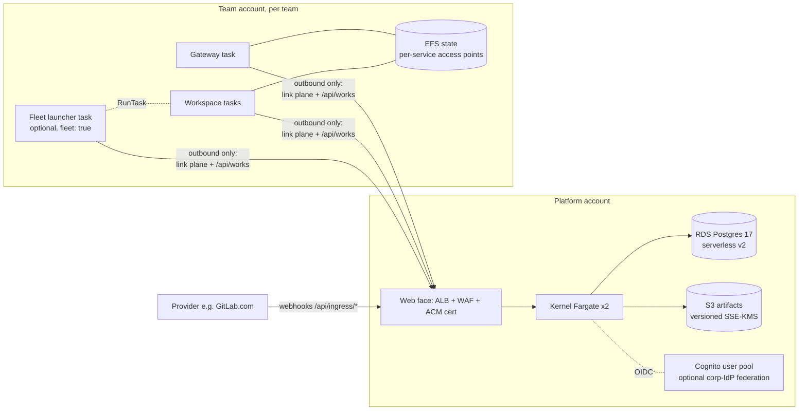

# AWS reference deployment (`examples/aws`)

A fork-me AWS deployment reference for the open-facilitator kernel, gateways,
and workspaces: one CDK v2 app (`example-aws-deploy`), one stack per workload,
driven by an env file (`envs/<name>.json`). It is an **example to copy**, not
a product: there is no live pipeline that runs `cdk deploy` anywhere — a
human runs `./deployctl deploy` with named profiles (see
[Deploy approach](#deploy-approach)).

Non-goals: EKS, multi-region, Terraform, and self-hosted forge stacks (we
never ship the platforms we interact with — GitLab.com SaaS is the example
provider below).

## Shape



Two account classes: **platform** (kernel, data, identity — everything
inbound) and **team** (gateway/workspaces/fleet launcher — everything is
outbound-only; there is no ALB and no inbound rule anywhere in a team
account). The single web face is the only door that crosses boundaries:
webhooks in, link-plane + admin/SPA out.

## Laws (invariants you must keep when you fork)

- **No deploy in CI.** `cdk deploy` appears in no pipeline; the gate is
  synth snapshots + cdk-nag (`pnpm test`) + an optional
  [LocalStack smoke](#localstack-smoke). Deploys are human-run.
- **Create-or-reference.** Company-owned things (VPC, Route53 zone, IdP
  federation) are created only when the env file has no id for them
  (`"vpc": null` ⇒ create; set ⇒ import). Local infra (RDS, S3, secrets,
  EFS) is always created here.
- **Credential chain, zero static keys.** Task roles ARE the credentials:
  the kernel's S3 store resolves the SDK default chain (task role → IMDSv2)
  when `Storage__S3__AccessKey`/`SecretKey` are unset — as a PAIR (a
  half-set pair fails closed). On AWS: `Storage__S3__Endpoint=https://s3.<region>.amazonaws.com`,
  `Storage__S3__ForcePathStyle=false`, no keys.
- **Digest-pinned images.** Every container image is a `@sha256:…` URI from
  the env file (`images.*`) — the registry is opaque (ghcr today,
  GitLab/ECR later). Same supply-chain posture as `../../reference/versions.env`.
- **The fleet launcher is non-production.** Unsupported reference code, not
  part of the supported adapter set (see its own README header).

## Stacks

|Stack|Account|What / why this service|
|---|---|---|
|`ofac-<env>-network`|platform|VPC: 2 AZs, private subnets only, NAT, gateway S3 endpoint + interface endpoints (Secrets Manager, ECR api+dkr, Logs, Cognito idp, STS). Private-only because the only public surface is the ALB. Import an existing VPC via `vpc: {vpcId, privateSubnetIds[, publicSubnetIds]}`.|
|`ofac-<env>-data`|platform|RDS Postgres 17 + artifact bucket + shared secrets. **RDS serverless v2 only** (0.5–2 ACU default props): the kernel is a low-baseline, bursty workload — provisioned instances pay for idle, Aurora bills more for the same failure model; scaling to zero isn't offered by sv2, the 0.5 ACU floor is the dev-cheap point. Secret auto-created as `facilitator/db`; storage encrypted with the `aws:rds` key (prop-able CMK); no public IP; 5432 reachable only from the kernel SG. S3: versioned + SSE-KMS + public-access-block + noncurrent-expiry lifecycle (retention GC is kernel-side, `Storage:Gc`); server-access logs to a second bucket.|
|`ofac-<env>-identity`|platform|Cognito user pool + managed login domain + `facilitator-api` resource server + SPA client (public, PKCE, no implicit) + server client (client-credentials) — the same client set as `../../reference/keycloak/realm.json`. **Cognito over Keycloak-on-ECS**: it's the AWS-native front door (ALB forward-auth speaks it natively, federation props wire a corporate OIDC/SAML IdP in), while Keycloak-on-ECS remains the 1:1 port of the reference env if you need it — run it yourself, it's not a stack here. FedCM/SPA flows ride the same OIDC surface the UI already speaks.|
|`ofac-<env>-kernel`|platform|ECS cluster + ALB web face + WAF + kernel (Fargate, `desiredCount: 2` — the two-replica shape the compose replicas overlay proves; the outbox dispatcher is a DB-lease consumer, migrations take `pg_advisory_lock`). **Fargate over EC2**: no host fleet, no docker daemon anywhere — the same reason the fleet launcher uses `ecs:RunTask` instead of the docker socket. Env reproduces `../../reference/config/facilitator.env` names 1:1 (no static S3 keys). Scaling: CPU/memory target-tracking only (60%); queue-depth autoscaling is deliberately absent — see Observability.|
|`ofac-<env>-observability`|platform|Log groups, OTLP/X-Ray policy fragments, alarms (ALB 5xx target health, outbox depth, dead-letter gauge). **ADOT collector sidecar over direct OTLP→CloudWatch**: the kernel exports OTLP/HTTP to `127.0.0.1` and the sidecar (pinned contrib image + config shipped in `lib/adot.ts`) forwards to CloudWatch/X-Ray — one vendor-neutral export path (identical to the Aspire endpoint in the reference env), one place to add processors without kernel deploys. The OTLP→CloudWatch metric namespace is ONE prop (`platform.metricNamespace`, default `facilitator`, overridable via `-c metricNamespace`) fed to both the sidecar and the alarms; the default is **unverified — confirm at first deploy**. Prop off ⇒ no sidecar container, no alarms.|
|`ofac-<env>-team-<name>-network`|team|Same private-only VPC law, no ALB — hence no public subnets needed unless you import a shared VPC.|
|`ofac-<env>-team-<name>-plane`|team|Gateway + workspace Fargate tasks, **outbound-only**: they dial `https://<kernelDomain>` over the link plane (`/api/link/v1/enroll`, `/hubs/link`), so no port is opened toward the team, ever. Link tokens arrive via task-def `secrets:` (Secrets Manager injection; re-enroll-on-401 is SDK law). State: per-team EFS (encrypted, in-transit TLS) with a POSIX-owning access point per service, mounted at the connector SQLite state path. `teams[].observability: true` adds the ADOT sidecar + a self-contained publish policy (no ref into the platform account).|
|`ofac-<env>-team-<name>-fleet`|team|**Opt-in** (`"fleet": true`): fleet launcher + its RunTask-IAM-shaped fleet. Mirrors how the compose reference env rides provisioning as an overlay. See below.|

Web-face listener rules (order matters, `lib/web-face.ts`): `10`
`/api/ingress/*` → kernel (public, WAF rate-limited); `20`
`/api/link/v1/*`, `/hubs/link`, `/events`, `/deliveries`, `/health` → kernel
(this is the link-plane door every gateway/workspace/launcher dials out to);
`100` `/api/admin/*`, `/api/works*`, `/ui-config`, `/` → kernel **behind ALB
forward-auth to Cognito** when `infraAuth` is on (default) — the SPA is
intercepted before its first script, and `infraAuth: false` skips the infra
hop because the kernel's own OIDC authorization
(`identity:authorization` bindings) still enforces underneath. Webhook and
link-plane rules are never infra-authed.

## Dev-cheap vs prod

|Knob|Dev|Prod|
|---|---|---|
|`multiAz` (RDS)|false|true (default)|
|ACU floor (`minAcu`)|0.5|raise to taste|
|`enableWaf`|false OK|true (default)|
|`infraAuth`|off — app-level OIDC only|on (default)|
|`observability` (platform, default on) / `teams[].observability` (default off)|off|on (prop)|
|`production` (env name `prod`/`staging`)|—|DeletionProtection + Retain on RDS|
|VPC / Route53 zone|created|referenced (`vpc.id`, zone pre-exists)|
|IdP|Cognito managed logins|`federation: {type: oidc\|saml, …}`|

## Bring-up order

```bash
cp envs/example.json envs/mycorp.json   # edit accounts, domains, images
./deployctl deploy --env mycorp --account platform   # network → data → identity → kernel → observability
./deployctl deploy --env mycorp --account team:team-alpha
```

`deployctl` resolves `envs/<name>.json` and names the stacks per account
class; pass explicit stack names (or `--profile`) to go narrower. Bring-up
order within an account is `network → data → identity → kernel →
observability`, then team plane, then fleet — the one-way stack graph in
`bin/app.ts` matches that order.

**Enrollment-secret hand-off** (manual by design, no rotation Lambda): the
team plane creates `facilitator/team/<name>/enrollment` with a placeholder.
A kernel admin mints a short-lived enrollment token (admin API), the
operator writes it into the team secret (`aws secretsmanager
put-secret-value`), and the workload re-enrolls on next start / next 401 —
short-lived re-enroll IS the rotation story. Same law for forge tokens and
bot creds.

**Webhooks (GitLab.com example):** point the project's push/MR hooks at
`https://<kernelDomain>/api/ingress/webhooks/gitlab` with the shared secret;
the ALB rule `10` is public and WAF rate-limited, and the HMAC check stays
adapter-side (`@ofac/provider-core` webhook receiver), so the kernel never
holds forge credentials.

## Fleet launcher (optional, non-production)

`fleet-launcher/` is a link-plane client like every other team workload: it
enrolls, publishes capabilities, and receives
`org.facilitator.command.provision.start.v1` / `.stop.v1` — then calls
`ecs:RunTask` / `StopTask` against a **static local rules file**
(`fleet-rules.json`: `workloadId → {taskDefinition, cluster, subnets?,
envAllowlist?}`). The rules file is the image-allowlist + network-pinning
analog of the oci launcher's docker-socket law; the kernel's `$NAME`
env-indirection law holds (spec values travel as `$NAME`, resolved from the
launcher's own env). The kernel never opens a connection toward the team.
`TeamFleetStack` exists only when the team entry sets `"fleet": true`; with
no launcher, the kernel records provisioning ops and sends no envelopes.

## LocalStack smoke

Local-only, no credentials, not CI:

```bash
./deployctl smoke
```

Brings up `localstack/compose.yaml` (free image, edge :4566), deploys
`ofac-smoke-network`, `-data`, `-identity` against a single fake account,
and asserts: VPC + ≥2 private subnets + endpoints, versioned bucket,
serverless-v2 DB + the DB master secret (resolved through the stack's
resource inventory — the name is env-scoped), Cognito pool + domain.
**Documented exclusions:** ALB+WAF and ECS have only partial LocalStack
coverage — those stacks are synth/snapshot-tested only, never smoke-deployed.
The smoke env sets `platform.natMode: "none"` (LocalStack 4's CFN cannot
provision a `AWS::EC2::NatGateway`: its EIP wiring hands back an unusable
allocation id), and Cognito resources are asserted as `CREATE_COMPLETE`
on the stack — LocalStack's CFN provider does not wire pools into the
cognito-idp API mock.

## Deploy approach

No live pipeline runs `cdk deploy`. Humans run `./deployctl deploy` (or bare
`pnpm exec cdk -c envFile=envs/<name>.json deploy …`) with named AWS
profiles; `--account platform|team:<name>` selects the stack set for the
credentials you have. The future path (sketched, not wired): a
GitHub-Actions-OIDC workflow assuming a per-account deploy role, calling the
same `deployctl` verbs — nothing here blocks it.

## Tests & gates

- `pnpm -C examples/aws test` — golden synth snapshots per stack, cdk-nag
  (`cdk-nag` v3, per-stack justified suppressions), and explicit behavior
  asserts: private-only Fargate placement, no `0.0.0.0/0` ingress outside
  the ALB, RDS not publicly accessible, S3 versioning + public-access-block,
  kernel task def has **no** `Storage__S3__AccessKey` and does reference the
  DB secret, ALB rule order, WAF rate rules, the sidecar's metric namespace
  matching the alarm namespace byte-for-byte, and no Cognito forward config
  when `infraAuth: false`.
- Bare `pnpm exec cdk synth -c envFile=envs/example.json` also needs no
  AWS credentials: the committed `cdk.context.json` carries the AZ lists
  for the example accounts (regenerate per real account with
  `cdk synth` once credentials exist).
- `pnpm -C examples/aws/fleet-launcher test` — mocked-ECS launcher contract
  tests (RunTask on known workloadId, `rejected` receipt on unknown).
- `./deployctl smoke` — see above.

## Cost posture per stack

network: NAT gateway dominates (~hourly) — consider the gateway-endpoint
mode for dev; data: sv2 floor 0.5 ACU ≈ a few $/day, bucket requests
negligible; identity: MAU-priced, free tier covers a team; kernel: two
~1 vCPU Fargate tasks + ALB LCUs; observability: CW logs + ingested
metrics — prop it off in dev; team plane: two-three small Fargate tasks +
EFS storage; fleet: one launcher task + whatever it launches.
