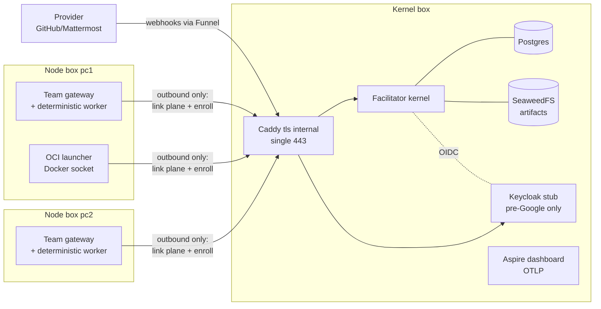

# Local home deployment (`examples/local`)

A fork-me, fully self-hosted deployment reference: the Facilitator kernel
on one box, persistent gateways + launchers on the others, no cloud
services anywhere. Like `examples/aws`, it is an **example to copy**, not
a product — but unlike the AWS example its automated gate (`make
example-local-smoke`) runs the whole topology on one host, AI-free.

Non-goals: HA/multi-replica kernel, ACME-by-default (Caddy `tls internal`
is), hosted IdP (Keycloak is the pre-Google bootstrap stub), and shipping
the platforms you talk to — GitHub/Mattermost are docs-only recipes.

## Shape



Two box classes: **kernel** (inbound surface: one Caddy 443 site + the
tailscale sidecar when that topology is chosen) and **node** (NO inbound
API surface: gateway diagnostics bind container loopback, the launcher
has no health port — only sshd for the `localctl` push and outbound
HTTPS/WebSocket). The `sim` topology collapses all boxes onto one host
with plain loopback ports — that run is the automated gate.

## Laws (invariants you must keep when you fork)

- **Outbound-only nodes.** Nothing on a node box listens inbound except
  sshd. Every link-plane leg dials out to the kernel URL.
- **Digest-or-local images.** Every image is either built from this repo
  (`"local"`) or pinned as `name@sha256:…` in the roles file. Third-party
  pins live in `versions.env` (same update law as `reference/`).
- **Rendered, not handwritten.** Every bundle file under `.out/<env>/`
  comes from `templates/` + roles + secrets + pins. Hand-editing a bundle
  is a bug; fix the template.
- **Lockfile law.** `envs/<env>.lock.json` records the resolved image
  refs; `localctl upgrade` appends `{from,to,timestamp}` entries. It is
  committed audit data (secrets never are — `secrets/` is gitignored).
- **Enrollment:** node gateways ride a **minted** token (short-lived
  until first use, then that endpoint's standing re-enroll secret until
  revoked/expired); children and launchers ride the **static**
  `Link__EnrollmentToken` (break-glass + kernel-side workload identities).

## Machine prep

**Kernel box** (any Linux + Docker Engine + compose v2):
- Outbound HTTPS (image pulls) and, for `tailscale`, the `tailscale`
  auth flow via the sidecar (`tailscale:` block, `TS_AUTHKEY` env).
- `backupPath` — a host folder outside Docker (survives `compose down -v`).

**Node box** (any Linux + Docker Engine; your user in the `docker` group
for the launcher's socket mount):
- Outbound HTTPS/WebSocket to the kernel URL. **Nothing needs to listen
  inbound** except `sshd` (for `localctl` pushes).
- LLM box = a node box + your model server answering *from* that box
  (the gateway's harness talks to your local LLM; the kernel never dials
  into a node).

**Build host** (where you run `localctl`): node ≥ 22, pnpm, Docker
(same host in sim; anywhere with ssh access otherwise).

## Bring-up order

```bash
cd examples/local
pnpm -C tools/localctl build

./localctl init --env example          # generate secrets/example.env (0600)
$EDITOR envs/example.json              # hosts, teams, images, tls, backups
./localctl render --env example        # .out/example/<box>/ bundles + lock

./localctl up kernel --env example     # kernel box: compose up (ssh push)
./localctl enroll-token --node pc1 --env example   # mint + write into bundle
./localctl up pc1 --env example        # node box: gateway + launcher
./localctl status --env example        # per-box ps + links table
```

For the single-host simulation everything is the same with
`--env sim`, plus `127.0.0.1 id.localhost` in `/etc/hosts` (the issuer
alias law — `localctl status` reminds you). `localctl down [-v]`
tears down (and sweeps kernel-provisioned worker containers; `-v` drops
volumes).

The `lan`/`tailscale` up path tars each rendered bundle and pushes it to
`sshUser@host:<remoteDir>/<env>/<box>` over ssh. A `"local"` image on a
multi-box env also pushes a `git archive` of HEAD so the box can build
(it warns); the zero-dependency path for real installs is registry
digests.

## Enrollment hand-off (static secret vs minted token)

- The kernel always keeps `Link__EnrollmentToken` (the secrets file's
  `OFAC_ENROLLMENT_TOKEN`). It is the **break-glass** line and the
  credential for kernel-side child identities (worker self-enroll, the
  OCI launcher — both enroll `role=child`, which a minted *gateway*
  token can't do).
- `localctl enroll-token --node pcN` calls `POST /api/admin/enroll-tokens`
  (admin bearer from the IdP's `facilitator-cli` client) with
  `role: gateway`, team = the node's team, TTL from
  `kernel.enrollmentTtlMinutes` (default 60 min). The literal
  (`et_…`, shown/stored once, hash-only server-side) goes into the node
  bundle's `.env` as `OFAC_ENROLL_SECRET`.
- First enroll **consumes** the token: it binds to that `endpointId` and
  becomes the standing re-enroll secret — a gateway restart rotates the
  link token by replaying it. Wrong endpoint reusing a consumed token:
  401. `localctl` won't re-render over a written secret (`up` rides the
  rendered bundles, not a fresh render).
- Revoke (`DELETE /api/admin/enroll-tokens/{id}` or the Links panel card)
  kills the token **and** the issued link enrollment immediately.
- Day one with Google: an admin (or the CLI) mints via API or the SPA's
  Links panel; the example Keycloak is only the pre-Google bootstrap IdP.

## Google OIDC (the day-one provider)

1. GCP project → OAuth consent screen → **External** → publish.
2. Credentials → OAuth client ID → **Web application**. Authorized
   redirect URI: `https://<kernelHost>/*` (sim: `http://localhost:7488/*`).
   Copy client id + secret.
3. On the kernel box, override via env (the bundle's `facilitator.env`
   rides compose's env layering; `externals` in the roles file is the
   operator's record of these values — the renderer validates it but the
   oidc switch itself is env-level):
   `identity__oidc__authority=https://accounts.google.com`,
   `identity__oidc__audience=<client id>`,
   `ui__oidcAuthority` / `ui__oidcClientId` (same config keys, `__`-joined).
4. Find your `sub`: sign in on the SPA, open devtools, decode the
   `access_token` (any JWT viewer) — then paste an admin role rule: replace the
   framework-admin rule in the rendered `facilitator.json` with
   `{"all":[{"claim":"/sub","op":"equals","value":"<your-sub>"}]}` (or
   an email-equals rule), and drop the Keycloak service. Google tokens
   carry no realm roles, so the claim-pointer rules are the whole
   authorization story.

## Webhooks: Tailscale Funnel (GitHub / Mattermost recipes)

With `tailscale.funnel: true` the sidecar exposes the single Caddy site
to the public internet at `https://<kernelHost>.ts.net` — webhooks ride
the same site block as everything else (no extra port, no port-forward).

- **GitHub:** point the repo webhook at
  `https://<kernelHost>.ts.net/api/ingress/webhooks/github`, secret =
  `externals.github.secretEnv`'s value on the *adapter* side (the kernel
  sink is signature-verified adapter-side, see
  `src/facilitator/Kernel/Integrations/WebhookIngressEndpoints.cs`).
- **Mattermost:** an Outgoing Webhook to the same path with the
  provider's own signing scheme; bot token rides
  `externals.mattermost.botTokenEnv`.

Both are **config recipes** pointing at operator-run services — this
example deploys neither adapter, and the smoke gate never touches them.

## Backup / restore

`localctl backup` writes a dated directory under `backupPath`:
`pg_dump` of the kernel DB (`facilitator.sql`), an `aws s3 sync` of the
`facilitator-artifacts` bucket, and tarballs of the aspire + caddy
volumes. The Keycloak stub is disposable: its realm file is in the
rendered bundle, so a fresh start re-imports it. The `backupPath` folder
is a host path outside Docker — it survives `docker compose down -v`.

Restore (documented steps, not automated):
1. `localctl up kernel` (fresh volumes), stop the `facilitator` service.
2. `docker compose -p ofackernel exec -T postgres psql -U home -d facilitator < facilitator.sql`
3. `aws s3 sync` the `artifacts/` dir back into the bucket; restore the
   aspire/caddy volume tarballs (when those services are enabled) into
   their named volumes.
4. `docker compose -p ofackernel up -d` the kernel box.

## Upgrade

`localctl upgrade [box]` re-resolves registry refs (`docker buildx
imagetools inspect` → fresh digests), appends the old→new diff to
`envs/<env>.lock.json`, re-renders, and rolls each box (`compose pull &&
up -d`). `"local"` images roll by rebuilding from the current checkout.
Registry unreachable → the locked digest is kept and the command warns
(sim never needs the registry at all). Bump third-party pins in
`versions.env` the same way `reference/` does: PR + a compose
verification run.

## Day-one walkthrough

1. Bring up per [Bring-up order](#bring-up-order); open
   `https://<kernelHost>/` (sim: `http://localhost:7488/`).
2. Sign in with Google (or `admin`/`admin` on the Keycloak stub before
   the switch); find your `sub`; add the admin role rule.
3. Browse the **Links** panel: your node gateways are online; the
   **Enrollment tokens** card lists what `localctl enroll-token` minted —
   mint one for a third machine from here too (copy-once warning applies).
4. Submit a work — there is **no work-submit form in the SPA yet**, so:
   ```bash
   curl -s -X POST http://localhost:7488/api/works \
     -H "Authorization: Bearer $TOKEN" -H 'content-type: application/json' \
     -d '{"objective":"summarize the garage camera notes",
          "capabilityId":"research.analyze","projectId":"<uuid>"}'
   ```
   (the `TOKEN` recipe: Keycloak `facilitator-cli` client_credentials, as
   `localctl` does; `projectId` from the admin SPA search.)
5. Watch `GET /api/works/{id}/timeline` fill up: dispatch → the
   deterministic worker completes → one result manifest.

## Tests & gates

- Unit gate (no Docker): `pnpm -C examples/local/tools/localctl test` —
  render snapshots for both topologies (sim: no caddy/tailscale, loopback
  ports, external `ofac-local` network; lan: Caddy `tls internal`;
  digest roles → bare `image:` line; missing secret names the key).
- The gate: `make example-local-smoke` from a clean tree with Docker —
  builds local images, runs the full leg table (health, seed, both
  gateways online, persistent-gateway work → manifest, elastic leg
  (scale min1 → managed container → work completes → provisioning op
  reaches `running` (the kernel vocabulary's success marker) → min0 + a
  1-minute idle-shutdown window → GC),
  zero dead letters; Aspire spans soft). NOT wired into `make test` — no
  hosted CI dependency, same posture as the
  AWS example.
- Multi-box LAN run: the same verbs against real boxes (`--env example`)
  — there is no separate command surface to drift.
