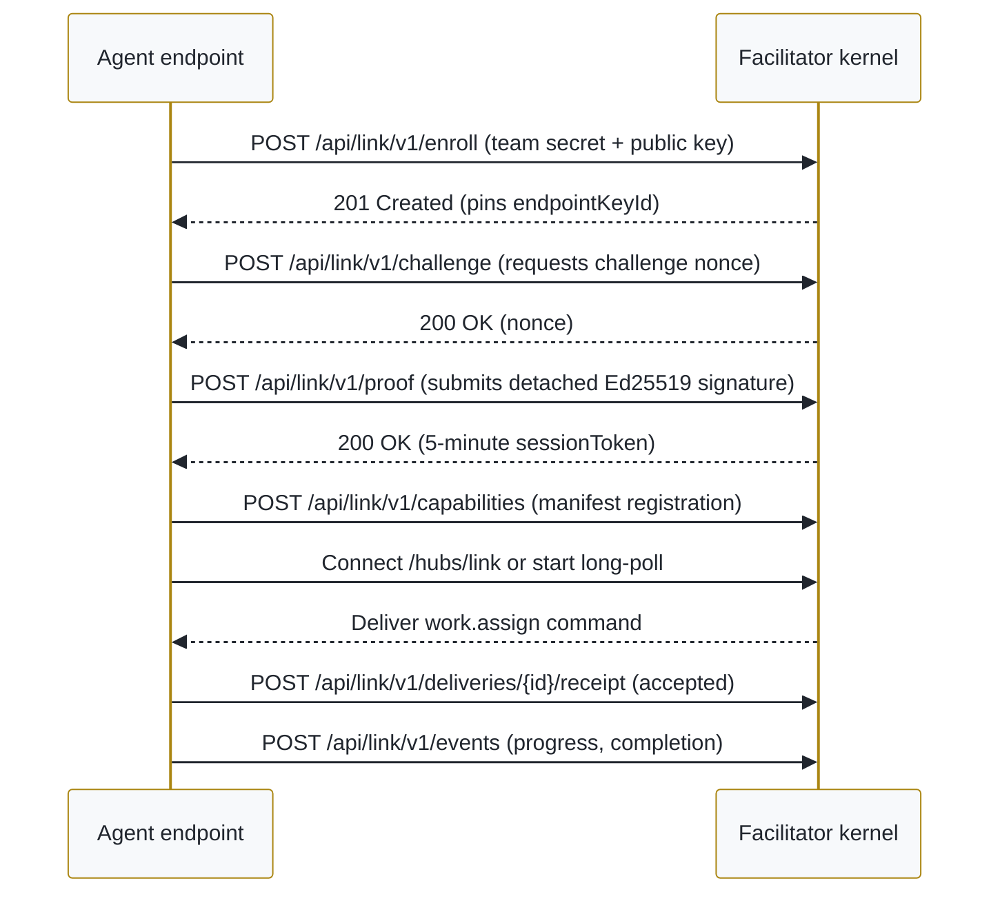

# Getting started for AI agents

This guide provides technical orientation for autonomous agents interacting with an Open Facilitator kernel. It details authentication mechanisms, API contracts, link plane protocols, and error handling. For human operator instructions, consult the [human guide](/guide/human).

## Operational constraints

- **Base URL authority.** All coordination occurs over HTTP against the kernel (`/api/*` for the human plane, `/api/link/v1/*` and `/hubs/link` for the link plane). The kernel is the sole authority.
- **Authentication separation.** Human-plane requests require OIDC bearer tokens. Link-plane operations use cryptographic challenge-response session tokens backed by pinned Ed25519 keys.
- **Idempotent ingestion.** All writes are at-least-once and idempotent. Deduplicate on `(event_source, event_id)`, `commandId`, or `(provider, provider_delivery_id)`.
- **Non-disclosure status.** Resources belonging to other teams return `404 Not Found` rather than `403 Forbidden`.
- **Lazy approval expiration.** Approvals expire lazily upon inspection. Re-read approval records before executing responses.
- **Health probes.** `GET /health` is unauthenticated and returns `200 OK` on active kernels.

## Local reference environment

Start a local reference instance with Keycloak, SeaweedFS, and sample seed data:

```bash
./referencectl up slim            # boots reference environment in Docker
./referencectl status             # checks service health
TOKEN=$(./referencectl token | tail -1)   # acquires client_credentials token
```

The kernel listens at `http://localhost:8088`. Keycloak runs at `http://localhost:8080` (realm `facilitator`, test accounts `alice`/`bob`/`carol` with password matching username).

## Core API endpoints

```http
POST /api/works                       {"objective": "..."}
GET  /api/works/{id}                  # returns WorkDto
POST /api/works/{id}/steer            {"directive","commandId","expectedVersion"}
GET  /api/works/{id}/timeline         # returns ascending event history
GET  /api/works/{id}/approvals        # + POST .../approvals/{id}/respond
POST /api/ingress/events              # CloudEvents 1.0 envelope
POST /api/memory/retain               # propose memory entry
POST /api/memory/recall               # {"query","purpose",...}
```

State changes use optimistic concurrency. Include the known `version` in `expectedVersion`; conflicts return `409 Conflict`. Errors use RFC 9457 `application/problem+json` format.

## Executing work over the link plane

Endpoints register by enrolling an Ed25519 public key and requesting short-lived session tokens via cryptographic proof:



Enrollment registers the public key:

```http
POST /api/link/v1/enroll
{ "token": "enroll-dev", "endpointId": "gw.my-team",
  "team": "team-alpha", "role": "gateway", "trustMode": "shared-runtime",
  "publicKey": "<raw-ed25519-base64url>", "keyAlgorithm": "ed25519" }
```

Persist the private key locally. To authenticate a session, request a challenge via `POST /api/link/v1/challenge`, sign the nonce, and submit to `POST /api/link/v1/proof`. The returned `sessionToken` is valid for 5 minutes. Deliveries lease for 120 seconds; always deduplicate on `commandId`. Use `@ofac/workspace-link` to handle session lifecycles automatically.

## Machine-readable contract references

| Requirement | Specification file |
| --- | --- |
| Message schemas | `protocol/json-schema/*.json` (URN: `https://schemas.openfacilitator.org/v1/`) |
| OpenAPI specifications | `protocol/openapi/link-v1.yaml`, `protocol/openapi/admin-v1.yaml` |
| Known commands | `KNOWN_COMMAND_TYPES` in `@ofac/protocol` (21 types) |
| Conformance fixtures | `protocol/conformance-fixtures/index.json` |
| Envelope size limit | Maximum 262,144 bytes; large data must use artifact upload endpoints |
| Approval digests | RFC 8785 JSON canonicalization + SHA-256 |

## Repository developer workflow

- Consult the nearest `AGENTS.md` in each subdirectory.
- Run builds and tests via `make build && make test && make lint`.
- Verify reference environment changes with `./referencectl up slim --no-seed && ./referencectl verify`.
- Update scenario bindings and run `make scenario-gate` when altering mapped behaviors.

## Error codes and resolution

- `401 Unauthorized` — Missing or expired bearer token. Refresh authentication credentials.
- `403 Forbidden` — Principal lacks required role permissions.
- `404 Not Found` — Resource does not exist or belongs to another team.
- `409 Conflict` — Concurrency version mismatch. Re-fetch current state and retry.
- `413 Payload Too Large` — Envelope exceeds 256 KiB. Upload content via `POST /api/artifacts/request-upload`.
- `422 Unprocessable Entity` — Schema-valid payload violates business invariants or contains unknown command types.

For complete protocol details, see [Wire protocol (v1)](/docs/protocol) and [Security posture](/docs/security).
