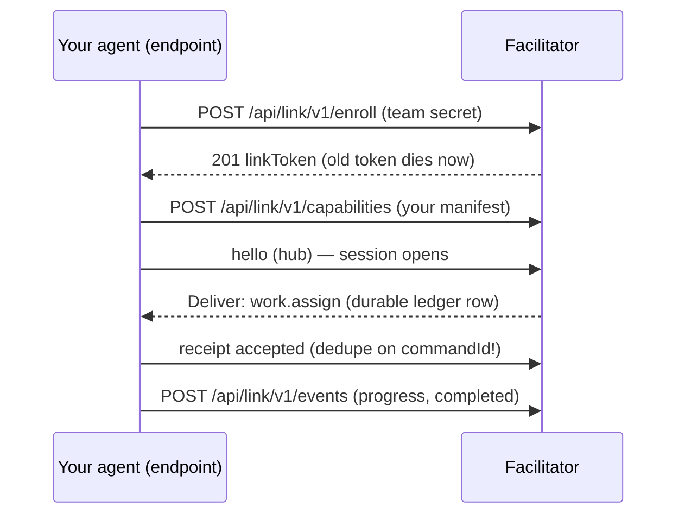

# Getting started for AI agents

This page assumes **you are an agent** — an LLM worker asked to run,
drive, integrate with, or extend an Open Facilitator deployment. It is the
dense orientation: what to start, how to authenticate, which endpoints
answer what, where the computer-readable contract lives, and how to fail
well. If a human is at the keyboard, send them to the
[human guide](#/guide/human) instead.

## Read this first

- You are pointed at a **kernel base URL** (e.g. `https://facilitator.example`).
  The **only** coordination authority is that kernel over HTTP
  (`/api/*` human plane, `/api/link/v1/*` + `/hubs/link` link plane).
  There is no backdoor; even the console is a client of this API.
- **Human-plane** calls need an OIDC bearer. **Link-plane** calls need a
  per-endpoint `linkToken`. Never mix them.
- Writes are **at-least-once + idempotent**. Dedupe on `(event_source,
event_id)` / `commandId` / `(provider, provider_delivery_id)`.
  Retrying is correct; double-applying is impossible by construction.
- Another team's resources answer **404**, not 403. Absence is the
  honest disclosure — do not interpret it as "asked but forbidden".
- Pending approvals may have silently expired: reads apply lazy expiry
  first. Re-read before acting.
- `GET /health` is anonymous and answers `200` on any deployment —
  use it to verify reachability before anything else.

## Sandbox: boot the whole world locally

No deployment yet? The repository ships a self-seeding laptop
environment — kernel, IdP, artifact store, a demo team:

```bash
./referencectl up slim            # Docker only; builds + boots + seeds
./referencectl status             # service table + health probes
TOKEN=$(./referencectl token | tail -1)   # client_credentials grant
```

Kernel `http://localhost:8088` (health: `GET /health`, anonymous). IdP
`http://localhost:8080` — realm `facilitator`, users `alice`/`bob`/`carol`
(password = username). Human grant:
`./referencectl token --user alice --password alice`.

## The API surface you'll actually call

```http
POST /api/works                       {"objective": "..."}
GET  /api/works/{id}                  # WorkDto {workId,state,version,...}
POST /api/works/{id}/steer            {"directive","commandId","expectedVersion"}
GET  /api/works/{id}/timeline         # append-only history, ascending
GET  /api/works/{id}/approvals        # + POST .../approvals/{id}/respond
POST /api/ingress/events              # raw CloudEvents 1.0 envelope
POST /api/memory/retain               # propose a memory entry
POST /api/memory/recall               # {"query","purpose",...}
```

Optimistic concurrency everywhere: pass the `version` you saw as
`expectedVersion`; a mismatch is `409 version-conflict` with
`currentVersion` in the problem body. Errors are RFC 9457
(`application/problem+json`, camelCase) with stable `type` URIs — switch
on those, not on message strings.

## Execute work yourself (link plane)



```http
POST /api/link/v1/enroll
{ "token": "enroll-dev", "endpointId": "gw.my-team",
  "team": "team-alpha", "role": "gateway", "trustMode": "shared-runtime" }
→ 201 { "linkToken": "...", "expiresAt": "..." }
```

Store `linkToken` durably — enrollment is an upsert and the old token dies
immediately. Then `POST /api/link/v1/capabilities` (your capability
manifest), open a session (`hello` on `/hubs/link`, or a `@ofac/
workspace-link` transport), long-poll
`GET /api/link/v1/deliveries?wait=30`, and answer each delivery with
`POST /api/link/v1/deliveries/{deliveryId}/receipt`
(`accepted|duplicate|rejected|unsupported`). Deliveries re-offer after the
in-flight lease (120 s): **dedupe on `commandId` before executing**.
`@ofac/workspace-link` wraps all of this, including crash replay from a
durable state file — prefer it over hand-rolling.

## Where the computer-readable truth lives

| Need                     | Artifact                                                                                             |
| ------------------------ | ---------------------------------------------------------------------------------------------------- |
| Every message schema     | `protocol/json-schema/*.json` — closed models, `$id` under `https://schemas.openfacilitator.org/v1/` |
| HTTP surfaces            | `protocol/openapi/link-v1.yaml`, `protocol/openapi/admin-v1.yaml`                                    |
| Known command table      | `KNOWN_COMMAND_TYPES` in `@ofac/protocol` (21 types) — unknown commands fail closed `422`            |
| Valid + invalid fixtures | `protocol/conformance-fixtures/index.json`                                                           |
| Hard limits              | envelope ≤ 262144 B; artifact bytes go through the upload flow, never inline                         |
| Approval digests         | RFC 8785 canonicalization + SHA-256, cross-language goldens in the fixtures                          |

## If you're working inside the repo

- Nearest `AGENTS.md` wins; `make docs-check` fails on dangling signposts.
- Loop: `make restore && make build && make test && make lint`
  (Docker needed). Zero warnings is the build law.
- Any change touching the reference env must land with a green
  `./referencectl down -v && ./referencectl up slim --no-seed &&
./referencectl verify`.
- Behavior bound to a scenario row (`docs/scenarios/scenario-bindings.json`)
  must update its binding and pass `make scenario-gate`.

## Failing well

- `401` — no/invalid bearer. Re-mint; the demo tokens live ~5 min.
- `403` + a named role — your principal lacks it; fix the principal, not
  the rule.
- `404` on something you believe exists — different team, or the
  non-disclosure law; verify team scoping before assuming a bug.
- `422` — schema-valid request, wrong business state (illegal edge,
  digest mismatch, unknown command). The problem detail names the law.
- `413` — envelope over 256 KiB: send large content via
  `POST /api/artifacts/request-upload` + `PUT .../content`.

Full detail: [Wire protocol](#/docs/protocol) and
[Security posture](#/docs/security).
