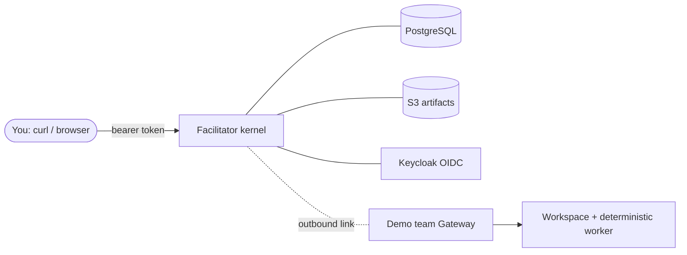

# Getting started for humans

You have a laptop, a browser, and opinions about your team's tools. Ten
minutes from now you'll have run a piece of work through Open Facilitator
end to end: created from an API call, executed by a demo workspace, gated
by an approval, delivered as an artifact you can download — and you'll have
watched it all in the admin console.

## What you'll set up

Everything runs locally in Docker. One command boots the **slim reference
environment**: the Facilitator kernel, PostgreSQL, an OIDC identity
provider (Keycloak), an S3-compatible artifact store, a telemetry
dashboard, and a demo team workspace with a deterministic worker already
attached over an outbound link.



**Prerequisites:** Docker with Compose v2 and ~4 GiB free RAM. Nothing else.

```bash
git clone https://github.com/denisekart/open-facilitator.git
cd open-facilitator
./referencectl up slim
```

Watch for every service to report healthy, then run the built-in
acceptance suite to see what the system promises:

```bash
./referencectl verify
```

Eleven steps, each one a hop of the real flow — login, work creation,
dispatch over the link, artifact storage with digest verification, an
approval that survives a kernel restart, trace correlation. Exit code 0
means every promise held.

## Run your own Work

Mint an operator token (it lives ~5 minutes — re-mint freely):

```bash
TOKEN=$(./referencectl token | tail -1)
```

Create a Work and watch it move:

```bash
WORK=$(curl -s -X POST http://localhost:8088/api/works \
  -H "Authorization: Bearer $TOKEN" -H 'content-type: application/json' \
  -d '{"objective": "survey the reference environment"}' | jq -r .workId)

watch -n2 "curl -s http://localhost:8088/api/works/$WORK/timeline \
  -H 'Authorization: Bearer $TOKEN' | jq '[.[].kind]'"
```

The timeline grows: `created`, progress notes, two `artifact.stored`
events (the worker's report + its manifest), `manifest.recorded`,
`memory.candidate`. The worker executed **in the demo workspace**, not
inside the kernel — the kernel just held the record and the wire.

## The admin console

Open `http://localhost:8088` and sign in as `alice` / `alice`. The
embedded console is the same public API with a face:

- **Search** any Work by id or word from its objective; the inspector
  shows assignments, attempts, manifests, artifacts, and the full
  timeline.
- **Links** shows which team gateways are online — and the honest
  rule: the database lease is the only authority, a stale socket means
  offline.
- **Deliveries** surfaces poison messages; replay one and try to replay
  it twice — the ledger says no.
- **Config** edits stored operator intents through versioned
  `If-Match` writes, audited with a change reason.

## See a human approval work

The demo's full-profile overlay adds a chat provider and a forge, where
privileged writes (opening a pull request) ride a **confirm** policy: the
worker asks, the kernel mints a durable approval, a human decides, the
team-side connector acts. Bring it up with `FULL=1 ./referencectl up
slim` and run `make provider-e2e` for the scripted tour — or read the
story in the [getting-started guide](#/docs/getting-started), section 10.

## Where to go next

- **You run your own workloads:** read
  [Advanced topics](#/docs/advanced) — Gateway modes, harness adapters,
  Dev Container Features (the one-step way to make a team container a
  workspace).
- **You own the wire:** [Wire protocol](#/docs/protocol) is the whole
  contract, conformance fixtures included.
- **Something hurts:** [runbooks](#/docs/runbooks).
- **Tear it down:** `./referencectl down -v`.
