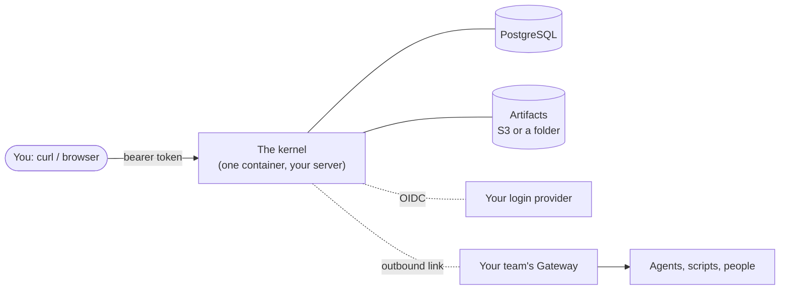
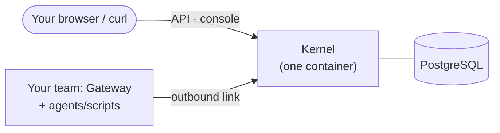

# Get running — Humans

You have a machine with Docker, a browser, and opinions about your
team's tools. This page gets you from nothing to a kernel answering
your API calls, with one Work moving through it.

Two roads, take either:

- **Road A — run the published image yourself** (10 minutes, your
  infrastructure pattern, closest to production shape).
- **Road B — the guided tour environment** (one command, boots a whole
  demo world — kernel + login provider + artifact store + a demo team —
  and proves every hop for you).



Either road ends at the same API: everything below works against both.

## Road A: your own kernel, three containers

You need PostgreSQL and a container runtime. Everything else is one
image.



```bash
docker network create ofac
docker run -d --name ofac-pg --network ofac \
  -e POSTGRES_PASSWORD=… -e POSTGRES_DB=facilitator postgres:17

docker run -d --name ofac --network ofac -p 8080:8080 \
  -e ConnectionStrings__Facilitator="Host=ofac-pg;Database=facilitator;Username=postgres;Password=…" \
  -e Link__EnrollmentToken=change-me \
  -e Storage__Provider=filesystem \
  -v $PWD/facilitator.json:/app/config/facilitator.json:ro \
  ghcr.io/denisekart/open-facilitator/facilitator:v0.1.2
```

`facilitator.json` points the kernel at your OIDC provider (the login
authority — Azure AD, Keycloak, Authelia, anything standards-compliant)
and tells it how identity claims are shaped. The kernel is fail-closed:
it refuses to start on missing or ambiguous config rather than
guessing, so this file is deliberately explicit:

```jsonc
{
  "ui": { "oidcAuthority": "https://login.example/realms/teams", "oidcClientId": "facilitator-api" },
  "identity": {
    "oidc": { "authority": "https://login.example/realms/teams", "audience": "facilitator-api" },
    "claims": {
      "subject": "/sub",
      "displayName": "/preferred_username",
      "groups": [{ "path": "/groups", "shape": "string-array" }]
    }
  },
  "Link": { "Teams": ["team-alpha"] }
}
```

When `GET http://localhost:8080/health` answers, you have a control
plane. `/` serves the admin console, `/api/*` is the whole product.

### Connect a team, run a Work

Install the Gateway wherever your agents live (it is a Node process; a
container is fine):

```bash
npm install -g @ofac/gateway
cat > gateway.yaml <<'EOF'
apiVersion: facilitator.framework/v1
kind: Gateway
gatewayId: gw.team-alpha
team: team-alpha
facilitatorUrl: http://facilitator.example:8080
enrollmentSecret: change-me
trustMode: isolated-executor
stateDir: ./.ofac-gateway
mode: standalone
children: []
EOF
ofac-gateway run --config gateway.yaml
```

The Gateway dials **out**, enrolls with the shared token, and waits for
work for its team. Now create a Work as any OIDC-authenticated user:

```bash
curl -X POST http://facilitator.example:8080/api/works \
  -H "authorization: Bearer $TOKEN" -H 'content-type: application/json' \
  -d '{"objective": "draft the billing migration plan"}'
```

Open the console, search the objective, and watch the timeline grow as
the work routes, executes, and files its evidence.

## Road B: the guided tour

If you want to see the *whole* system — kernel, login provider,
artifact store, a demo team with a worker, and an acceptance suite that
proves all eleven hops unattended — run the tour instead:

```bash
git clone https://github.com/denisekart/open-facilitator.git
cd open-facilitator
./referencectl up slim   # ~4 GiB RAM, Docker only
./referencectl verify    # proves every promise, unattended
```

It is a repository tool, not a runtime component — a permanent,
self-testing demo world on your laptop. The
[tour walkthrough](/docs/getting-started) drives it end to end: your
first Work, an approval a human decides, artifacts you download, the
console views.

## What you'll want next

- **Make a container a workspace** → add a
  [Dev Container Feature](/artifacts) to your team's `devcontainer.json`.
- **Plug in your chat/forge** → [Supported integrations](/integrations).
- **The operator surface, in depth** → [The admin console](/console).
- **Wire-level reference** → [Wire protocol](/docs/protocol).
