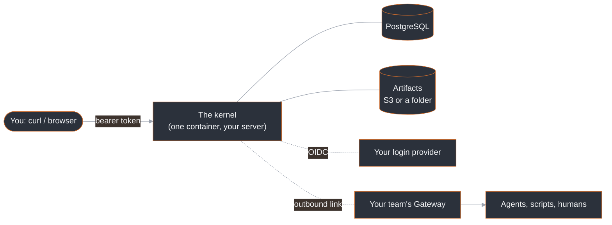

# Get running — Humans

This guide explains how to start a kernel, connect a team Gateway, and create your first Work item.

Choose between two setup methods:

- **Road A — Standalone container deployment** (10 minutes, using your infrastructure).
- **Road B — Guided reference tour** (one command, boots kernel, OIDC provider, artifact storage, and a demo team).



Both paths expose identical HTTP APIs and console interfaces.

## Road A: standalone container deployment

Deploy PostgreSQL and the Facilitator container on a shared Docker bridge network. Point the kernel at an external OIDC provider for user authentication.

```bash
docker network create ofac
docker run -d --name ofac-pg --network ofac \
  -e POSTGRES_PASSWORD=secret -e POSTGRES_DB=facilitator postgres:17

docker run -d --name ofac --network ofac -p 8080:8080 \
  -e ConnectionStrings__Facilitator="Host=ofac-pg;Database=facilitator;Username=postgres;Password=secret" \
  -e Link__EnrollmentToken=change-me \
  -e Storage__Provider=filesystem \
  -v $PWD/facilitator.json:/app/config/facilitator.json:ro \
  ghcr.io/denisekart/open-facilitator/facilitator:v0.1.2
```

Create `facilitator.json` to define OIDC authority settings and claim mappings:

```jsonc
{
  "ui": {
    "oidcAuthority": "https://login.example/realms/teams",
    "oidcClientId": "facilitator-api"
  },
  "identity": {
    "oidc": {
      "authority": "https://login.example/realms/teams",
      "audience": "facilitator-api"
    },
    "claims": {
      "subject": "/sub",
      "displayName": "/preferred_username",
      "groups": [{ "path": "/groups", "shape": "string-array" }]
    }
  },
  "Link": { "Teams": ["team-alpha"] }
}
```

Verify startup by probing `GET http://localhost:8080/health`. The root path `/` serves the console, and `/api/*` handles API requests.

### Connect a team and create a Work

Install `@ofac/gateway` on the host or container running your team's execution harnesses:

```bash
npm install -g @ofac/gateway
cat > gateway.yaml <<'EOF'
apiVersion: facilitator.framework/v1
kind: Gateway
gatewayId: gw.team-alpha
team: team-alpha
facilitatorUrl: http://localhost:8080
enrollmentSecret: change-me
trustMode: isolated-executor
stateDir: ./.ofac-gateway
mode: standalone
children: []
EOF
ofac-gateway run --config gateway.yaml
```

The Gateway connects outbound to the kernel, completes enrollment, and waits for assignments. Create a Work using an authenticated HTTP request:

```bash
curl -X POST http://localhost:8080/api/works \
  -H "authorization: Bearer $TOKEN" -H 'content-type: application/json' \
  -d '{"objective": "draft the billing migration plan"}'
```

Open the console at `http://localhost:8080`, search for the objective, and view the real-time event timeline.

## Road B: guided reference tour

To run a pre-configured environment including Keycloak, SeaweedFS, and an automated verification suite, clone the repository:

```bash
git clone https://github.com/denisekart/open-facilitator.git
cd open-facilitator
./referencectl up slim   # requires Docker Compose, ~4 GiB RAM
./referencectl verify    # executes 12 automated verification steps
```

The [guided tour walkthrough](/docs/getting-started) demonstrates token acquisition, work creation, human approvals, and artifact downloads.

## Where to go next

- Add linked workspace features to containers: [Dev Container Features](/artifacts).
- Configure chat and forge integrations: [Supported integrations](/integrations).
- Explore operator surfaces and audit logs: [The admin console](/console).
- Inspect the wire protocol specification: [Wire protocol (v1)](/docs/protocol).
