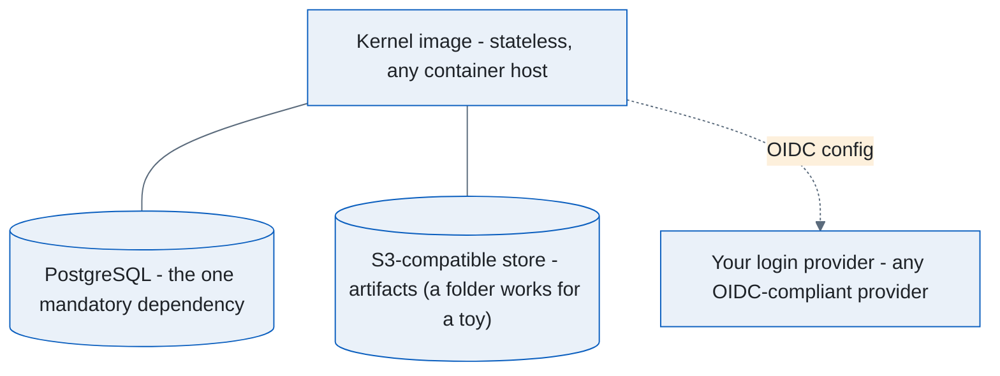

# Artifacts & installation

Open Facilitator installs from published artifacts only: one kernel
container image, a set of npm packages for the team side, and Dev
Container Features that turn a container you already have into a linked
workspace. Every one is versioned on a public registry — no source builds,
no registry login for the base image stream.

## The kernel image

```bash
docker pull ghcr.io/denisekart/open-facilitator/facilitator:v0.1.2
```

One stateless container, multi-architecture (amd64 + arm64), tagged per
release and pinned by digest in every release's provenance. It needs
three things to start, all injected as configuration — and it is
deliberately fail-closed: missing or ambiguous config stops startup with
a readable error instead of guessing defaults:

| Needs                        | How                                                                                                   |
| ---------------------------- | ----------------------------------------------------------------------------------------------------- |
| PostgreSQL                   | `ConnectionStrings__Facilitator` — schema migrations run at startup                                   |
| An OIDC provider             | config file block: authority, audience, and the claim mapping your provider emits                     |
| S3-compatible object storage | `Storage__S3__*` env block (`Storage__Provider=filesystem` + `Storage:FileSystem:RootPath` for a toy) |

Those three are the whole neighbourhood — drawn once, so you can see what
you are responsible for operating:



_The one claim: the kernel keeps no state of its own, so the three things
beside it are all commodities you already run — PostgreSQL mandatory, the
object store for artifact bytes, the login provider for identity — and the
kernel itself can be replaced or multiplied freely._

```bash
docker run -d -p 8080:8080 \
  -e ConnectionStrings__Facilitator="Host=db;Database=facilitator;Username=ofac;Password=…" \
  -e Storage__Provider=s3 \
  -e Storage__S3__Endpoint=https://s3.example \
  -e Storage__S3__Bucket=facilitator \
  -e Storage__S3__AccessKey=… -e Storage__S3__SecretKey=… \
  -v $PWD/facilitator.json:/app/config/facilitator.json:ro \
  ghcr.io/denisekart/open-facilitator/facilitator:v0.1.2
```

Serving that URL is your whole control plane: the console and the API
share the origin. Scale by running more copies against the same
PostgreSQL — the coordination is in the database, not in the process.

## Node packages (team side)

From the `@ofac` scope on npm:

| Package                                                                         | What you get                                                                |
| ------------------------------------------------------------------------------- | --------------------------------------------------------------------------- |
| `@ofac/gateway`                                                                 | the Gateway runtime (`ofac-gateway`) — one process, many workspaces         |
| `@ofac/workspace-link`                                                          | Link SDK + `ofac-linkd` supervisor for custom runtimes                      |
| `@ofac/protocol`                                                                | typed contract: envelope builders + schema validators for your own services |
| `@ofac/adapter`                                                                 | harness-adapter SDK + conformance kit                                       |
| `@ofac/provider-core`                                                           | shared scaffolding for a provider pair of your own                           |
| `@ofac/harness-omp`, `@ofac/harness-codex`                                                        | ready-made harnesses                                                        |
| `@ofac/mattermost-adapter`, `@ofac/telegram-adapter`                            | chat provider services                                                      |
| `@ofac/github-adapter` + `@ofac/github-connector` (and `forgejo-*`, `gitlab-*`) | forge pairs: inbound normalization + approval-gated outbound writes         |
| `@ofac/provisioning-oci`                                                        | workspace-provisioning launcher                                             |

Everything is public: `npm install` works anywhere, without registry
auth. Pin the version you consume; upgrades are your decision.

## Dev Container Features

Turn any team container into a linked workspace with one line of
`devcontainer.json` — OCI images on the same GHCR namespace, semver
tagged plus a major alias (`:1.0.0` and `:1` today):

```jsonc
"features": {
  "ghcr.io/denisekart/open-facilitator/features/gateway:1": {},
  "ghcr.io/denisekart/open-facilitator/features/workspace-link:1": {},
  "ghcr.io/denisekart/open-facilitator/features/harness-adapter:1": {}
}
```

Available features: `gateway`, `workspace-link`, `harness-adapter`,
`omp-adapter`, `codex-adapter`, `forgejo-provider` — composable, each
idempotent, supervised with crash-restart by the feature supervisor.

## The team-side runtime base

`ghcr.io/denisekart/open-facilitator/node-runtime` carries every
team-side process — Gateway, the `ofac-linkd` supervisor, the
deterministic worker, the chat and forge adapters, the provisioning
launcher — in one image, selected by the command you start it with. Using
it as the base for a team image is convenience, not coupling: anything
that speaks the wire works, including your own build.

## Release discipline you can rely on

- Every release cuts from a tag, builds multi-arch (amd64 + arm64), and
  attaches a CycloneDX SBOM for both halves of the system.
- Third-party base images are digest-pinned by the pipeline.
- The wire contract is versioned in its schema names
  (`org.facilitator.*.v1`): breaking changes get a new version segment,
  never a silent edit — two independent implementations must pass the
  same conformance fixtures before a change lands.
- What gates a release is the same twelve-leg acceptance run you can run
  yourself against the [guided tour](/docs/getting-started).

## Current release

The pipeline publishes on every version tag: multi-arch images and
semver-tagged features, `latest` tracking the newest release. The current
release line is `v0.1.2` — pin a tag or a digest, never `latest`, in
anything you operate.

## Where to go next

- Start the pulled image against your own PostgreSQL: [Get running](/guide/human).
- See what each piece talks to: [Explore the architecture](/architecture).
- Write the package the coordinates do not cover: [Extend it yourself](/extend).
