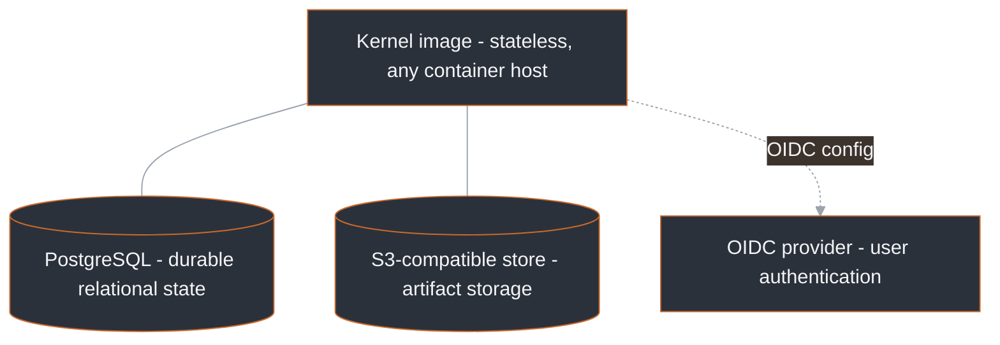

# Artifacts and installation

Open Facilitator distributes as published artifacts: one kernel container image, team-side npm packages, and Dev Container Features. Every component is versioned on public registries, requiring no private registry credentials or local source compilation.

## Kernel container image

```bash
docker pull ghcr.io/denisekart/open-facilitator/facilitator:v0.1.2
```

The kernel image is stateless and multi-architecture (amd64 and arm64). Each release is tagged by semantic version and pinned by digest in the release manifest. The kernel requires three configuration sources and fails closed if configuration is missing or invalid:

| Requirement | Configuration |
| --- | --- |
| PostgreSQL | `ConnectionStrings__Facilitator` (migrations execute automatically on startup) |
| OIDC provider | Configuration file block defining authority, audience, and claim mappings |
| S3-compatible storage | `Storage__S3__*` environment variables (or `Storage__Provider=filesystem` for local testing) |

The diagram below illustrates the required infrastructure components:



_The kernel holds no local state. Relational state resides in PostgreSQL, artifact binaries in object storage, and identities in your OIDC provider._

```bash
docker run -d -p 8080:8080 \
  -e ConnectionStrings__Facilitator="Host=db;Database=facilitator;Username=ofac;Password=secret" \
  -e Storage__Provider=s3 \
  -e Storage__S3__Endpoint=https://s3.example \
  -e Storage__S3__Bucket=facilitator \
  -e Storage__S3__AccessKey=minioadmin -e Storage__S3__SecretKey=minioadmin \
  -v $PWD/facilitator.json:/app/config/facilitator.json:ro \
  ghcr.io/denisekart/open-facilitator/facilitator:v0.1.2
```

The container serves both the admin console and the HTTP API from a single origin. Scale horizontally by running additional replicas against the shared PostgreSQL database.

## Team-side Node packages

The `@ofac` scope on npm publishes the following packages:

| Package | Function |
| --- | --- |
| `@ofac/gateway` | The Gateway runtime (`ofac-gateway`) multiplexing child workspaces. |
| `@ofac/workspace-link` | Link SDK and `ofac-linkd` supervisor daemon. |
| `@ofac/protocol` | Typed TypeScript models, envelope builders, and schema validators. |
| `@ofac/adapter` | Harness adapter SDK and automated conformance test kit. |
| `@ofac/provider-core` | Shared scaffolding for building custom chat and forge integrations. |
| `@ofac/harness-omp`, `@ofac/harness-codex` | Shipped execution harnesses for oh-my-pi and Codex agents. |
| `@ofac/mattermost-adapter`, `@ofac/telegram-adapter` | Chat provider adapter services. |
| `@ofac/github-adapter`, `@ofac/forgejo-adapter`, `@ofac/gitlab-adapter` | Forge adapters with paired outbound write connectors. |
| `@ofac/provisioning-oci` | Dynamic workspace provisioning service for container engines. |

All npm packages are public and require no registry authentication.

## Dev Container Features

Add features to your team's `devcontainer.json` to link development containers to the coordination plane:

```jsonc
"features": {
  "ghcr.io/denisekart/open-facilitator/features/gateway:1": {},
  "ghcr.io/denisekart/open-facilitator/features/workspace-link:1": {},
  "ghcr.io/denisekart/open-facilitator/features/harness-adapter:1": {}
}
```

Available features: `gateway`, `workspace-link`, `harness-adapter`, `omp-adapter`, `codex-adapter`, and `forgejo-provider`. Each feature includes supervision and automatic crash recovery.

## Team runtime base image

The image `ghcr.io/denisekart/open-facilitator/node-runtime` packages all team-side components in one container: Gateway, `ofac-linkd`, the CLI harness, chat/forge adapters, and the provisioning service. The command argument selects the active component.

## Release discipline

- Every release originates from a signed Git tag and builds multi-architecture binaries (amd64 and arm64) with CycloneDX SBOMs.
- Upstream base images are digest-pinned in build workflows.
- Wire schemas use explicit version namespaces (`org.facilitator.*.v1`). Breaking changes increment the version segment.
- Releases require passing the 12-leg automated acceptance suite used in the reference environment.

## Release pinning

Releases publish on version tags with major and minor aliases. The current release line is `v0.1.2`. Always pin immutable release tags or SHA-256 digests in production deployments.

## Where to go next

- Deploy the kernel container: [Get running (humans)](/guide/human).
- Review architectural boundaries: [Explore the architecture](/architecture).
- Build a custom harness or provider: [Extend it yourself](/extend).
