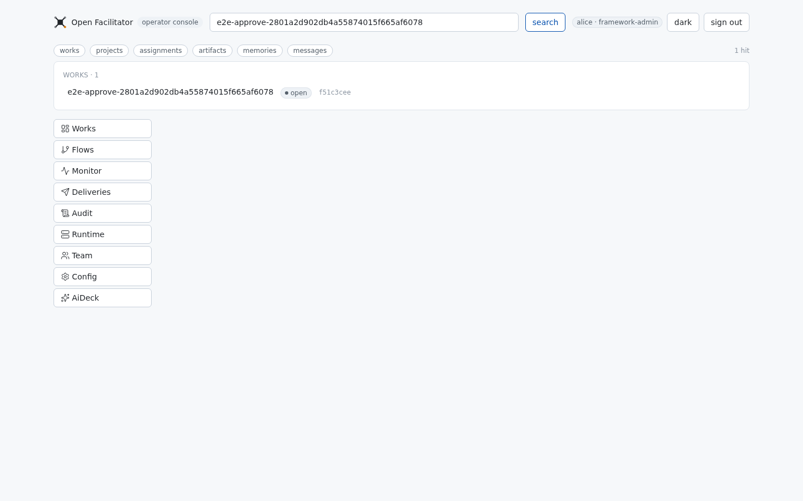
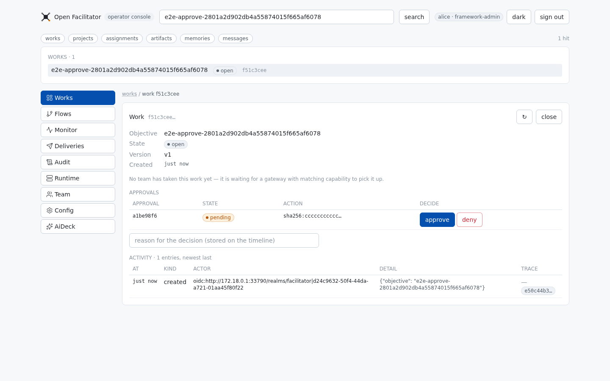

# The admin console

The console provides the operational interface built into the kernel. It is served directly from the kernel origin, requiring no separate deployment or database. The console operates as a client of the public HTTP API, ensuring that every view and action matches the programmatic API.

Access is controlled via OIDC authentication: any identity from your configured identity provider with an operator role can sign in.

Every view maps to a bookmarkable URL. `#/works?state=blocked,review` opens the pre-filtered triage queue, `#/work/<id>` opens a Work inspector, and `#/audit?correlation=<id>` opens the exact decision trail for a timeline entry.

## Search and Work inspection

Search covers works, projects, assignments, artifacts, and memories. Correlation identifiers serve as direct lookup keys: pasting a trace identifier from a timeline badge or audit record immediately surfaces the corresponding Work.

Opening a Work provides the complete inspector: assignment history with fencing generations, pending and resolved approvals, result manifests, and an append-only event timeline detailing actors, timestamps, and payloads.

_Search for an objective, identifier, or keyword to open matching records. Every view in the console has a bookmarkable URL._

_The Work inspector displays timeline events, approver assignments, and state transitions. Actions taken in the UI execute standard audited API writes._

## Console navigation surfaces

The navigation menu provides access to nine operational areas:

- **Activities** — The active queue (code: `works`), sorted newest first, filterable by state. Team-scoped operators see only activities belonging to their assigned teams.
- **Flows** — The workflow plane. Displays active, shadow, and inactive definitions alongside visual execution graphs and step-level retry controls.
- **Monitor** — Real-time workflow instances, replica status, queue depth, and link health based on active database leases.
- **Deliveries** — The outbound delivery ledger tracking dispatched messages, acknowledgments, poison queues, and retry attempts.
- **Audit** — The decision record, filterable by allow/deny outcomes, actors, actions, and correlation identifiers, with CSV export.
- **Runtime** — Active replica nodes, provisioning records, and manual sweeper triggers requiring mandatory change reasons.
- **Team** — Connected team Gateways displaying endpoint identifiers, session durations, last acknowledged sequence numbers, and revocation controls.
- **Config** — Runtime routing policies and media rules edited via optimistic concurrency (`If-Match`) with required audit reasons.
- **Assistant** — An operator assistant drawer. Queries live state using the operator's permissions and presents structured proposals for human confirmation.

## What the console is not

The console is an operational control panel, not a general-purpose dashboard builder. It contains no custom widgets or speculative analytics pipelines. All counters, summaries, and timelines reflect standard API queries. For custom analytics and metrics, query the underlying PostgreSQL database or export metrics via OTLP to external dashboards.

## Where to go next

- Run the console in the demo environment: [Guided tour](/docs/getting-started).
- Configure automated workflows: [Authoring flows](/workflows).
- Inspect external adapters feeding the console: [Supported integrations](/integrations).
- Deploy the kernel and access the console: [Get running (humans)](/guide/human).
