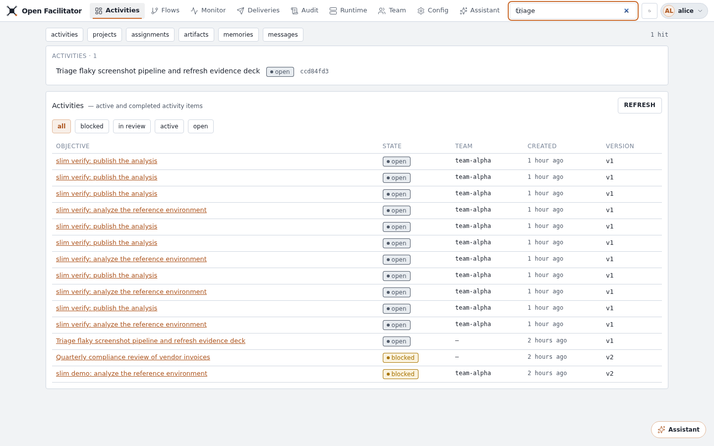
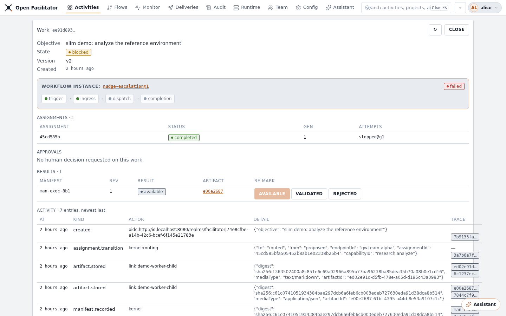
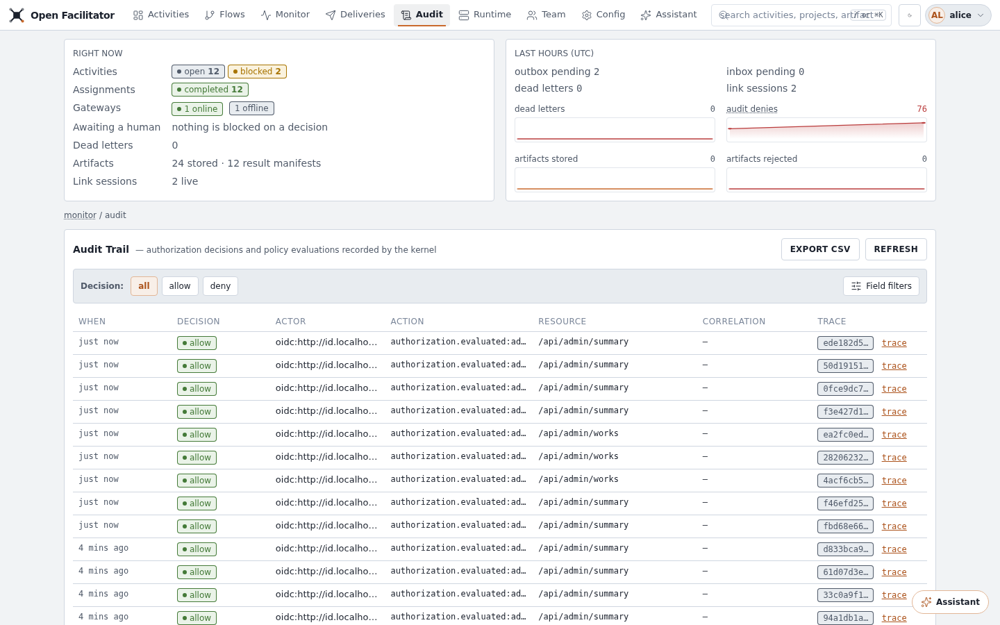
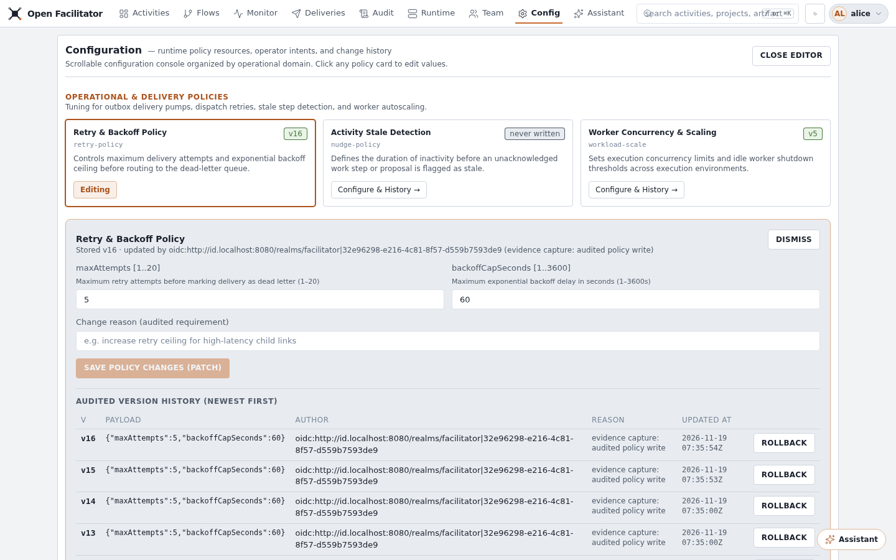
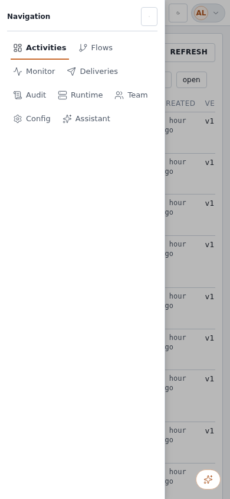
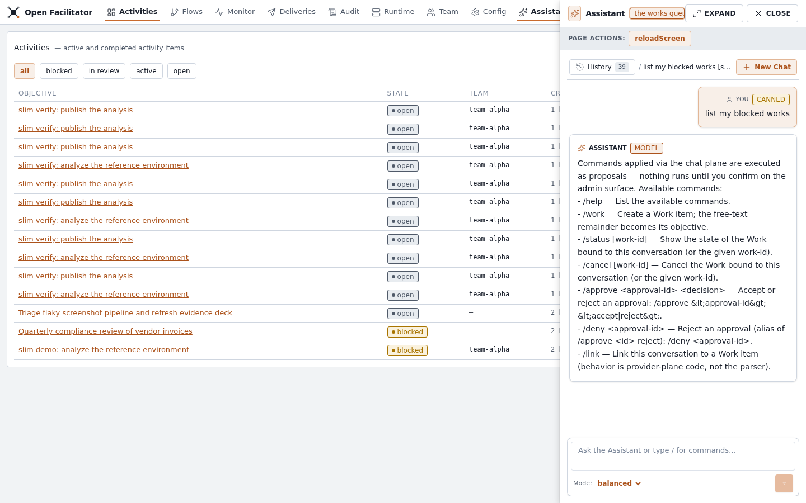

# The admin console

The console provides the operational interface built into the kernel. It is served directly from the kernel origin, requiring no separate deployment or database. The console operates as a client of the public HTTP API, ensuring that every view and action matches the programmatic API.

Access is controlled via OIDC authentication: any identity from your configured identity provider with an operator role can sign in. Identities without mutate rights see the same surfaces read-only — action controls are hidden, not merely denied.

Every view maps to a bookmarkable URL. `#/works?state=blocked,review` opens the pre-filtered triage queue, `#/work/<id>` opens a Work inspector, and `#/monitor/audit?correlation=<id>` opens the exact decision trail for a timeline entry.

## Search and Work inspection

Search covers six sections — works, projects, assignments, artifacts, memories, and messages — each independently bounded. Correlation identifiers serve as direct lookup keys: pasting a trace identifier from a timeline badge or audit record immediately surfaces the corresponding Work.

Opening a Work provides the complete inspector: assignment history with fencing generations, pending and resolved approvals, result manifests, triggered-flow strips, and an append-only event timeline detailing actors, timestamps, and payloads.

_Search for an objective, identifier, or keyword; hits are grouped by section. Every view in the console has a bookmarkable URL._

_The Work inspector displays timeline events, approver assignments, and state transitions. Actions taken in the UI execute standard audited API writes._

## Console navigation surfaces

The navigation menu provides access to nine operational areas:

- **Activities** — The active queue (`#/works`), sorted newest first, filterable by state. Team-scoped operators see only activities belonging to their assigned teams.
- **Flows** — The workflow plane (`#/flows`, definitions at `#/monitor/definitions/<id>`). Displays active, shadow, and inactive definitions alongside visual execution graphs, definition history, and per-step retry and skip controls on running instances.
- **Monitor** — Workflow instances at `#/monitor/runs`, with a per-run detail view showing the step log, timings, and pause/resume, retry-step, and skip-step operator actions.
- **Deliveries** — The outbound delivery ledger at `#/monitor/deliveries`: dispatched messages with state filters, and single-use dead-letter replay carrying a mandatory change reason.
- **Audit** — The decision record at `#/monitor/audit`, filterable by allow/deny outcomes, actors, actions, and correlation identifiers, with CSV export.
- **Runtime** — Active replica nodes, provisioning records, and manual sweeper triggers at `#/monitor/runtime`, each requiring a mandatory change reason.
- **Team** — Connected team Gateways displaying endpoint identifiers, session durations, last acknowledged sequence numbers, and revocation controls (`#/team`), plus enrollment tokens for onboarding new workspaces.
- **Config** — Runtime configuration resources edited at `#/config` via optimistic concurrency (`If-Match`) with a mandatory change reason (`X-Change-Reason`). Every resource keeps a bounded version history you can inspect and roll back from, one rollback at a time, each with its own reason.
- **Assistant** — An operator assistant drawer, available to identities with the chat role. See below.

_Every authorization decision — allow or deny — with actor, action, and correlation identifier. Filter, then export._

_A config resource edit in flight: the form requires a change reason, and the history panel lists prior versions with a rollback action._

_On a phone the nine surfaces collapse into a drawer; the console is touch-sized down to 390px._

## The Assistant

The Assistant is the AI drawer docked to any screen. It answers questions from live kernel state using the operator's own permissions — it never sees more than the console does — and presents proposed mutations as structured actions that execute only after you confirm them (`POST /api/chat/actions/<id>/confirm`, or cancel).

- **Slash-verbs** seed the common moves: `/help`, `/work <objective>`, `/status`, `/cancel`, `/approve <id> <accept|reject>`, `/deny <id>`, `/link`. Operators can register additional verbs through the `commands` config resource.
- **Verbosity** is a per-session setting: `terse`, `balanced`, or `proactive`.
- **Page awareness**: each screen registers a context (its route and the ids on it), so "what is this run doing?" means the run you are looking at — and screens can offer the Assistant live actions such as opening a record.
- **Session history** persists: past conversations stay listable and resumable.

_The Assistant answers from live state, bounded by the operator's own role grants._

## What the console is not

The console is an operational control panel, not a general-purpose dashboard builder. It contains no custom widgets or speculative analytics pipelines. All counters, summaries, and timelines reflect standard API queries. For custom analytics and metrics, query the underlying PostgreSQL database or export metrics via OTLP to external dashboards.

## Where to go next

- Run the console in the demo environment: [Guided tour](/docs/getting-started).
- Configure automated workflows: [Authoring flows](/workflows).
- The console as an API surface: [The operator console reference](/docs/console).
- Inspect external adapters feeding the console: [Supported integrations](/integrations).
- Deploy the kernel and access the console: [Get running (humans)](/guide/human).
