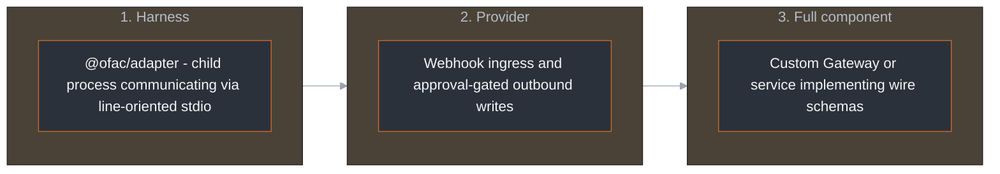

# Extend it yourself

You can extend any part of the system. First-party and third-party components operate against the same published wire contract.

## Three extension seams

Extension points vary by operational responsibility:

_Moving from left to right increases control over the runtime environment while reducing dependencies on shipped packages._

### 1. Write a harness

A harness executes assigned work. Shipped harnesses support LLM agents, deterministic scripts, and coding tools. Custom harnesses can wrap data pipelines, batch jobs, or manual checklists.

- Depend on `@ofac/adapter` to implement the child lifecycle: accept, report progress, propose privileged writes, and return result manifests.
- Use the included **conformance kit** to validate that your harness passes the same test suite as shipped implementations.
- Write in any programming language using standard line-oriented JSON over stdin and stdout.

### 2. Write a provider

A provider adapter normalizes external webhooks into standard CloudEvents. A paired connector executes privileged outbound writes under human approval policy.

The `@ofac/provider-core` package provides shared utilities for cryptographic signature verification, cursor management, idempotent admission, and approval callbacks. Use providers to integrate ticketing systems, custom chat platforms, and internal developer tools.

### 3. Implement a whole component

Because the protocol is open, you can replace any system component:

- **Custom Gateway.** Implement the Link protocol (enrollment, challenge-response auth, ledger acknowledgments, and capability advertisement) against published JSON Schemas.
- **Custom kernel services.** Build custom ingress or coordination services targeting the OpenAPI 3.1 and JSON Schema specifications.
- **Custom consoles and tools.** The console is a client of the public HTTP API. Custom dashboards and CLI tools consume the same endpoints.

## Contract guarantees

- **Explicit versioning.** Event type names include explicit version segments (`org.facilitator.event.work.progress.v1`). Breaking changes introduce new types without altering existing schemas.
- **Conformance fixtures.** Protocol changes include cross-language JSON fixtures verified across multiple independent stacks.
- **Explicit security boundaries.** Adapters and harnesses document token scopes, required network egress, and emitted events for security review.

## Where to go next

- Review message envelope schemas: [Wire protocol (v1)](/docs/protocol).
- Explore advanced Gateway patterns and memory brokers: [Advanced topics](/docs/advanced).
- Inspect authentication and approval lifecycle rules: [Security posture](/docs/security).
- Review published package coordinates: [Artifacts & installation](/artifacts).
