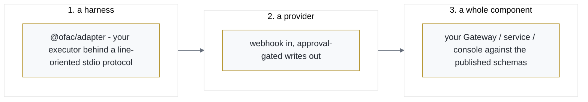

# Extend it yourself

You can write your own piece of this system: the components that ship are
built on a published contract, and that contract is the same one handed to
you. Nothing a first-party package can do is closed to an outside one.

## Three ways to extend, cheapest first

The three seams differ in how much of the system you take responsibility
for, not in how much authority you get:

_Left to right, the surface you own grows and the parts you depend on
shrink: a harness is a child process the shipped Gateway spawns, a
provider is a service you run beside it, a component replaces one of them
entirely — and all three are judged by the same published contract._

### 1. Write a harness (execute work your way)

A harness is the component that receives an assignment and does it. The
shipped ones drive LLM agents, deterministic scripts, and coding agents;
yours might drive a data pipeline, a RPA bot, or a human checklist.

- Depend on `@ofac/adapter` — the SDK defines the child-protocol:
  accept, progress, propose (optional privileged writes), complete with
  a result manifest.
- The **conformance kit** in the same package runs the exact suite the
  shipped harnesses run. Green means the kernel, the Gateway, and every
  runbook treat your harness as first-class.
- Your harness can be any language: the child protocol is line-oriented
  JSON over stdio.

### 2. Write a provider (connect a new system of record)

A provider adapter normalizes some external system's webhooks into the
published event types; a connector performs privileged outbound writes
under approval policy. Provider-core carries the shared scaffolding:
signature envelopes, cursorization, idempotent admission, the
connector's approval roundtrip. Chat platforms, ticket systems, CRMs,
home-grown internal tools — if it can post a webhook, it can feed
Works; if it has an API, its writes can ride approvals.

### 3. Implement a whole component (own a side of the wire)

Because the wire is the product, you can replace any side:

- **A Gateway in another language** — implement the Link protocol
  (enroll, connect, acknowledge-by-cursor, dispatch, ledger) against
  the published schemas. The conformance fixtures are the spec;
  `@ofac/protocol` mirrors them for typed builders and validators.
- **Your own kernel-compatible service** — the admin API, ingress, and
  link transport are fully specified (OpenAPI 3.1 + JSON Schema). The
  two implementations that exist today already interoperate only
  through that contract.
- **Your own console or bot** — the console is just a client of the
  public API. Anything it shows, your tooling can query.

## What makes this tractable

- **The version is in the name.** Event type names carry their version
  (`org.facilitator.event.work.progress.v1`). Compatible changes add
  fields; breaking ones get a new version segment and the old name keeps
  its meaning, so an adapter holds its ground across kernel upgrades.
- **Fixtures, not assertions.** Every protocol change ships with
  cross-language conformance fixtures that two independent stacks
  parse and emit identically. “It works against my kernel” is not a
  claim you have to take on faith.
- **Security posture per adapter.** Each connector and harness ships a
  short statement of which tokens it holds, which network directions
  it needs, and which events it can cause — so adding an integration
  is a reviewable decision, not a black box.

## Where to go next

- The grammar your piece must satisfy: [Wire protocol (v1)](/docs/protocol) —
  envelopes, type registry, ingress, link transport.
- Gateway modes, the full HarnessAdapter contract, provider plumbing, the
  memory broker: [Advanced topics](/docs/advanced).
- The rules your piece must respect (identities, gates, approval
  lifecycle, team-side policy): [Security posture](/docs/security).
- Where your piece sits among the shipped ones:
  [Explore the architecture](/architecture), and the coordinates you
  publish beside: [Artifacts & installation](/artifacts).
