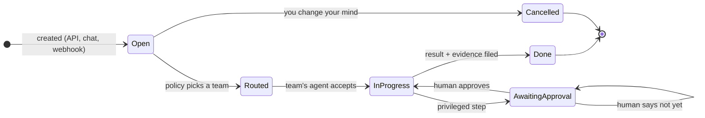
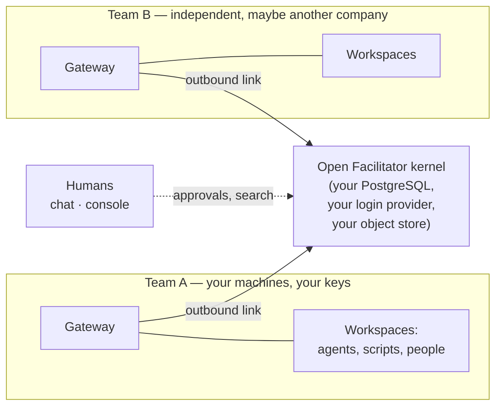

# What Open Facilitator is

You run work with a mix of AI agents, people, and scripts. Some of that
work matters enough to audit, to approve, to hand over a wall between
teams, or to still understand in six months. Open Facilitator is the
durable record and coordinator for exactly that work — and nothing else.

## The object at the center: a Work

A **Work** is one piece of work with a life of its own: an objective, a
state, a timeline of everything that happened to it, and the evidence it
produced. You create one with a single API call (or from a chat message),
and from that moment it survives every process, container, and model
involved in doing it.

Move the mouse over any node above to see what it guarantees.

## The cast, and who holds what

Three roles, each with exactly one job:

- **The kernel** coordinates and remembers. It holds the work queue, the
  routing decisions, the approvals, the artifact ledger. It never
  executes anything and holds none of your credentials.
- **Teams** execute. Each team runs a small **Gateway** on its own
  machines, holding its own source checkouts, API keys, and model
  access. It keeps its own ledger of what it was told and what it did.
- **You** decide. Wherever a gate is configured, the work pauses and a
  human — through chat or the console — makes the call. Gates are
  durable: they survive kernel restarts and fire exactly once.

Information always flows the same way: your team dials **out** to the
kernel. Nothing on a team's network is exposed to the kernel, to other
teams, or to the internet.

## What makes it different from a task queue or a workflow engine

- **The workers are agents with opinions.** A Workflow engine assumes
  steps are known. Here, an agent decides *how* to do the assignment,
  and the framework only insists on the contract: accept, progress,
  propose, deliver — every step recorded.
- **Federated, not centralized.** Every team is a separate authority
  with its own policy and its own ledger. The kernel cannot reach into
  a team's machine; a team cannot forge another team's history.
- **Evidence is the product.** Each Work accumulates digest-verified
  artifacts, a complete audit timeline, and optional shared memories.
  "Who did what, when, and who allowed it" is a query, not an
  investigation.
- **It is a protocol first.** The whole coordination is a published
  wire contract — event envelopes, schemas, HTTP surfaces — that two
  independent runtime implementations already satisfy. You are never
  trapped inside one implementation of the idea.

## What it is not

- **Not an agent framework inside your process.** It coordinates across
  processes and organizational boundaries, not within one agent loop.
- **Not a chat product, a forge, or a model gateway.** It plugs into
  the chat and forge you already use; it never proxies your model
  traffic.
- **Not a managed service.** You deploy the published image on
  infrastructure you already run; your database is your data.

## Where to go next

- See the pieces you install: [Artifacts & installation](/artifacts).
- See what plugs in today: [Supported integrations](/integrations).
- Look at the operator surface: [The admin console](/console).
- Or stop reading and [get running](/guide/human).
