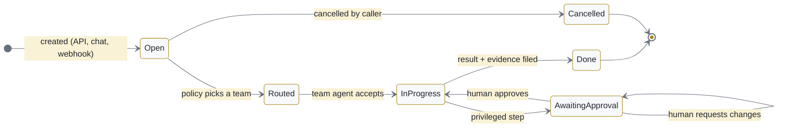

# What Open Facilitator is

Open Facilitator coordinates and records work shared across AI agents, humans, and deterministic scripts. It tracks who owns an objective, what progress occurred, what approvals were granted, and what evidence was produced. The kernel executes no workload and holds no credentials. It manages the work that requires auditability, governance, cross-team handoffs, and long-term durability.

## System at a glance

One map shows every moving part, grouped by operational boundary. Click any node to inspect its guarantees, or run a guided scenario to follow data flow step by step.

```archmap

```

Communication across team boundaries uses outbound links and normalized events. The kernel cannot reach into a team environment, and teams cannot alter another team's ledger. Every team retains complete operational control over its own infrastructure.

## The object at the center: a Work

A Work represents a durable objective with a defined lifecycle. It tracks current state, an append-only timeline of events, and references to produced artifacts. You create a Work through an API call or chat event. Once created, the record survives container restarts, network partitions, and process crashes.



Hover any node above to inspect its guarantees.

## System actors and responsibilities

Three roles operate within the framework, each with a single responsibility:

- **The kernel** coordinates and records. It maintains the work queue, routing policy, approval state, and artifact ledger. It executes no code and holds no team credentials.
- **Teams** execute. Each team runs a Gateway within its own environment, managing source repositories, API keys, and model access. The Gateway records assignments and status in a local ledger.
- **Humans** decide. When policy requires approval, execution pauses until an operator decides through chat or the console. Approvals are durable records that survive kernel restarts and fire once.

Network connections flow outbound from the team Gateway to the kernel. No team port or endpoint is exposed to the kernel, external teams, or the public internet.

```mermaid title="One assignment, hop by hop — every arrow outbound from the team"
%%{init: {"theme": "base", "themeVariables": {"primaryColor": "#f7f9fb", "primaryBorderColor": "#ab8612", "primaryTextColor": "#21262e", "lineColor": "#676f7c", "secondaryColor": "#faf2d6"}}}%%
sequenceDiagram
    actor H as Human
    participant K as Kernel
    participant G as Team Gateway
    participant W as Harness (agent)
    H->>K: Create a Work (API / chat)
    K->>K: Policy: pick team, mint assignment
    K--)G: Push assignment (outbound link, at-least-once)
    G->>G: Team policy: verify and record in team ledger
    G->>W: Spawn harness for assignment
    W--)K: Progress events (idempotent)
    W->>G: Propose privileged write (open PR)
    G--)K: Approval request (durable)
    K--)H: Approval prompt (chat / console)
    H->>K: Approve (consumed exactly once)
    K--)G: Approval granted
    G->>G: Connector executes write team-side
    W->>G: Complete with result manifest
    G--)K: Artifacts + completion (digest-verified)
    K->>K: File evidence, update timeline
```

The kernel never connects directly to your source repositories, model providers, or chat platforms. Those connections remain team-side and execute only when local policy and human approvals permit.

## Differences from task queues and workflow engines

- **Autonomous agents decide execution.** Workflow engines expect predefined step graphs. In Open Facilitator, agents determine execution paths, adhering to a defined protocol: accept, progress, propose, and deliver.
- **Federated authority.** Teams operate as sovereign entities with independent policies and local ledgers. The kernel cannot execute commands inside a team workspace.
- **Evidence-first output.** Each Work produces digest-verified artifacts, an append-only timeline, and team-scoped memories. Operators query proven history rather than reconstructing logs.
- **Open protocol specification.** Coordination relies on published contracts: CloudEvents envelopes, JSON Schemas, and OpenAPI specifications. Two independent implementations verify wire compatibility.

## What the system is not

- **Not an intra-process agent framework.** It coordinates across processes and team boundaries, rather than managing internal agent prompt loops.
- **Not a chat server, forge, or model gateway.** It integrates with existing chat and code hosting platforms and does not proxy model traffic.
- **Not a proprietary managed platform.** You deploy the published container on existing infrastructure alongside PostgreSQL and object storage.

## Where to go next

- Review installation artifacts and container images: [Artifacts & installation](/artifacts).
- Inspect supported chat, forge, and harness integrations: [Supported integrations](/integrations).
- Explore operator views and search tools: [The admin console](/console).
- Configure automated multi-step trigger rules: [Authoring flows](/workflows).
- Deploy the kernel and run your first Work: [Get running (humans)](/guide/human).
