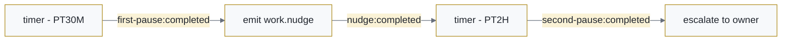

# Authoring flows

A flow defines reactive automation rules within the kernel. Each flow contains one trigger and up to 20 steps, chosen from a closed verb palette. While routing policy selects who executes an objective, workflows determine follow-on coordination without redeploying services.

Flow definitions are compact JSON or YAML documents. The kernel validates definitions against a strict schema, draws execution graphs in real time, and rejects invalid configurations with precise error details.

## Flow triggers

- **Wire events** — `on: { event: org.facilitator.event.provider.issue.v1 }`, optionally filtered with a `where` clause (`data.action: labeled`). Every accepted event evaluates against all enabled definitions.
- **Scheduled cadence** — `on: { schedule: interval:15m }`, `daily:07:30`, or five-field cron expressions. Schedules evaluate internally within the kernel.
- **Callable invocations** — `on: { invoked: {} }`. A callable flow acts as a reusable component invoked by a parent flow's `invoke` step.

## Step palette

Each step executes a single predefined action:

All flow durations use ISO-8601 formatting: `PT30M` for 30 minutes, `PT2H` for two hours, `P1D` for one day. Zero-length durations are rejected during validation.

| Step | Action |
| --- | --- |
| `emit` | Appends a command to the outbox or requests a capability routing. |
| `wait` | Suspends execution until a matching event arrives, with optional timeout branches. |
| `timer` | Suspends execution for a specified duration (`for: "PT30M"`) before proceeding. |
| `approval` | Requests decisions from named operators and resumes upon response. |
| `decide` | Evaluates conditional logic or model outputs with a required fallback branch. |
| `select` | Projects extracted fields into the execution state. |
| `fork-work` / `work-create` | Forks the current Work or creates a new independent Work item. |
| `sign-over` | Transfers frozen artifact references and thread bindings to a designated team. |
| `escalate` | Increases priority or reassigns stalled assignments. |
| `fan-out` | Executes concurrent child branches for each item in an array. |
| `signal` | Resumes a suspended step by matching a correlation key. |
| `invoke` | Executes a child callable flow and waits for output. |
| `join` / `memory` | Joins concurrent branches or writes to scoped shared memory. |

Steps link via deterministic edges: `always` (sequential execution), `<stepId>:completed`, `timeout`, and `failed`. This forms a directed acyclic graph (DAG) rendered in the editor during authoring.

_Timer steps suspend execution as durable database rows. Every step emits standard audited commands._

## Execution guarantees

- **Immutable versions.** Modifying a flow increments the version number. Running instances complete on the version they started with.
- **Audited execution.** Every command emitted by a flow passes through the standard outbox, idempotency checks, and audit logging.
- **Durable suspension.** Waiting for an approval or timer requires only a database record, consuming no active threads or processes.
- **Shadow evaluation.** Shadow mode evaluates definitions alongside live traffic, logging planned actions without executing external writes.

## Authoring in the editor

To author or modify flows, navigate to **Flows** in the console. The editor validates fields against live registries: event schemas, command types, and advertised gateway capabilities.

_The flow editor renders the step graph dynamically as you edit. Pickers populate from the live schema registry, and changes generate versioned diffs._

## Inspecting flow instances

Opening an active instance displays real-time execution status on the DAG: green for completed steps, amber for waiting timers, and red for failures. Operators can pause, retry, skip, or cancel steps with required audit reasons.

_The instance view tracks execution progress. The step log displays output payloads, and controls enforce valid state transitions._

The kernel ships with six built-in flow templates: review forks, PR pipelines, routing rules, nudge ladders, research workflows, and callable capacity checks.

## Where to go next

- Author flows directly in the console: **Flows** in [The admin console](/console).
- Inspect available trigger event types: [Supported integrations](/integrations).
- Review the complete step grammar: [Wire protocol (v1)](/docs/protocol).
- Deploy and test flows locally: [Get running (humans)](/guide/human).
