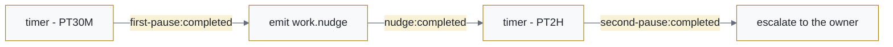
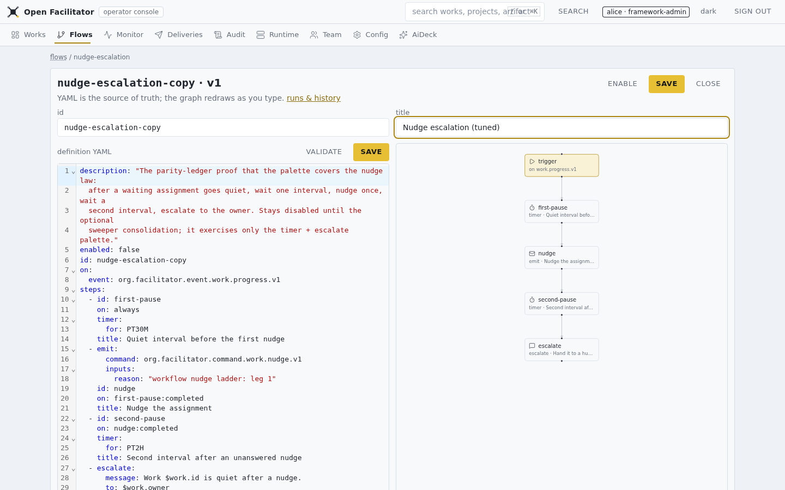
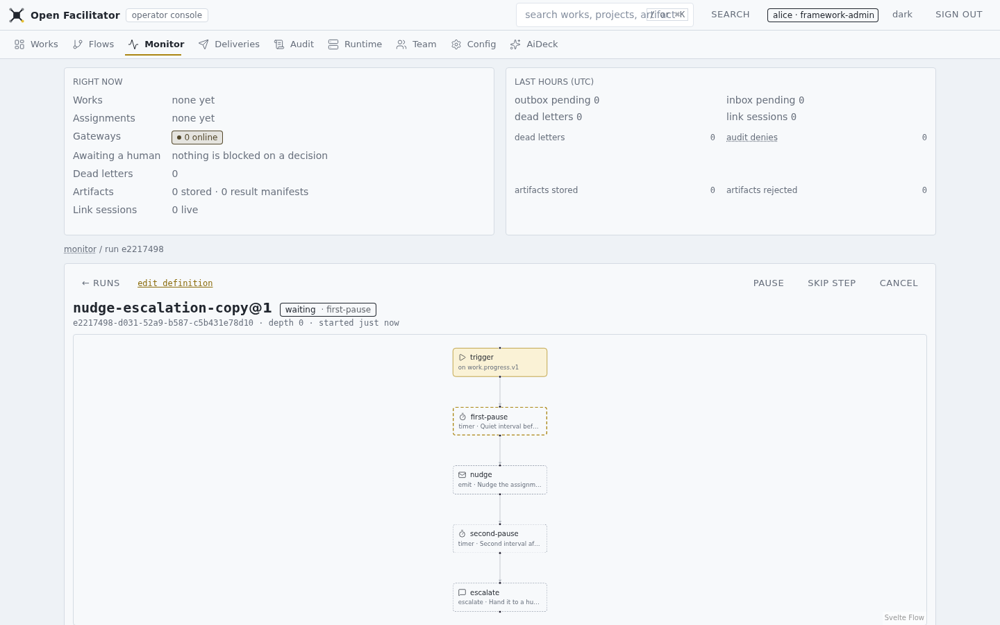

# Authoring flows

A flow is the rules you write for what happens next: one trigger, up to
twenty steps, each step one verb from a closed list. The kernel already
decides *who* does a piece of work; the workflow plane decides *what
follows*, and you author that in the console without redeploying anything.

A flow is a small JSON (or YAML, if you prefer) document. Because the
vocabulary is closed, the kernel can validate your flow before it stores
it, draw it before it runs it, and tell you exactly which rule it broke
when it refuses.

## Triggers

- **An event from the wire** — `on: { event: org.facilitator.event.provider.issue.v1 }`,
  optionally narrowed with a `where` matcher (`data.action: labeled`,
  values or `*` globs). Every accepted event is offered to every enabled
  definition; a non-match costs nothing.
- **A cadence** — `on: { schedule: interval:15m }` (or `daily:07:30`, or
  a five-field cron). The schedule plane ticks inside the kernel: no
  external cron, and a missed minute settles into one catch-up run.
- **Being called** — `on: { invoked: {} }`. A callable flow is a
  component: it runs when a parent flow's `invoke` step calls it, gets
  its own `$input`, and hands its projected output back on completion.

## The palette

Each step declares exactly one payload:

Durations everywhere in a flow are ISO-8601: `PT30M` is thirty
minutes, `PT2H` two hours, `P1D` one day, `PT1H30M` ninety minutes.
Only days, hours, minutes, and seconds are allowed, and a zero-length
duration is refused by the validator.

| step | what it does |
| --- | --- |
| `emit` | append one command (a known wire command, or a capability for the router to place) |
| `wait` | park until a matching event arrives, with a timeout branch |
| `timer` | park for a fixed duration (`for: "PT30M"`), then continue on the `always` edge — this is how you say "wait half an hour, then keep going" |
| `approval` | ask named humans; resume on the decision |
| `decide` | branch on a guard or a model verdict, with a mandatory fallback |
| `select` | project values into the run's output |
| `fork-work` / `work-create` | re-fork the subject work, or create new work |
| `sign-over` | move the frozen artifact refs of this event to a named team (ownership, not bytes) and repoint the thread's binding |
| `escalate` | raise the stakes on a stalled assignment |
| `fan-out` | spawn one child leg per item |
| `signal` | wake a parked waiter elsewhere, by correlation key |
| `invoke` | call a callable flow and await its hand-off |
| `join` / `memory` | stored, arriving with their runtime |

Steps chain through edges: `always` (the next step), `<stepId>:completed`,
`timeout`, `failed`. That is the entire control flow — a DAG you can
read off the picture the editor draws while you type. The shipped nudge
ladder is the smallest real one: four steps, entered on `always` and
chained by three `completed` edges.

_The claim: patience is data. Both parks are durable timer rows, each step
is one command the kernel itself records, and the flow ships disabled
until someone chooses to enable it._

## The laws you can lean on

- **A stored version never changes.** Saving edits lands version N+1;
  instances already running keep the version they started on, so a
  mid-flight definition edit can't tear a run in progress.
- **Effects are kernel acts.** Every command a flow appends rides the
  same outbox, idempotency, and audit spine as a REST call would — a
  flow cannot smuggle an unaudited side effect. `X-Change-Reason` on
  every write; a reason-less write is refused.
- **Parks are durable.** A flow waiting on a human approval or a week-long
  timer costs one row, not a process; a kernel restart loses nothing.
- **Shadow mode is the safe rollout.** Run a definition beside the
  existing arm and it records what it *would* do (a shadow report diffs
  it against reality) without touching anything real.

## Inside the editor

Open **Flows** in the console, then `edit`, `clone`, or `author a flow`.
The form populates every picker from the live registry — event types
from the mirrored schemas, commands from the frozen command table,
capability ids from what your gateways advertise right now — so you
cannot type an id the kernel will refuse. The picture above the form is
the flow you are authoring, redrawn on every keystroke.

_A cloned gallery entry under edit: the step graph mirrors the form
live, every picker speaks the live registry, and the save button says
exactly what it will do — land a new version. Below the fold, a diff
block lists every field that changed against the stored version._

Open any **instance** and the same picture wears the run: green legs that
landed, the amber park it waits on, the red leg that failed. Click a
node to read the leg's recorded output; the operator actions —
pause, skip a parked leg, retry a failed one, cancel the subtree — act
on the leg the picture shows, and every action carries a reason into
the audit trail.

_The console's instance view: a run parked on its first timer — the
graph wears the run (the amber outline is where it stands, dashed
nodes are legs not yet taken), the step log underneath shows the leg
that parked, and the pause, skip, and cancel buttons above are fenced
by what the run's status legally allows._

Start from the gallery. The kernel ships six definitions — a review
fork, a PR-on-manifest pipeline, assign-rule forging, a nudge ladder,
an agentic-research composition, and a callable capacity component.
Clone one, bend it to your team, and the audit line will say so.

## Where to go next

- Author one against the live registry: **Flows** in [the admin console](/console).
- See which event types can start a flow: [Supported integrations](/integrations).
- Read the trigger and step grammar field by field: [Wire protocol (v1)](/docs/protocol).
- Or stop reading and [get running](/guide/human).
